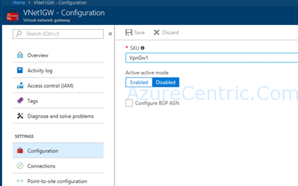

So, you have a Virtual Network Gateway deployed in Azure and it’s working just fine, although you would like to add another public IP to an existing Azure Virtual Network Gateway to be used as an Active/Active BGP scenario. 

### The question is: 
Can I update the IP configuration for the existing gateway or do I have to remove/rebuild the gateway to add the new public IP?

### The answer is: 

You don’t need to delete or disconnect the existing connections on the Virtual Network Gateway, you can just create a new Public IP and update the existing gateway configuration.

You can do this from the Portal, under the “Configuration” section of your VNet Gateway blade

However, as this will change the gateway configuration, you may see a short interruption on the existing connections. Once this change is completed, you will be able to get the new (second) public IP address from the Portal. You will need to use that to configure your on-premises VPN devices to establish the second IPsec tunnel from each on-premises networks to this gateway. For VNet-to-VNet connections, the second tunnel will be established automatically once the configuration operation is completed.

Cheers,

**Marcos Nogueira**  
**_Azure MVP_**  
[azurecentric.com](http://azurecentric.com)  
Twitter: [@mdnoga](http://www.twitter.com/mdnoga)
