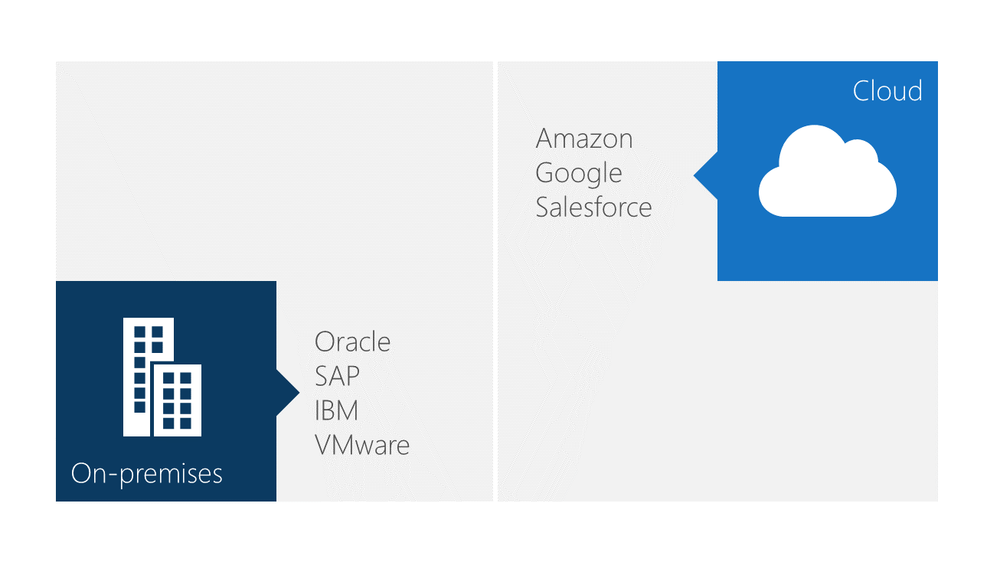
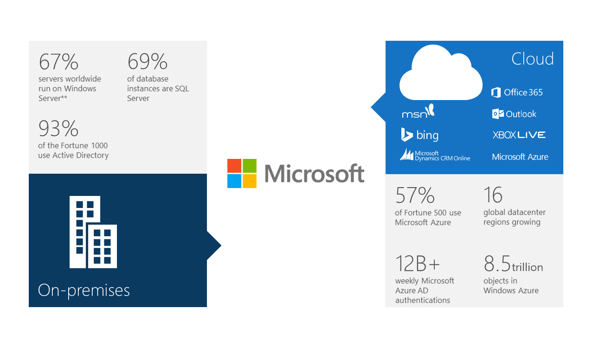

When we talk about cloud to any organization, these are always some of the Key Points that frequently we should address:
  * Most on-premises applications vendors recognize that the cloud is part of their customer’s future, but don’t have an actionable strategy to get there.
  * Cloud providers don’t understand your business and make it hard to extend your business to the cloud.

## **Applications On-Premises**

Let’s have a look at the current infrastructure-vendor landscape and how Microsoft stacks up. We’ve seen vendors lining up in either two categories: traditional on-premises vendors, and the newer vendors that started in the cloud.

Companies that have been traditional on-premises infrastructure providers have realized that to continue to provide agility and economics to their customers they need to expand their offerings to the cloud, but for the most part have been slow to do more than cloud-wash their technologies. They are adding capabilities through merger and acquisition which takes time to see the benefits. Or, they’re rushing to catch up on building out cloud datacenters, which is a costly proposition. Microsoft invested $15 BILLION dollars in their datacenters to run our cloud services—that’s a big number for most vendors. All in all, creating flexibility requires substantial services to connect all of the on-premises capabilities with cloud services—not cheap. You have probably heard about Microsoft recent partnerships where vendors like Oracle and SAP are letting their customers take advantage of our cloud resources to run their apps in our cloud.

## **Applications on Cloud**

Now, when it comes to the pure cloud providers the situation is flipped: they tout pure cloud solutions and don’t or won’t support customer on-premises needs and make it less than ideal to integrate with what you already have. They know that a 100% cloud solution for most customers is unrealistic. What happens is that you will start to amass a large collection of cloud-based solutions that support specific needs but are challenging to integrate with existing investments.

Microsoft is the only company that, at scale, can support the enterprise on premises and in the cloud.

**Key Points:**

  * You might not know that Microsoft provides the most complete on-premises and cloud strategy and portfolio. 	
  * Microsoft are striving to provide parity and consistency between our on-premises and cloud services.
  * Because of our unique innovation and investment strategy, only Microsoft gives organizations the flexibility of having both solutions.

This is where I do a little bragging about the amazing progress Microsoft has made to give you the flexibility to innovate without friction. They’re the standard on premises when it comes to infrastructure, identity, data, and productivity. We will continue to invest to our on-premises portfolio to ensure you have what you need to modernize legacy applications, support new work styles, and build new experiences.

Now have a look at our portfolio of cloud solutions.  You might not automatically think of Microsoft as a cloud company however let me assure you that in the last 5 years Microsoft have made that transition.  Microsoft Azure, Office 365, Dynamics CRM Online are all good examples as are the tremendously scalable services Microsoft have in Hotmail/Live and Bing that teach us how to support the world’s largest scale opportunities. Microsoft have made massive investments in the services like Azure Active Directory to make it easier for companies to provide a seamless experience between on-premises and the cloud.

The big priority has been creating parity between our on-premises capabilities and the cloud. When you’re building applications or services on Azure, you get the same great tools available on-premises, including infrastructure, identity, and data. It’s our goal to have “cloud for everyone, on every device.” And we’re making great progress to make that happen.

Some interesting Microsoft cloud facts: 	
  * Microsoft Azure is available in 89 countries around the world.
  * 5 billion+ Bing queries monthly
  * 350 million active Hotmail accounts
  * 40 million XBOX Live users
  * 200+ global, 24x7, online services
  * 135k Dynamics CRM users
  * Office 365 1B+Office users, 1 in 4 enterprise customers now has Office 365
  * 280% year-over-year database growth in Microsoft Azure

Cheers,

**Marcos Nogueira**
[azurecentric.com](http://azurecentric.com)
Twitter: [@mdnoga](http://www.twitter.com/mdnoga)
