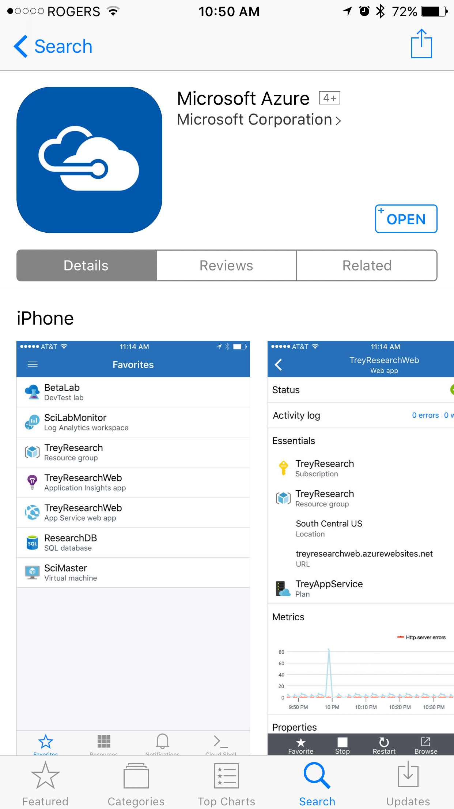
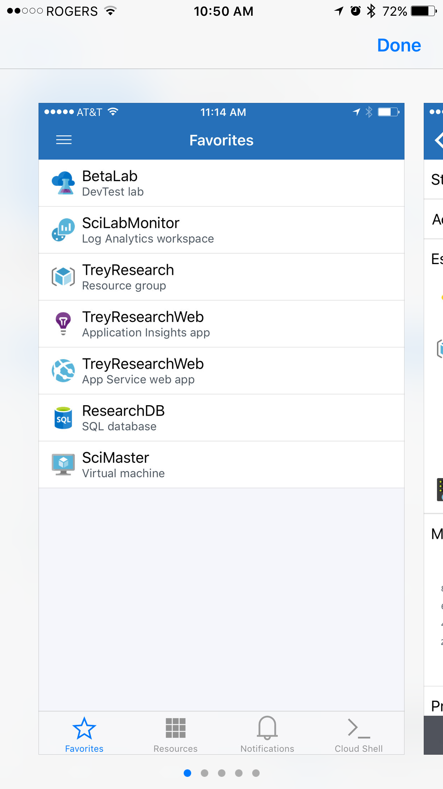
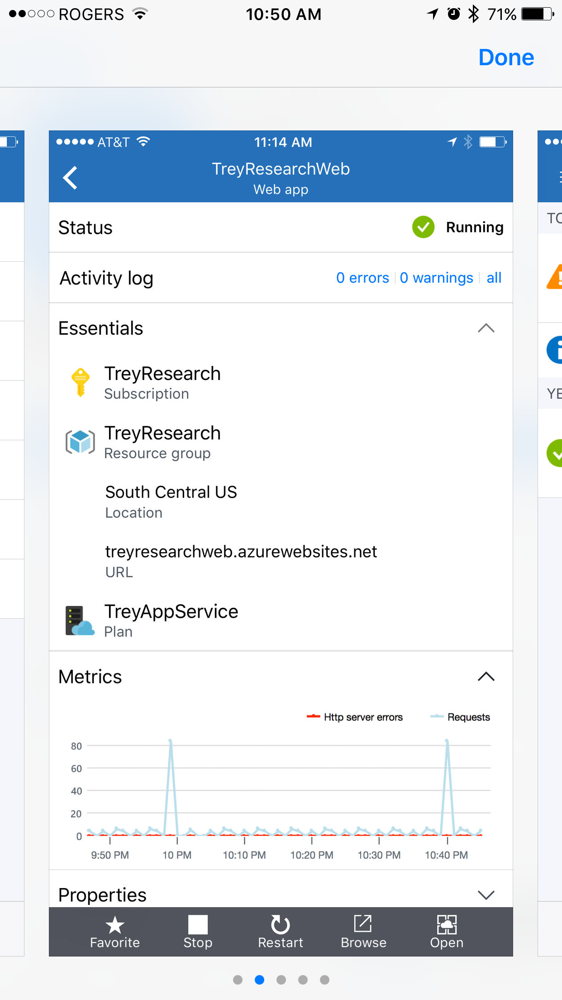
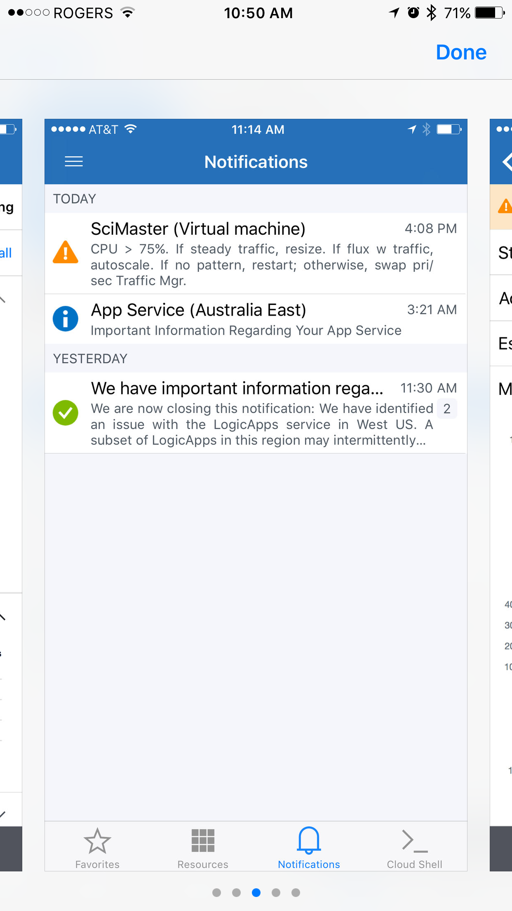
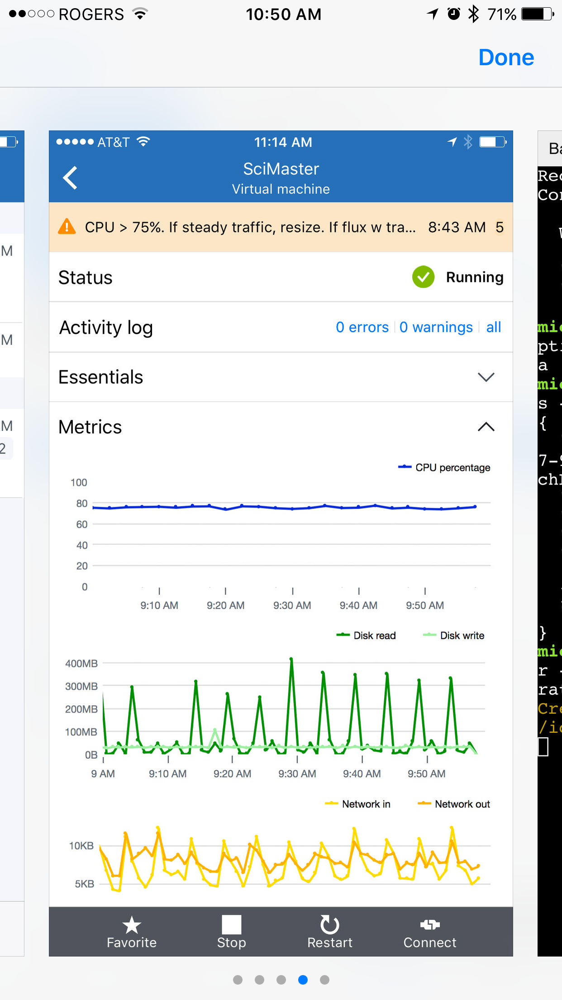
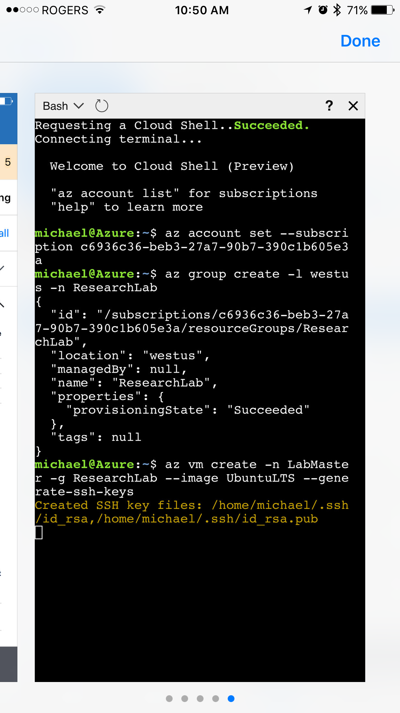
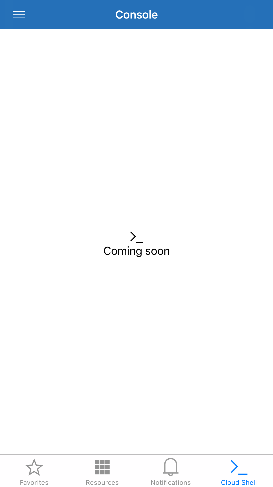

WOW! Microsoft did it again! If you didn’t saw the announcements at the Microsoft Build 2017 Conference, you should!

They announce a lot of new things, but regarding Azure one of may favorite is the application for IOS specific!

I see this App, as a savior in so many ways! Those times that you have a problem and you need immediately access to run a PowerShell script or that an action like restart a virtual machine or even something else, now you have the right tools at your reach! Be able to access Azure subscription through my mobile phone is amazing!

From what I was able to see and play with is basically your azure portal but on a IOS App! I’ve been setting up and playing on Azure with this app and it’s is really good.

Here are some of the screenshots from the Azure IOS App.

As you have on the Azure Portal, you can select what you want to see, by choosing your favorite. This is the shortcut view of what is the most interesting to you.

When you select the resource the information and the tasks that you can do are really like what is available on the Azure Portal.

Even the notification that you have in the Azure Portal is available here. So you can track what is going on your Azure tenant.

When you select, the Virtual Machine is really good to see a lot of information. Usually on Apps for smartphones you have a subset of capabilities of the main too (in this case the Azure Portal), but with this Apps you can do >80% of your daily basic tasks through this App.

And as you expected, Azure Cloud Shell will be available on the Azure App as well. Although it’s not available yet. At least for me (see picture bellow).

But this is probably the serious reason why I will use this app a lot. I store a lot of my scripts in my OneNote and be able to copy/paste into this PowerShell window and setup a S2S vpn, for example, while you are waiting for your food arrived is something that every “Azure Geek”/”Azure Centric Nerd” dream of, Right? The possibilities are unlimited!

Cheers,

**Marcos Nogueira**
[azurecentric.com](http://azurecentric.com)
Twitter: [@mdnoga](http://www.twitter.com/mdnoga)
