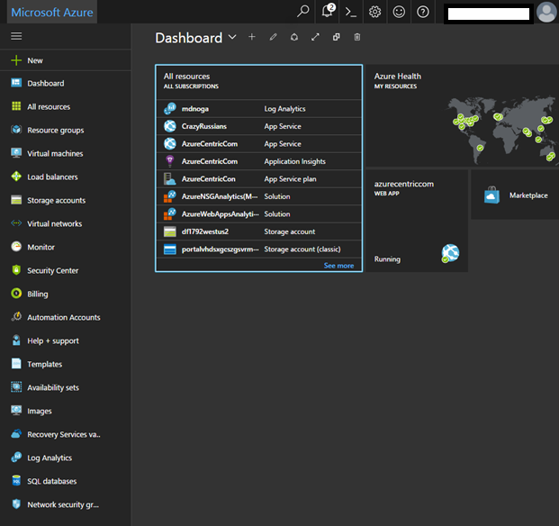
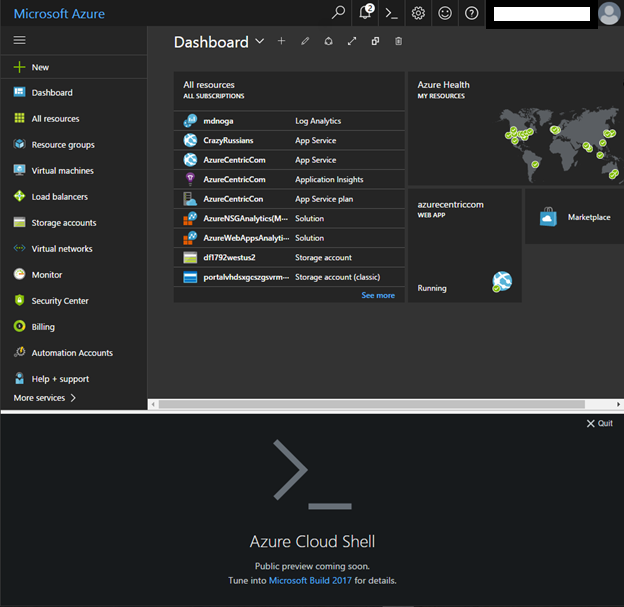

Microsoft Azure is an awesome evolving platform that I love to work. Today when I enter at my Azure subscription I saw something new. But this is not unusual on Azure. Although, this time it’s different! It’s something that I always wanted Azure to have it. When you don’t have your laptop with you with all the tools required (in this case the PowerShell modules), the only option was to use the Azure Portal.

So, this is what I see when I enter today at the Microsoft Azure Portal

But if you look closer to the top bar you will see something new.

I know that symbol, it’s the PowerShell symbol! So after I clicked appear this.

What?! Azure Cloud Shell! Now Microsoft, just make my life easier and I can be more productive no matter where! Oh yeah!

I can’t wait to start using this.

Cheers,

**Marcos Nogueira**
[azurecentric.com](http://azurecentric.com/)
Twitter: [@mdnoga](http://www.twitter.com/mdnoga)
