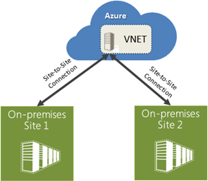
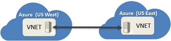

After Scott Guthrie announce the new enhancements on Azure, last May, I was very excited with one in particular. Multi Site-to-Site VPN. This enhancement comes at the best time. Because I have 2 datacenter and I want to connect both with the same Azure Subscription.

I did used the Site-to-Site VPN when I want to extend my datacenter to Azure. It’s very handy when you need to spin a temporary virtual machine and you are almost running out of resources in your datacenter. The possibility of extend your network to Azure and the virtual machine that you just created is accessible from your network, but you are using the Azure resources it’s pretty cool and sometimes save you time. Especially if you are outside of your organization.

Last time I did this, it was for a simple test when I was shopping with my family!

But this Site-to-Site VPN had a limitation, it only worked if you have one site (datacenter) to azure. If you have more than one datacenter (like me) you cannot use Site-to-Site VPN with the same Azure subscription. But now it’s possible with Multi Site-to-Site VPN.

That means that I can have multiple sites (datacenters) using the some Azure subscription and be able to spin virtual machines in Azure and they can be accessible from both datacenters. The cost of this stay the same!

Now with Azure you can connect different Azure Regions through VNET-to-VNET connectivity. That means that multiple virtual networks can now be directly and securely connected with one another. Using this feature, you can connect VNETs that are running in the same or different Azure regions and in case of different Azure regions have the traffic securely route via the Microsoft network backbone.

This feature enables scenarios that require presence in multiple regions (e.g. Europe and US, or East US and West US), applications that are highly available, or the integration of VNETs within a single region for a much larger network. This feature also enables you to connect VNETs across multiple different Azure account subscriptions, so you can now connect workloads across different divisions of your organization, or even different companies. The data traffic flowing between VNETs is charged at the same rate as egress traffic.

To see the full announcement click [here](http://weblogs.asp.net/scottgu/azure-vm-security-extensions-expressroute-ga-reserved-ips-internal-load-balancing-multi-site-to-site-vpns-storage-import-export-ga-new-smb-file-service-api-management-hybrid-connection-service-redis-cache-remote-apps-and-more)

To have more information about Azure Virtual Network, click [here](http://azure.microsoft.com/en-us/services/virtual-network/)

Cheers,

**Marcos Nogueira**
**_MVP_**  
[azurecentric.com](http://azurecentric.com)
Twitter: [@mdnoga](http://www.twitter.com/mdnoga)
