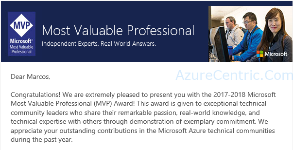
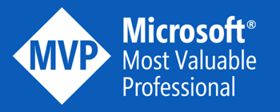

What a better way to start the 150th Canada day receiving this email:

It’s a huge honor to belong to this Exclusive and Exquisite Elite Technical group. I have been before MVP, but then I lost when I joined Microsoft. But this time, feels completely different. It’s reinvigorating! Being an MVP is a tremendous responsibility and a pleasure at the same time.

This Award means that Microsoft, recognizes exceptional community knowledge share. It’s not something that you can study and pass on exam, it’s earned for the long hours blogging, speaking, preparing content and so on. But, my friends, it’s worth it, when you received this email. All your effort, time away from your family and friend is worth when you enter in this world.

But what is an Microsoft MVP?
>_Microsoft Most Valuable Professionals, or MVPs, are technology experts who passionately share their knowledge with the community. They are always on the "bleeding edge" and have an unstoppable urge to get their hands on new, exciting technologies. They have very deep knowledge of Microsoft products and services, while also being able to bring together diverse platforms, products and solutions, to solve real world problems. MVPs make up a global community of over 4,000 technical experts and community leaders across 90 countries and are driven by their passion, community spirit, and quest for knowledge. Above all and in addition to their amazing technical abilities, MVPs are always willing to help others - that's what sets them apart._

What is the MVP Award?
>_For more than two decades, the Microsoft MVP Award is our way of saying "Thanks!" to outstanding community leaders. The contributions MVPs make to the community, ranging from speaking engagements, to social media posts, to writing books, to helping others in online communities, have incredible impact. Key benefits to MVPs include early access to Microsoft products, direct communication channels with our product teams and an invitation to the Global MVP Summit, an exclusive annual event hosted in our global HQ in Redmond. They also have a very close relationship with the local Microsoft teams in their area, who are there to support and empower MVPs to address needs and opportunities in the local ecosystem. Other benefits include an executive recognition letter, an MSDN technical subscription, and an Office 365 subscription._

You can find more information on the [MVP](https://mvp.microsoft.com/en-US/Overview) Site

I just want to share my happiness with all of you! Thank you for your support!

Cheers,

**Marcos Nogueira**  
**_Azure MVP_**  
[azurecentric.com](http://azurecentric.com)  
Twitter: [@mdnoga](http://www.twitter.com/mdnoga)
