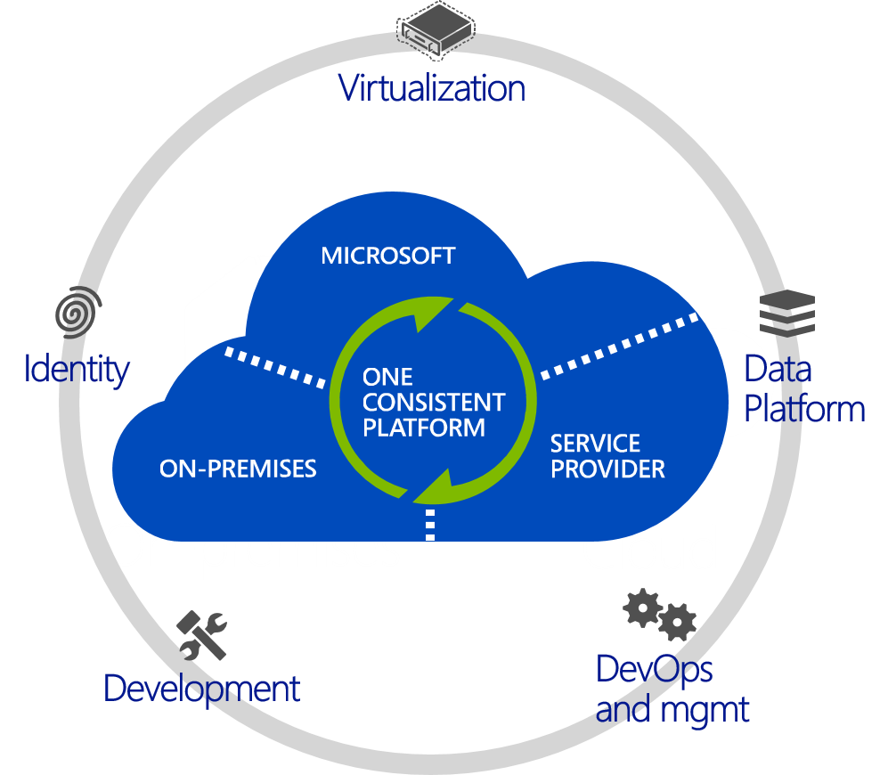
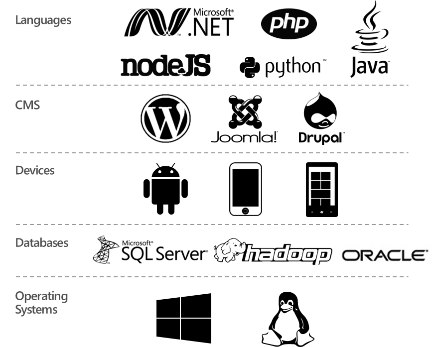
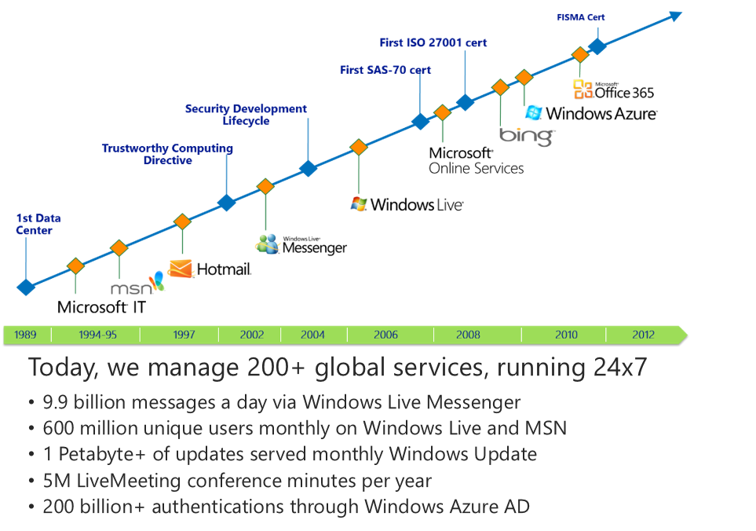

What you as enterprise customers uniquely expect from a public cloud platform. These are “must haves” that I always get when I asked:
  * **Integration** – So you can integrate with your existing apps and infrastructure.
  * **Heterogeneity** -  So you can continue to support multiple languages, frameworks, OSs
  * **Security** – So you continue to run your enterprise apps securely and reliably

Microsoft Azure, our public cloud offering, addresses these needs. Azure is built on three core fundamentals:

**Integration**

**On-premises AND Cloud:** Microsoft believe in a world where you’re integrating public cloud with your on-premises infrastructure, and using each where it makes sense, in conjunction with each other. **Think _and_, not _or_**. It’s not an on-premises OR cloud proposition – it’s an AND proposition. And when Microsoft say integration, they mean true integration – across infrastructure, apps, identity, and databases. This is what they call _hybrid_.

**Microsoft is the only company **which has the necessary assets across virtualization, identity, data platform, development and management to provide a consistent experience across on-premises, cloud and 3rd party service providers. This vision and strategy - called “Cloud OS” – is what Microsoft aim to deliver for their customers. If you choose look at other Cloud vendors that provide public OR private cloud offerings (Amazon, VMware, or Google), you must cobble together disparate offerings and you will not get a seamless experience.

## **Heterogeneity**

**Open, Broad and flexible:** Microsoft realize that you’ll want to run a variety of workloads in the cloud. In Azure, will of course provide first and best experience and support for Microsoft workloads, but at the same time we have embraced other open technologies so you get a cloud experience that satisfies your heterogeneous needs.

In enterprises, Java and .NET are still most used, but developers are also using PHP, Python and other languages in addition. Azure supports all these languages and more.

Azure provides **out-of-the box experience **for open frameworks like Hadoop, web frameworks like WordPress, Joomla and Drupal. We also provide first party SDKs for developing apps using Android, IOS or Windows phones.

Microsoft not only support, but have **embraced open technologies**.

They also provide a broad set of services that provide you a good choice. In addition to the breadth of the platform, it’s important to note that using Azure is **_not an all or nothing_** proposition. You can use most services independently of each other. For example, you can just use storage without compute or use DB without using storage. What you want to use and how you want to use is really YOUR choice.

## **Security**

Azure is not Microsoft first foray into Cloud Computing. They have been doing this for more than two decades, and have the deepest experience in the industry.

The first datacenter was in 1989. Since then, they have run some of the largest global services securely and efficiently – Bing, Office 365 and Hotmail just to name a few.

Today, Microsoft run over 200+ global services 24x7 and here are some stats to show you how large scale and global our operations are.

Azure is operated in the same manner by the same teams as some of these other global services. You can rest assure that security and operational efficiency is at our core.

Cheers,

**Marcos Nogueira**
**_MVP_**  
[azurecentric.com](http://azurecentric.com)
Twitter: [@mdnoga](http://www.twitter.com/mdnoga)
