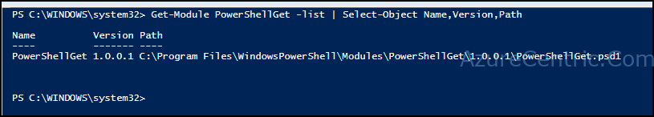
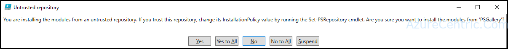
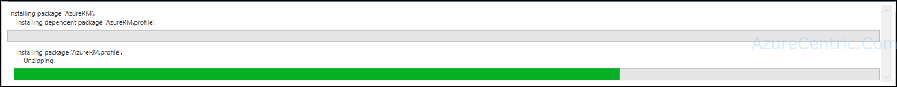
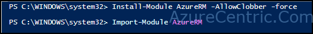
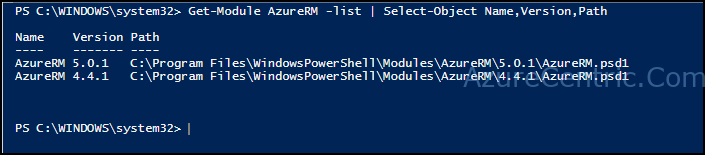

If you are like me that like to have all the tools on your desktop/laptop, special the Azure PowerShell module, now your live is way easier. Not long time ago, you had to download the Azure PowerShell module through the Web Platform. But now, there a simpler way.

I found this when I need to replace my Surface Pro. Through PowerShellGet module, all the modules related to Azure are on GitHub, so it is way simpler to get always the most update version of the cmdlets to manage Azure. The PowerShellGet comes on Windows 10. To verify if you are running the most updated version, run the following cmdlet:
```powershell
Get-Module PowerShellGet -list | Select-Object Name,Versio__n,Path
```
You should get an output like this:

To install all the Azure Resource Manager modules, just follow the steps and you will all the magic happens.

1. Open an PowerShell session with elevated privileges (Administrator mode)



2. Run the following command
```powershell
Install-Module AzureRM -AllowClobber_**
```


  **Note:** by default, PowerShell Gallery is configured as untrusted repository, so you have trust in this repository to be able to install the Azure RM module.

3. Answer Yes or Yes to All on the output of the command to be able to continue the installation



4. Just watch the progress bar finishes



5. Import the Azure RM module, by running the command 
```powershell
Import-Module AzureRM
```


To verify if the install was successful, you can use the following command:
```powershell
Get-Module AzureRM -list | Select-Object Name,Version,Path
```


Cheers,

**Marcos Nogueira**  
**_Azure MVP_**  
[azurecentric.com](http://azurecentric.com)  
Twitter: [@mdnoga](http://www.twitter.com/mdnoga)
