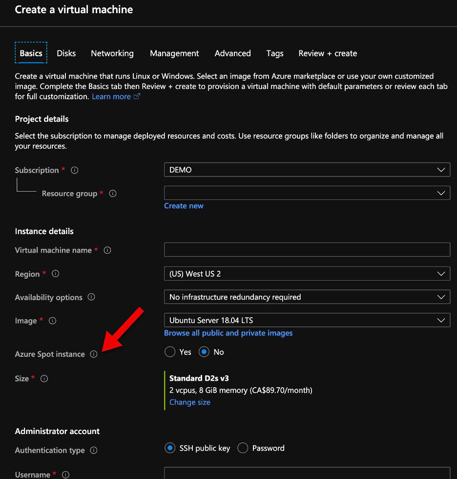
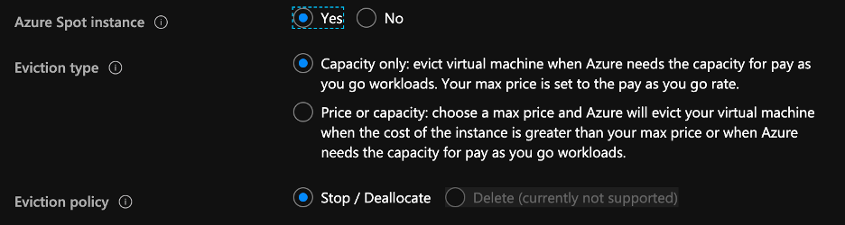

Today Microsoft announced the general availability of Azure Spot VMs (see [here](https://azure.microsoft.com/en-us/blog/announcing-the-general-availability-of-azure-spot-virtual-machines/) the announcement). This is one of the features that I have been waiting to become general available and start to use on my costumers.

So, what is Azure Spot VMs? It’s the way that Microsoft allow us to use their unused compute capacity on every region at very good discount rates. These discounts can go up to >80% of the pay-as-you-go rates, depending on the size of the VM and the capacity unused available.

You probably are familiar with the picture above, when you are deploying an Azure VM over the past few months, right? But did you explore what was that Azure Spot Instance? If you are like me and like to test and explore when Microsoft announced the Azure Spot on VM, you know what I am referring too. If you are not familiar, there is no shame. Now you can fully use this feature.

The deployment on Azure Spot VMs didn’t change much. If you enable this feature, you just need to select the eviction type and then the Eviction policy when that capacity is need. One thing you need to understand is, this compute capacity is not guaranteed. What is that means? Means that Microsoft will always reserve the Azure Compute capacity to the normal Pay-as-you-go rate, so be prepared (and plan accordingly) for your workloads to be stopped or deallocated.

What is the best way we can use Azure Spot Instance? The scenarios are unlimited, but the idea is to use on the workloads that are not critical and need to run 24x7. For example, on testing the load of a particular workload that you want to perform with a fraction of the cost.

Cheers,

**Marcos Nogueira**  
**_Azure MVP_**  
[azurecentric.com](http://azurecentric.com)  
Twitter: [@mdnoga](http://www.twitter.com/mdnoga)
