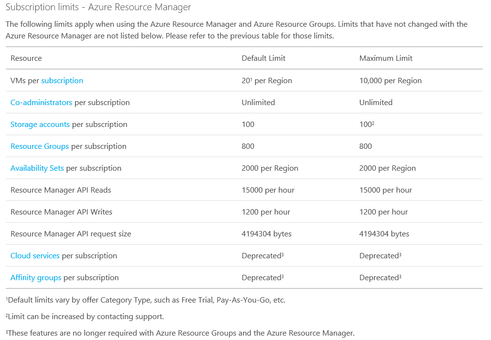
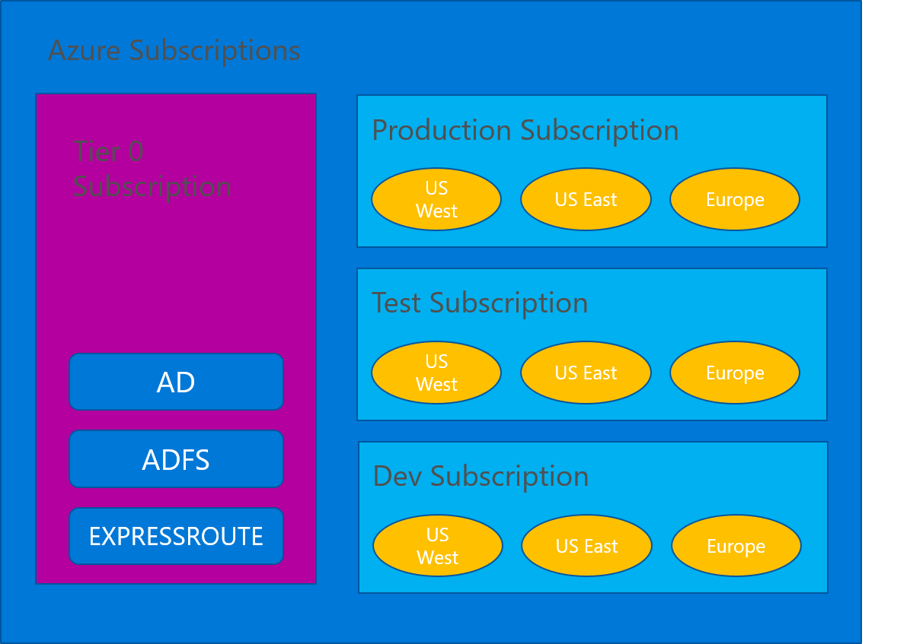
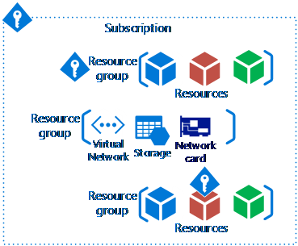

On the previous blog post ([see here](/posts/azure-subscriptions-best-practices-part-1)), we saw the characteristics of an Azure subscriptions. Now lets see how we can architect the Azure Subscription model, using best practices.

First we must understand the limits that each subscription has. See the picture bellow to see the limits. Although because azure is always change, please visit the link bellow to see the most up-to-date Azure subscription limits.

[http://azure.microsoft.com/en-us/documentation/articles/azure-subscription-service-limits/](http://azure.microsoft.com/en-us/documentation/articles/azure-subscription-service-limits/)

## **Subscription Design**

Frequently a lot of costumer ask me “what is the best model to design the Azure subscription?”. I don’t have just one model to answer the question, because there are a lot of factors that influence the model. What I usually do is start with the Tier 0 subscription model.

The Tier 0 subscription model, allow you have an architecture that we solution architect are used to have on premise infrastructures, by having the core services segregated from the different environments.

In this case the Tier 0 Subscription will have all the ExpressRoute or Site-to-Site (S2S) VPN, the domain controllers and all other services that are considered core services. Then you will create the environment subscriptions, like production, test and development (see picture below), if applicable.

By using this model, the Global Admins will control all the access and configuration for this subscription. This subscription should not have much change along the time, only when you are adding another core service or need to adjust something.

The other subscriptions should connect to the Tier 0 to be able to use the core services. On each subscription, you can have different Resource Groups (RG) in each region, if that is applicable. This mean, if you have 2 datacenters (one is US West and the other in US East) you can have the ExpressRoute connecting the both datacenter to the respective Azure regional datacenter.

With this model, you are minimizing the risk of anyone on either the production, test or dev subscription to “mess” with the core services. This apply as well for the Active Directory domain controllers running on Azure VMs.

If you want to use a different model, start with this one and evaluate what is the best solution for your organization. These are some points that might help design the right Azure subscription for you:
  1. Multiple Azure subscriptions means:
  2. Multiple Subscriptions = Complexity
    1. Duplicate provisioning and management: IP Address space, network circuits, gateways, vNets, Subnets, NSGs, routing
    2. More connectivity to manage
    3. More security to manage
    4. More identities to manage
    5. Potentially more ExpressRoute circuits to buy
  3. Multiple subscriptions are going to happen though, so design for it

## **Containers and Resources**

It’s not because you have only one big subscriptions (for example production) that you can control the access to the resources. You can give access to the RG using RBAC. To help you with that you need to understand that:
  * Subscription is the top-level container
  * Create Resource groups in the subscription
  * Place resources within the resource groups

When I design the Subscription model I always tried to take in consideration the following:
  1. Management approach
    1. Single team or distributed
    2. RBAC
  2. Security requirements
    1. Data or network security
    2. Environments - Sandbox, Dev, Test, UAT, Pre-Prod, Prod
  3. Connectivity requirements
    1. Single point of ingress?
    2. Multiple regions?
  4. Application requirements
    1. Data flow
    2. Compliance
    
Cheers,

**Marcos Nogueira**
[azurecentric.com](http://azurecentric.com)
Twitter: [@mdnoga](http://www.twitter.com/mdnoga)
