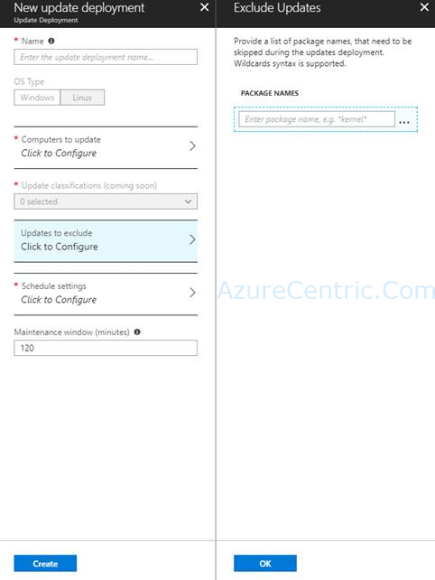

Another day, I started to play around with the Update Management, to see how I could automate the patching of Linux VMs on Azure. I’ve been using this feature to
patch Windows VMs, and I want to try on Linux VMs. Although when I try to be specific and implement some exclusion, it seems to want the KB of the patch to exclude. Most of the Linux patches doesn’t have anything like that, the only thing similar is the CVE number, but it’s not the same.

After researching and poke around, I found that when scheduling an update deployment against Linux virtual machines, the “exclusion” is keyed off of package name instead of the KB.

I hope all that time, help you to explore more about this feature.

Cheers,

**Marcos Nogueira**  
**_Azure MVP_**  
[azurecentric.com](http://azurecentric.com)  
Twitter: [@mdnoga](http://www.twitter.com/mdnoga)
