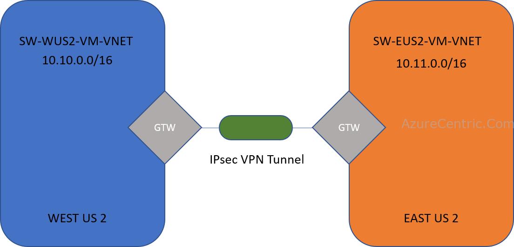
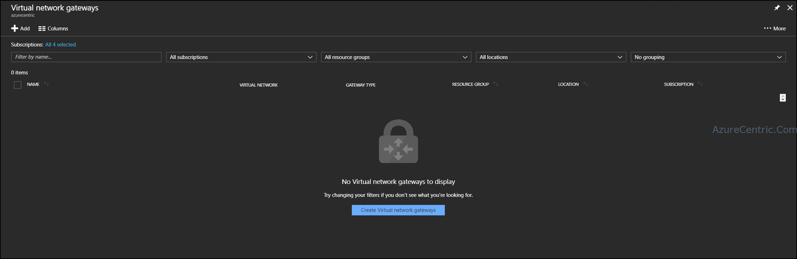
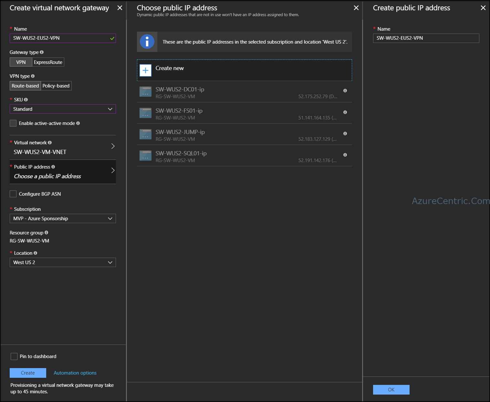
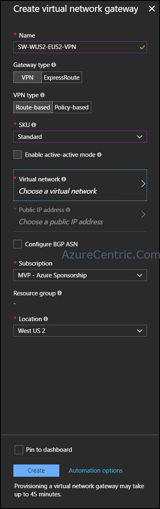

In this blog post series, I will cover what you need to configure to create a VNet-to-VNet VPN between to Azure regions on the same subscription. Although is about the same configuration if you want to configure two different VNets on different subscriptions.

A lot of my costumers think that you setup multiple VNets on Azure they automatically are connected to each other, because it’s Azure. That is a huge misconception, a huge one. A VNet is a totally isolated/segregated network from the other ones, only if you manually decide to connect them, they will communicate.

Even if you have ExpressRoute and you have multiple VNets on the same subscription, you manually have to connected them. This is called peering.

On the scenario bellow I will demonstrate how you can setup a VNet-to-VNet VPN between 2 VNets in Azure on different regions.

So, this is my architecture that I will show how to configure:

In this scenario, you have to configure both sides, that means that I will use the Azure Portal for one and PowerShell on the other. Then you have both ways that you can configure the VNet-to-VNet VPN. Let’s start.

Before to begin the configuration, I already have my VNets configured and being used. I just want to create a VPN between the two regions.

## **How to configure using Azure Portal**

To setup a VNet-to-VNet VPN follow these steps:

1. On the Azure Portal, navigate to the **Virtual network gateways**
2. On the **Virtual network gateways** blade, click on **Create Virtual network gateway** button.

3. At the Create virtual network gateway blade, fill the required information
  1. **Name** – This is the name of the VNet gateway.
    **NOTE:** I highly recommend that you create a name convention that make sense for your organization. In this scenario, I use the direction of the connection on the name (EX: SW-WUS2-EUS2-VPN, this means that the connection is from West US 2 to East US 2)
  2. **Gateway type** – This is the type of gateway. Instead of a VPN, you can have an ExpressRoute configuration. 	
  3. **VPN type** – This is where you define if you want your VPN based on policy or routing.
  4. **SKU** – This is where you define the SKU of the VPN. The SKU will give you different configurations and throughputs. For more information visit [About VPN Gateway configuration settings](https://docs.microsoft.com/en-us/azure/vpn-gateway/vpn-gateway-about-vpn-gateway-settings#gwsku)
  5. **Virtual Network** – This is where you will choose the network that you want to connect the VPN.
  6. **Public IP Address** – The Public IP is the IP that you will have your other VPN connected too. It’s recommended that you create a new Public IP for the VPN.

  7. **Subscription** – This is where you configure the subscription
  8. **Location** – This is the region that you are creating all the configuration. 	
4. After configured all the requirements fields, click on **Create**

5. After Azure create all the resources to enable the VNet gateway you need to configure the other region’s network.

Cheers,

**Marcos Nogueira**  
**_Azure MVP_**  
[azurecentric.com](http://azurecentric.com)  
Twitter: [@mdnoga](http://www.twitter.com/mdnoga)
