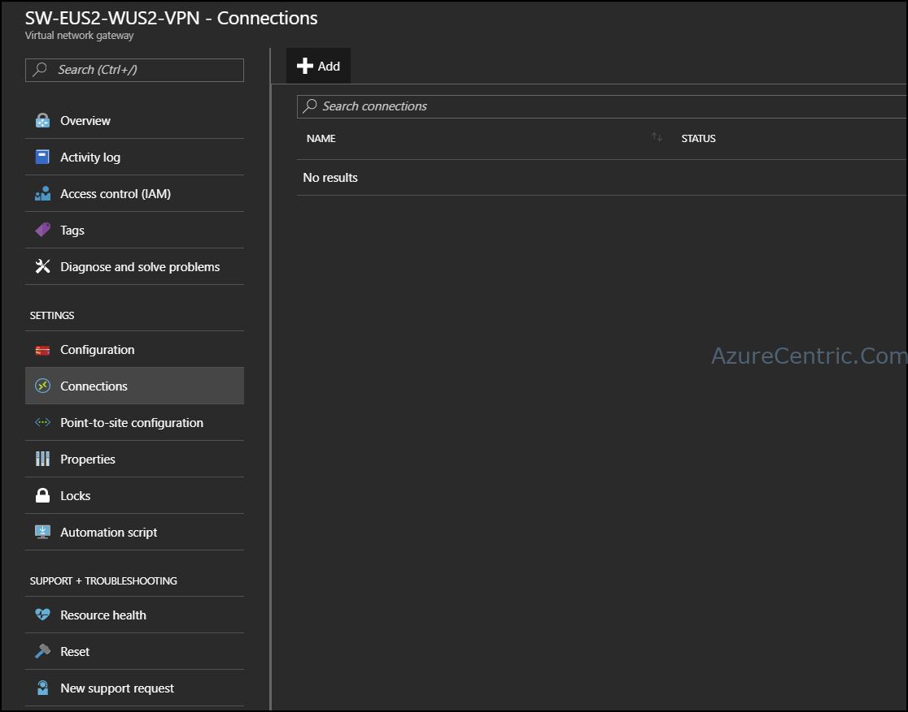
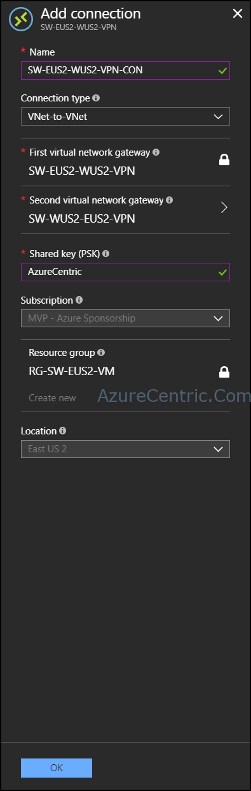

In this blog post series, I will cover what you need to configure to create a VNet-to-VNet VPN between to Azure regions on the same subscription. Although is about the same configuration if you want to configure two different VNets on different subscriptions. You can see the part 1 post [here](/posts/azure-vnet-to-vnet-vpn-configuration-part-1) and the part 2 [here](/posts/azure-vnet-to-vnet-vpn-configuration-part-2).

So, at this moment I have both networks setup with their gateways configured. Although I need to connect them to each other. For this I only have to choose one of them to setup the connection. Because I’m on the same subscription, this is one of the difference. If I want to connect different VNets on different subscription, I have to setup the connection on both sides. What they need to have in common is the Shared Key.

It’s exactly the same when setup a Site-to-Site VPN. One of the requirements after setup the networks, is connecting them with the Shared Key

## **How to connect two VNet gateways using Azure Portal**

After this running successful, we need to connect both networks. To be able to do it just follow the steps bellow:

1. On the VNet created, navigate to Connections (in this case I used the network that I configured with PowerShell - SW-EUS2-WUS2-VPN)
2. Click **Add**

3. When the Add connection blade open, you need to configure all the requirement fields:
  1. **Name** – This is where you insert the name of the VPN connection.
  2. **Connection type** – This is where you define which of connection want to use. VNet-to-VNet is used between two networks on Azure, Site-to-Site is used between a Azure network and on premise network. ExpressRoute is used between an Azure network and an existing circuit.
  3. **First virtual network gateway** – This is the network that you are configuring from.
  4. **Second virtual network gateway** – This where you want to connect. In this case, is the other region.
  5. **Shared key** – This is the key that is shared on both side to stablish the connection. This key only accepts number and/or letters.
  

4. Then click **OK**
5. After the connection it’s created, it will connect automatically.

Cheers,

**Marcos Nogueira**  
**_Azure MVP_**  
[azurecentric.com](http://azurecentric.com)  
Twitter: [@mdnoga](http://www.twitter.com/mdnoga)
