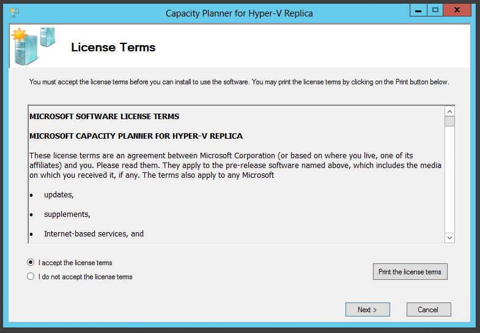
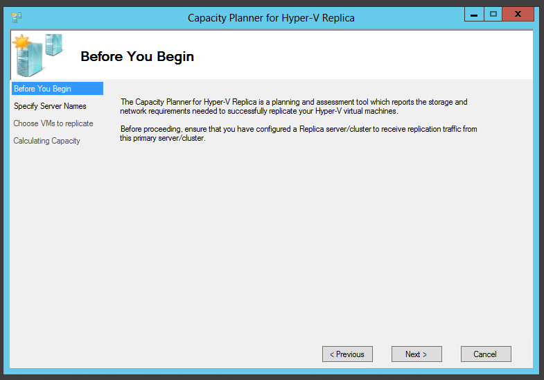
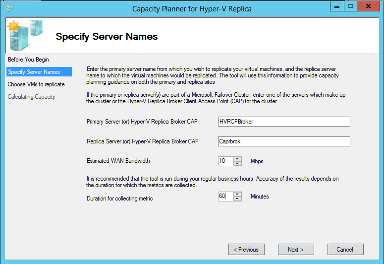
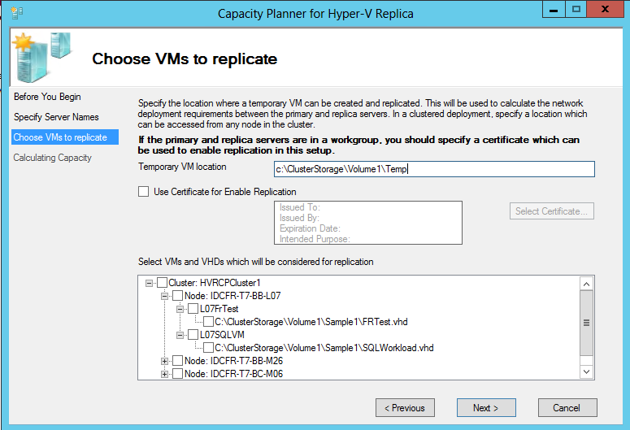
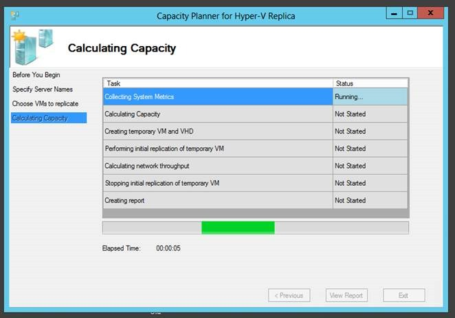
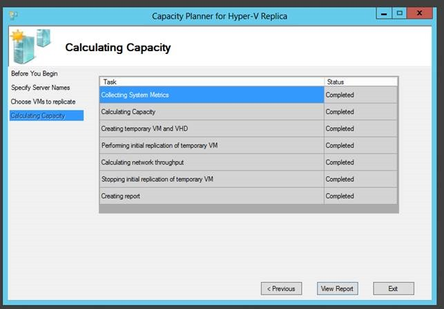

Hyper-V in Windows Server 2012 includes a new capability called Hyper-V Replica. Hyper-V Replica allows administrators to replicate their virtual machines from a primary server/cluster to a replica server/cluster. The **Capacity Planner for Hyper-V Replica** guides the IT administrator to design the server, storage and network infrastructure which is required to successfully deploy Hyper-V Replica.  

After reviewing the license terms, Click on ‘I accept the license term’ and click on ‘Next’.  

Before proceeding from this page, **ensure that a Hyper-V Replica server/cluster has been enabled to receive replication traffic from this primary server/cluster. **As part of collecting various metrics, the capacity planner attempts to send a temporary VHD from the primary server/cluster to the replica server/cluster. This allows the tool to study the network characteristics of the link between the primary and replica server.  

If your primary or replica server is part of a cluster, ensure that the Hyper-V Replica Broker role is added to the cluster.  

Specify the following parameters in this screen and click ‘Next’:  

## **Primary Server/Cluster details:**  
    1. For a standalone primary server, enter the server name or FQDN.  
    2. If your primary server is part of a cluster, enter the FQDN of the (primary cluster) Hyper-V Replica Broker Client Access Point (CAP).  

## **Replica Server/Cluster details:**  
    1. For a standalone replica server, enter the server name or FQDN.  
    2. If your replica server is part of a cluster, enter the FQDN of the (replica cluster) Hyper-V Replica Broker Client Access Point.  

## **Estimated WAN Bandwidth:**  
    1. Enter the estimated WAN bandwidth link speed between the primary and replica server/cluster.  

## **Duration of collecting metrics:**  
    1. Enter an appropriate interval for which the metrics need to be collected. It is highly recommended that the tool is run during ‘production hours’ which ensures that the most representative data is collected. Running the tool for a short duration (eg: 10mins) may not give quality data.  

The tool connects to the primary server and enumerates the virtual machines which are running on the primary. Ensure the following:  
    1. You are an administrator on the primary server/cluster. Remote-WMI is used to enumerate the virtual machines on the primary server – ensure that the right set of firewalls and permissions are set to allow this call to execute.  
    2. Ensure that replication has not been enabled on any of the VMs which are on the primary server/cluster.  
    3. Ensure that the VMs on the primary server/cluster are running.  

The following details needs to be provided in the page:  
    1. Temporary VM location: As part of collecting various metrics, the tool creates a temporary VM on your primary server/cluster and enables replication on the VM. This allows the tool to study the network characteristics between the primary and replica server. Provide a location on the primary server/cluster in which this VHD/VM can be created. In a clustered deployment, ensure that the location is accessible from all the nodes in the cluster.  
    2. (**Optional**) Certificate: If your primary and replica servers are in a workgroup [or] if certificate based authentication is being used in your Hyper-V Replica environment, you should provide the required certificate in this page.  
    3. Select VMs and VHDs: You can select the VMs and VHDs on which the metrics need to be collected. If you are not planning to enable replication on any specific VM/VHD, you can uncheck the VM in this screen.  

Click ‘Next’ after providing all the inputs.  

The tool now captures the metrics in the background. The tool will run for a few minutes beyond the duration of the run. You can continue to operate on your VM during the duration of the run. Once completed, the screen will look as follows:  

  

Click on ‘View Report’ to go over the recommendations.  

Cheers,

**Marcos Nogueira**
[azurecentric.com](http://azurecentric.com)
Twitter: [@mdnoga](http://www.twitter.com/mdnoga)
