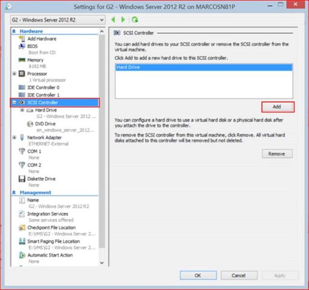
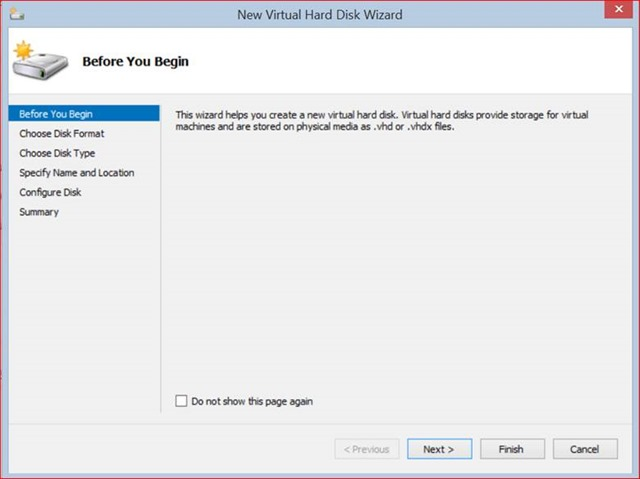
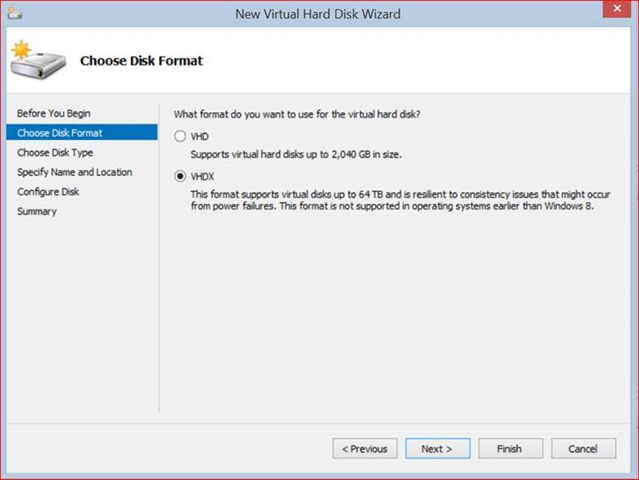
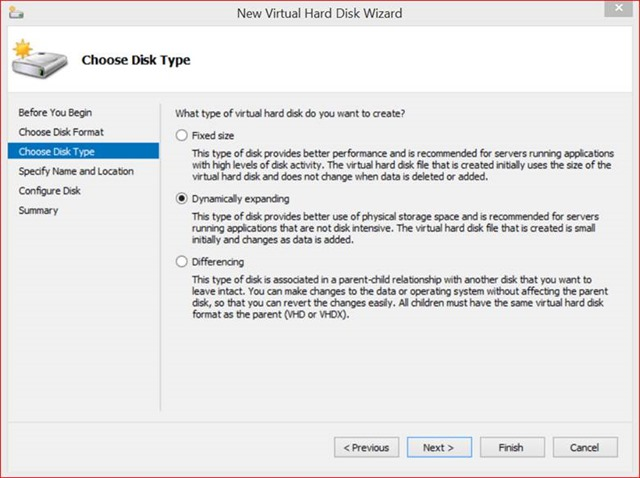
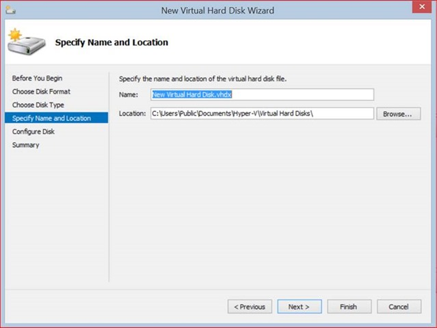
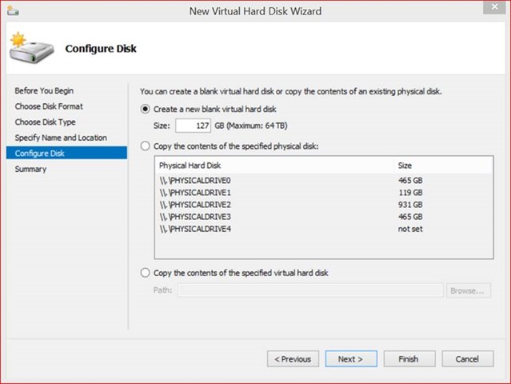
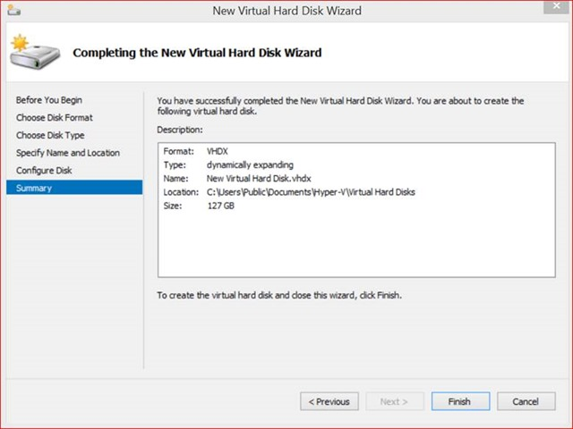
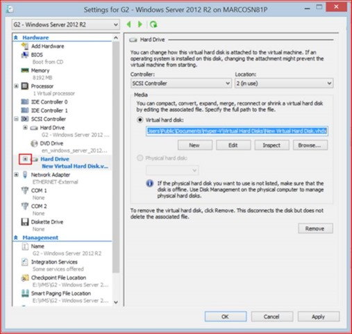
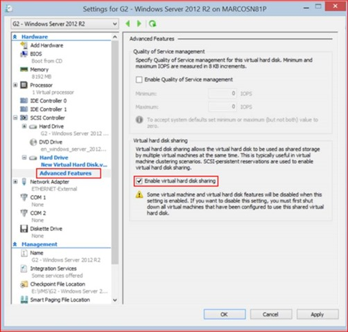

Starting in Windows Server 2012 R2 Preview, Hyper-V makes it possible to share a virtual hard disk file between multiple virtual machines. Sharing a virtual hard disk file (.vhdx) provides the shared storage that is necessary for a Hyper-V guest failover cluster.  

Using a shared virtual hard disk is ideal for the following situations:  
    * SQL Server database files.  
    * File server services running within a virtual machine.  
    * Database files that reside on shared disks.  

## **Create and enable a shared virtual hard disk on a virtual machine**

Open Hyper-V Manager if it is not already open. (From Server Manager, click **Tools** and then click **Hyper-V Manager**.)  

Under **Virtual Machines**, select the virtual machine that you want to configure with a shared virtual hard disk..  

In the **Actions** pane, click **Settings**.  

  

Click **SCSI Controller**.  

On the left pane, under **SCSI Controller**, click **Add**.  

![clip_image004[4]](/assets/images/posts/2013/08/clip_image0044.jpg)  

On the left pane, under **Hard Drive**, click **New** to start the **New Virtual Hard Disk Wizard.**.  

  

On the **Before You Begin** page, click **Next**  

  

On the **Choose Disk Format**, accept the default **VHDX**. Click **Next**.  

  

On the **Choose Disk Type** Page, accept the default **Dynamic Expanding**. Click **Next**.  

  

On the **Specify Name and Location** page, enter the name of your shared virtual hard disk..  

On the **Specify Name and Location** page, click **Browse**. Navigate to your shared storage location. (Cluster Shared Volumes (CSV) or on a Scale-Out File Server Cluster with SMB 3.0).

Click **Select Folder**. Click **Next**.

  

On the **Configure Disk** page, verify the size of the new virtual hard disk and alter to desired size or accept default. Click **Next**.

  

On the Completing the New Virtual Hard Disk Wizard, review your configuration and Click **Finish**  

  

The new virtual hard disk is now created and needs to be enabled as a shared virtual hard disk. Click the Hard Drive you just created under **SCSI Controller**.

Click the “**+**” symbol next to the hard disk.

  

Click **Advanced Features**.  

On the right hand size, under **Virtual hard disk sharing**, click **Enable virtual hard disk sharing**.

Click **OK**. The shared virtual hard disk is now created and enabled.

### **Resuming**

Sharing a virtual hard disk file (.vhdx) means that you can create and manage a guest failover cluster to protect the application services running inside your virtual machines. Before Windows Server 2012 R2 Preview, if you wanted to create a Hyper-V guest failover cluster, you needed to expose your storage topology to the virtual machine.  

Starting in Windows Server 2012 R2 Preview, you can deploy a Hyper-V guest failover cluster that is no longer bound to your storage topology. You can implement a guest failover cluster by using a shared virtual hard disk, Fibre Channel, Server Message Block (SMB), Storage Spaces, or iSCSI storage options. Shared virtual hard disks are only available in Windows Server 2012 R2 Preview. Hyper-V makes it possible to share a virtual hard disk file between multiple virtual machines. Sharing a virtual hard disk file (.vhdx) provides the shared storage that is necessary for a Hyper-V guest failover cluster.  

Cheers,

**Marcos Nogueira**
[azurecentric.com](http://azurecentric.com)
Twitter: [@mdnoga](http://www.twitter.com/mdnoga)
