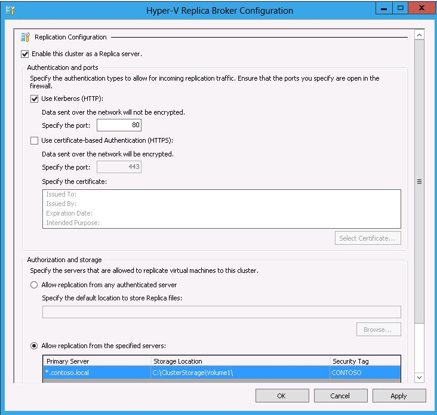

## Management Considerations

Hyper-V servers are managed locally using the Hyper-V Manager interface or remotely using the Hyper-V Remote Server Administration Tools (RSAT) or System Center Virtual Machine Manager (SCVMM).  If the configuration is a Hyper-V Failover Cluster, the Failover Cluster Management interface is used.

### Configuration and Management UI

Hyper-V Replica settings are configured in the Hyper-V Manager interface for standalone Hyper-V servers and the Failover Cluster Manager interface for Hyper-V Failover Clusters.

### Configuration Settings

##### Configuring a Standalone Hyper-V Replica Server
  1. In the Hyper-V Manager interface, Click on  **Hyper-V Settings** in the **Actions** pane
  2. In the **Hyper-V Settings** dialog box, Click on **Replication Configuration**
  3. In the **Details** pane, Select **Enable this computer as a replica server **
  4. Choose an **Authentication **method to include the port that will be used (The default ports are 80 for HTTP and 443 for HTTPS).  There are default firewall rules already in place that just need to be enabled when replication is enabled on the Hyper-V server.
  5. Configure **Authorization and storage**. This includes designating a specific location to store replica virtual machine files if the default location is not to be used.  Should you not desire to allow all Primary servers to be serviced, there is an option to allow only specific servers (Primary servers) to send replication requests.  If you want to allow all servers within the domain, a wildcard character can be used (e.g. *.contoso.com). When using a wildcard, only one storage location can be specified.  If individual server entries are used, different storage locations for replica files can be configured.  Complete all entries for the **Primary Server, Storage Locations, and Security Tag** information.  Click** Apply** or **OK** when finished.

An example configuration is shown here:

### Configuring a Hyper-V Replica Failover Cluster

A Failover Cluster consists of multiple physical servers also known as nodes.  Each node must have the Hyper-V role installed as well as the Failover Clustering feature.  Installation of the Hyper-V role has already been covered.   To install the Failover Clustering feature:
  1. In Server Manager, start the **Add Roles and Features Wizard (ARFW)** by first choosing the **Dashboard** view and then choose Add** Roles**.
  2. Step through the ARFW choosing the local node and making the following choices:
    1. **Installation Type:** Role-based or Feature-based installation
    2. **Server Selection:** Choose local node
    3. **Server Roles:** Make no selections and click **Next**
    4. **Features:** Choose **Failover Clustering**
    5. **Confirmation:**  Review the information and click **Install** (a reboot is not required when installing the Failover Clustering feature)
    6. **Results:** Ensure the result is a successful installation of the Failover Clustering feature.
  3. Complete this action across all nodes that will be members in the cluster
    **NOTE:** The Failover Clustering feature can also be installed from the command line interface (CLI) by using the Deployment Image and Service Management (DISM) command line tool.  At a command prompt, type: **dism /online /enable-feature /featurename:Failover-Clustering**.  A reboot is not required to complete the installation.
  
After the Failover Clustering feature is installed and a Failover Cluster is created, the Hyper-V Replica Broker Role needs to be configured.  To create the Hyper-V Replica Broker role:	
  1. Open the **Failover Cluster Manager** interface (located under ** Tools **in the Server Manager Menu bar)
  2.  In the left-pane, connect to the cluster
  3. With the name of the cluster highlighted in the left-hand pane, click on **Configure** **Role** in the **Actions** pane
  4. The **High Availability Wizard **initializes
  5. Select **Hyper-V Replica Broker** in the **Select Role** screen
  6. Complete the wizard by providing a properly formatted NetBIOS name and IP address (as needed) which serves as the connection point (**Client Access Point (CAP)**)when configuring virtual machines for replication
  7. Ensure the Role comes **Online** and is able to failover between all nodes in the cluster

### Configuring the Failover Cluster as a Replica cluster

With the Hyper-V Replica Broker Role configured in the cluster, the cluster can be configured as either a Primary cluster or a Replica cluster.  This is accomplished using the Highly Available Hyper-V Replica role.  To accomplish this:
  1. Open the **Failover Cluster Manager** interface (located under ** Tools **in the Server Manager Menu bar)
  2. In the left-pane, connect to the cluster
  3. With the name of the cluster highlighted in the left-hand pane, click on **Roles** in the details pane under the **Navigate** category
  4. Right-click on the Role and choose **Replication Settings**
  5. In the **Hyper-V Replica Clustering Broker Configuration** screen, make the appropriate selections as needed to configure the cluster as a Replica server.

This action implements the configuration across all nodes in the cluster.   Keep in mind this does not automatically enable the correct firewall rules in each node of the cluster nor does it properly configure authentication if certificates are being used.  Those actions will have to be completed by the administrator on each node in the cluster.  When using certificate based authentication in a Failover Cluster, all of the cluster nodes and the Client Access Point (CAP) supporting the Hyper-V Replica role will need machine certificates.

Cheers,

**Marcos Nogueira**
[azurecentric.com](http://azurecentric.com)
Twitter: [@mdnoga](http://www.twitter.com/mdnoga)
