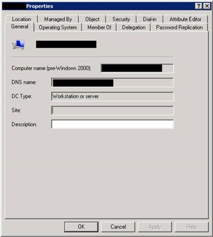
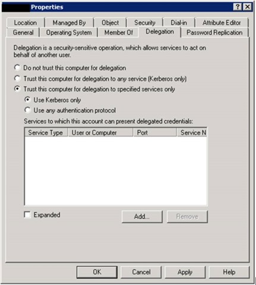
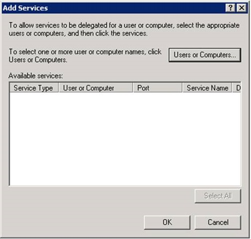
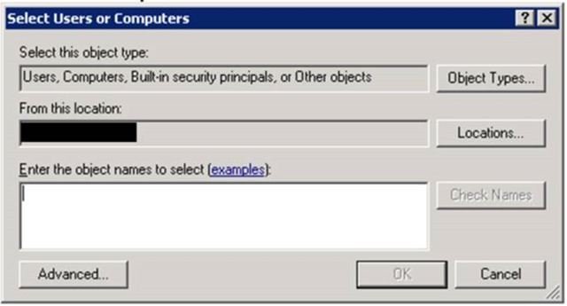
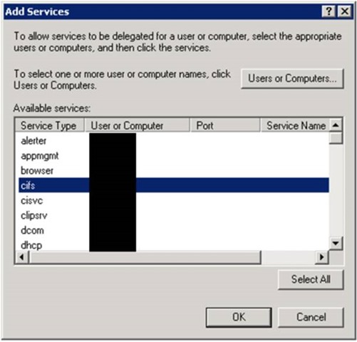
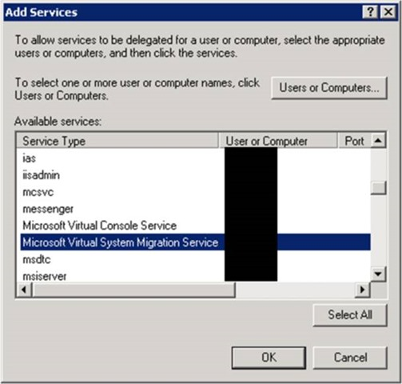
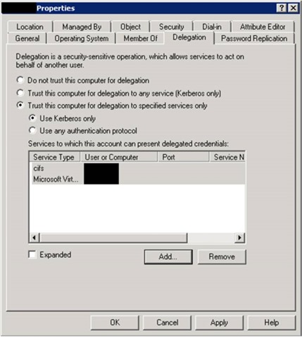

Constrained delegation allows live migrations to be started using any remote management tool and might help in providing more flexibility to move your VMs.

If the connection between the source and destination computers cannot be authenticated, an error occurs and the following message is displayed:

>Virtual machine migration operation failed at migration Source.
>
>Failed to establish a connection with host_**_<computer name>_**_: No credentials are available in the security package (0x8009030E).

To solve this issue you have to configuring constrained delegation to authenticate live migrations on both Hyper-V servers.****

## To enable it, just follow this steps
1. Open **Active Directory Users and Computers**
2. Right-click on the host computer account
3. Click on **Properties**.

4. In the Properties window, click on the Delegation tab, select **Trust this computer for delegation to the specified services only **

5. Select **Use Kerberos only**.
6. Click on **Add**

7. Click **Users or Computers**.

8. In the Select Users or Computers box, type the destination host server name and click **OK**.
9. In the Add Services dialog box
    1. Select **cifs**

    2. Select **Microsoft Virtual System Migration Service**

    3. Click on **OK**. The two services will be listed in the service type, as shown in the next screenshot:

10. Click on **OK** to close the computer properties window and repeat the same process on the destination server computer account.
    **NOTE:** The configuration changes do not take effect until the following has occurred:
        * The changes have replicated to the domain controllers that the servers running Hyper-V are logged into.
        * A new Kerberos ticket has been issued.

After that, you can change the live migration authentication type to use Kerberos.

Cheers,

**Marcos Nogueira**
[azurecentric.com](http://azurecentric.com)
Twitter: [@mdnoga](http://www.twitter.com/mdnoga)
