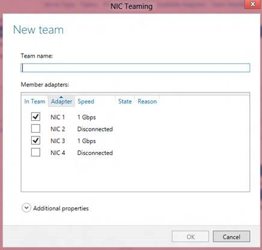
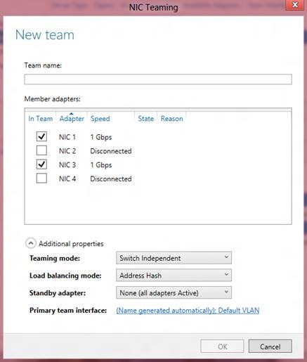
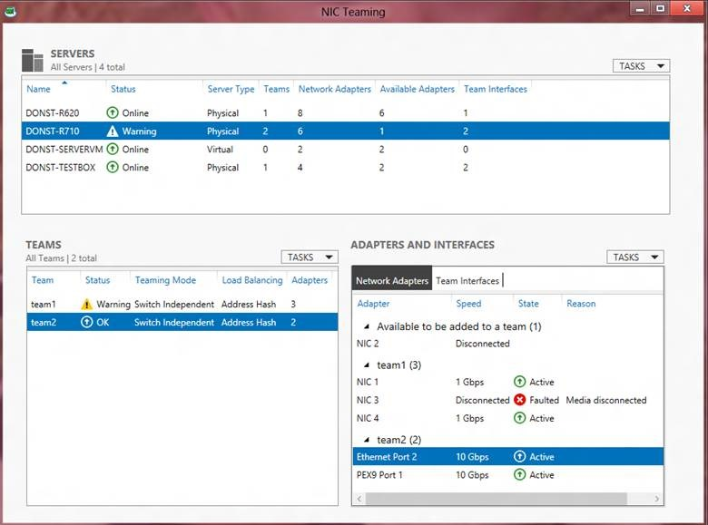

## There are two ways to invoke the **New Team** dialog box:

  * Select the **Tasks** menu in the **Teams** tile and then select **New Team**, or  
  * Right click on an available adapter in the **Network Adapters** tab and select the **Add to new team** item. Multi-select works for this: you can select multiple adapters, right-click on one, select **Add to new team**, and they will all be pre-marked in the **New Team** dialog box.

Both of these will cause the **New Team** dialog box to pop-up.  

  

When the **New Team** dialog box pops-up there are two actions that MUST be taken before the team can be created:  

  * A **Team name** must be provided, and  
  * One or more adapters must be selected to be members of the team

Optionally, the administrator may select the **Additional properties** item and configure the teaming mode, load distribution mode, and the name of the first (primary) team interface.  

  

In Additional properties the Load distribution mode drop-down provides only two options: Address Hash and Hyper-V Port. The Address Hash option in the UI is the equivalent of the TransportPorts option in Windows PowerShell. To select additional Address hashing algorithms use Windows PowerShell as described below.  

This is also the place where those who want to have a Standby adapter in to set the Standby adapter. Selecting the Standby adapter drop-down will give a list of the team members. The administrator can set one of them to be the Standby Adapter. A Standby adapter is not used by the team unless and until another member of the team fails. _Standby adapters are only permitted in Switch Independent mode. Changing the team to any Switch Dependent mode will cause all members to be made active members._  

When the team name, the team members, and optionally any additional properties (including the Primary team interface name or standby adapter) have been set to the administrator’s choices, the administrator will click on the OK button and the team will be created. Team creation may take several seconds and the NICs that are becoming team members will lose communication for a very short time.  

Teams can also be created through Windows PowerShell. The Windows PowerShell to do exactly what these figures have shown is **_New-NetLbfoTeam Team1 NIC1,NIC2_**  

Teams can be created with custom advanced properties.  
```powershell
New-NetLbfoTeam Team1 NIC1,NIC2 -TeamingMode LACP ‑LoadBalancingAlgorithm HyperVPorts 
```
If the team is being created in a VM, you **_MUST_** follow the instructions to allow guest teaming as described in previous post ([NIC teaming on Virtual Machines](/posts/nic-teaming-on-virtual-machines)).  

## Checking the status of a team

Whenever the NIC Teaming UI is active the current status of all NICs in the team, the status of the team, and the status of the server will be shown. In the picture bellow, in the **Network Adapters** tab of the **Adapters and Interfaces** tile, NIC 3 shows as faulted. The reason given is **Media Disconnected** (i.e., the cable is unplugged). This causes the team, Team1, to show a **Warning** as it is still operational but degraded. If all the NICs in the team were faulted it would show **Fault** instead of **Warning**. The server, DONST-R710, now shows **Warning**. If the team was not operational the server indication would be **Fault**. This makes it easy to scan the list of servers to see if there are any problems.  

  

Cheers,

**Marcos Nogueira**
[azurecentric.com](http://azurecentric.com)
Twitter: [@mdnoga](http://www.twitter.com/mdnoga)
