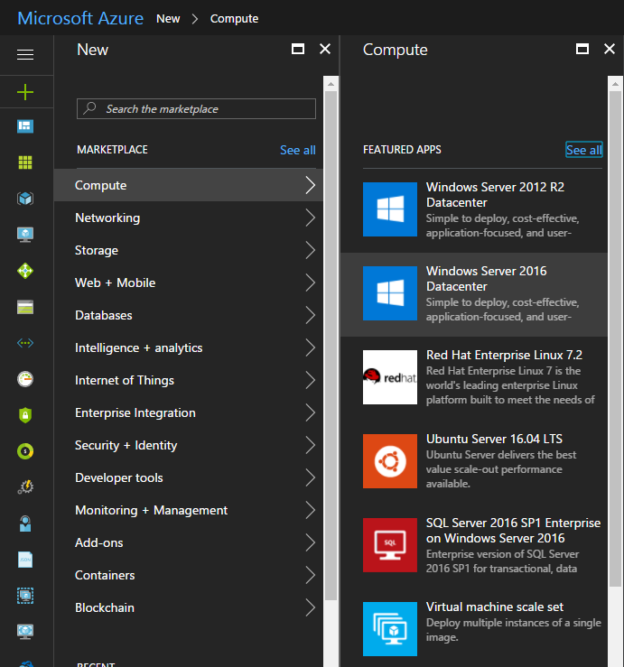

To create an Azure Resource Manager virtual machine from the Azure portal, perform the following steps:
  1. Sign in to the Azure portal at [portal.azure.com](http://portal.azure.com/).
  
  
  
  2. On the Hub menu, click New, click Compute, and then click Windows Server 2016 Datacenter.
  3. On the Windows Server 2016 Datacenter page, under Select a deployment model, select Resource Manager, and then click Create.
  4. On the Basics blade, enter the name that you want to give your virtual machine. The name cannot contain special characters.
  5. Select HDD or SSD, depending on whether you want to use Standard storage or Premium storage disks.
  6. Enter the Windows administrative user name and password. The password must be at eight to 123 characters long, and include at least three of the following: one lower-case character, one upper-case character, one number, and one special character. You will need the user name and password to sign in to the virtual machine.
  7. If you have more than one subscription, specify the one for the new virtual machine, a new or existing resource group, and an Azure datacenter location.
  8. On the Choose a size blade, select an appropriate virtual-machine size for your needs. Each size specifies the number of compute cores, memory, and other features, such as support for Premium Storage. These all affect the price. Azure recommends certain sizes automatically, depending on the image that you choose. The choices available on this blade depend on whether you selected HDD or SSD on the Basics blade.
  9. On the Settings blade, configure storage, networking, extensions, high availability, and monitoring settings for the new virtual machine.
  10. Click Summary to review your configuration choices. When you finish reviewing or updating the settings, click Create. As Azure creates the virtual machine, you can track the progress under Virtual Machines on the Hub menu.

These steps use the image based on Windows Server 2016 Datacenter Edition to create a virtual machine.

Cheers,

**Marcos Nogueira**
[azurecentric.com](http://azurecentric.com)
Twitter: [@mdnoga](http://www.twitter.com/mdnoga)
