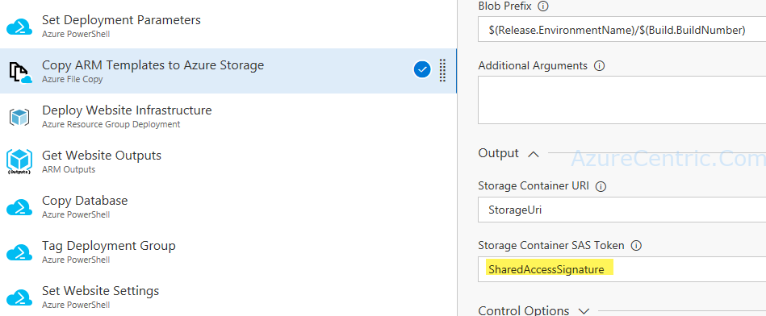
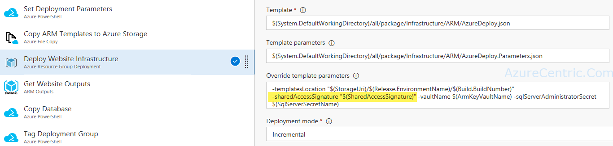
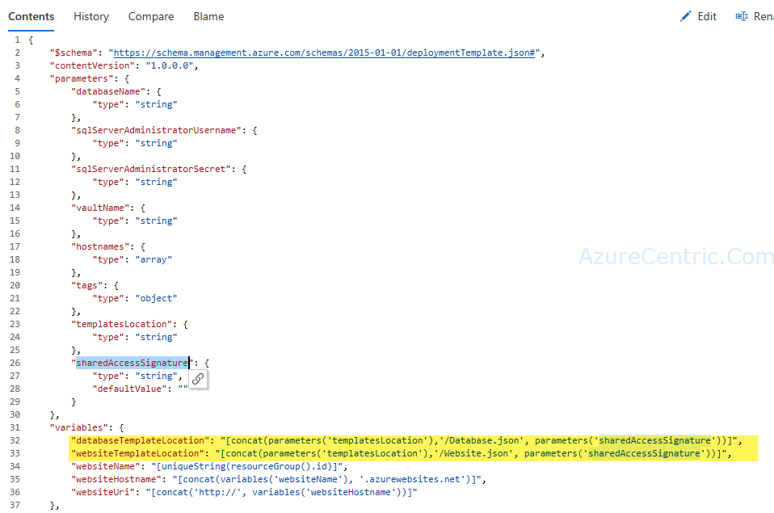

I’ve been deploying to Azure a lot of resources, one of my favorite things is to create templates where I can reuse for other situations. But sometimes, and in some situations, you need to increase the security. That is where I started to leverage the Key Vault to store my secrets.

Over the years, I have been creating a linked template reference where the main template passes parameters and the key vault references to the linked template. Although the template is uploaded to a storage blob container.

Let me exemplify. Imagine that you have the following scenario, you want to leverage the Azure Portal to deploy ARM Templates and you want to use the Key Vault to store the secrets. How I can do it? Although, your Manager concern is, since the URI is public how I can protect the storage container?

The way that I have been getting around on this situation is using private blob storage in conjunction with SAS.

Step 1 – Use Azure File Copy to copy your template to the storage account. Azure File Copy will give you a SAS token. Then use the token to deploy.

Step 2 - On Azure Resource Group Deployment, you have an option to override the template parameters.

Step 3 – You only need to append the SAS token to the final URL.

Cheers,

**Marcos Nogueira**  
**_Azure MVP_**  
[azurecentric.com](http://azurecentric.com)  
Twitter: [@mdnoga](http://www.twitter.com/mdnoga)
