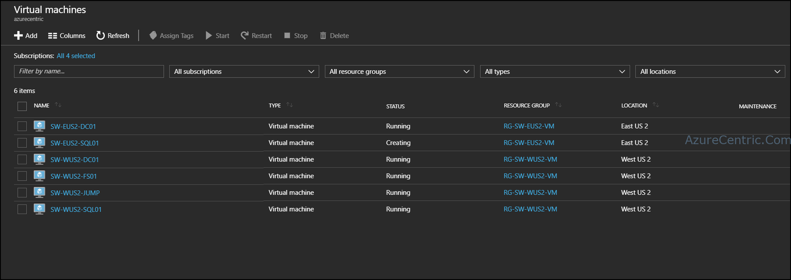
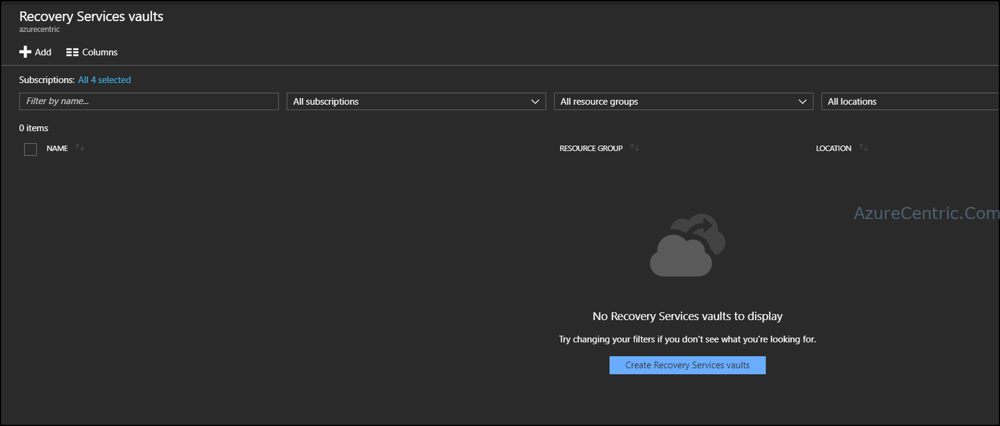
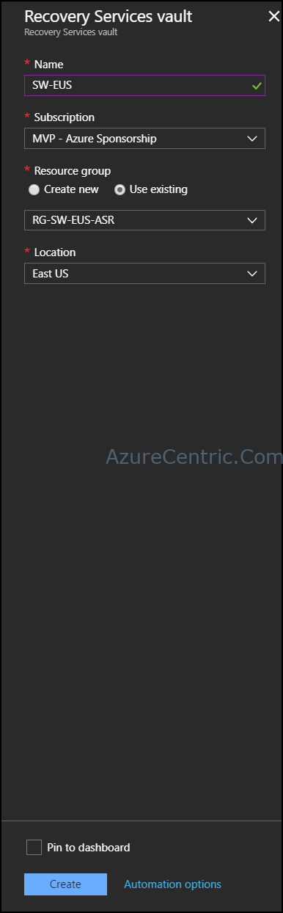
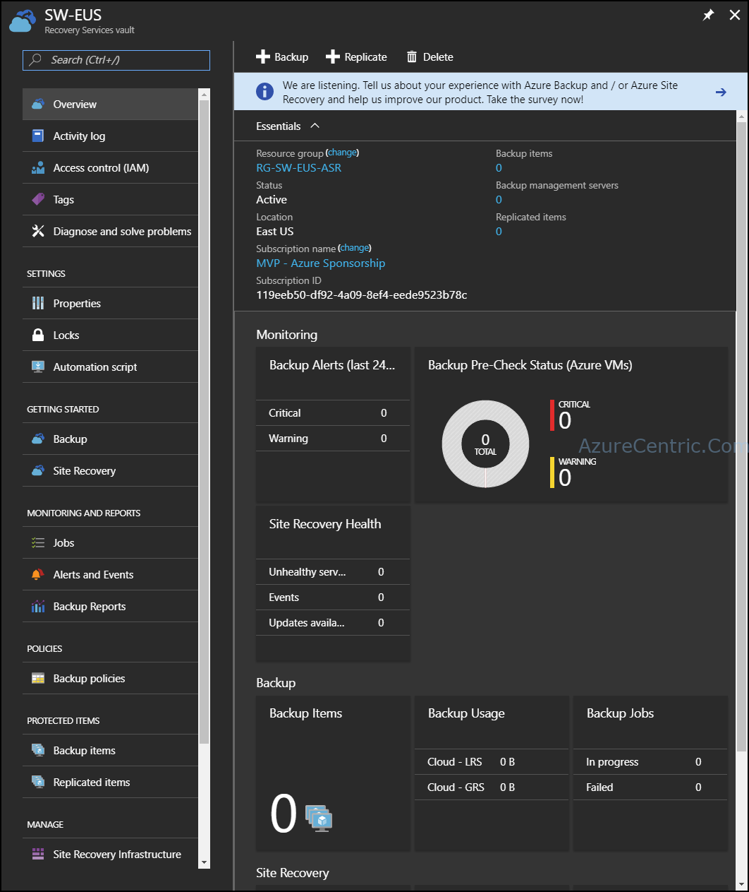

We know that in the Public Cloud, special Azure, we are cover by the SLA. Although some organizations like to be redundant where it comes to critical workloads. In this post I will cover how you can setup a Disaster Recovery solution within Azure.

In this case I have all my critical workloads running on West US 2 region and the East US 2 is my disaster recovery site.

The first step is to create the Recovery Vault. The Recovery Services Vault is feature inside Azure that makes everything work, as also known by Azure Site Recovery. You can have as many Recovery Services Vaults as you want. Each Recovery Services vault will have its own storage account associated, that means if you create more than one Recovery Service vault you will have more than one storage accounts.

When you create a Recovery Services vault, you need to choose the region where you want to store those workloads. That means the Recovery Services vault is acting as your destination, because of this it’s not recommended to create on the same region that your workloads are running.

To create the Recovery Services vault, follow the steps:

1. Click on the Create Recovery vaults button 	
2. Insert the following details
  1. Name
  2. Select the subscription that you want to create the Recovery Services Vault
  3. Create or Select an existing Resource Group
  4. Choose your location (this need to be a different region of the workloads that you want to protect) 	
3. Click on the Create.

 	
4. After the creation of the Recovery Services vault, you just create the infrastructure require on Azure to setup all the services need.

There are some considerations when you create a Recovery Services vault to protect you workloads within Azure (this considerations are only for this scenario).

1. At this present moment, you only create the infrastructure that supports Azure Site Recovery and Azure Backup. You are not done yet. The next step is to configure either or both services (Site Recovery and Backup).
2. If you want to use the Recovery Services for Site Recovery, you need to prepare the infrastructure that will support that. In this case, you need to decide what type of workloads you want to protect from where to Azure. If you want to protect workloads within Azure (i.e between regions), your source workloads (where they are running) should be in a different region. For optimal utilization try to use the “direct” DR Azure site (EastóWest or North óSouth).
3. You can protect different regions to the same Recovery Service vault. Although the workloads should not be running on the region, that your Recovery Services is created.
4. You don’t need to setup any VNet-to-VNet between the regions. Recovery Services uses the backbone of Azure, to connect to the workloads that you want to protect.

Cheers,

**Marcos Nogueira**  
**_Azure MVP_**  
[azurecentric.com](http://azurecentric.com)  
Twitter: [@mdnoga](http://www.twitter.com/mdnoga)
