On the previous post (see [here](azurecentric.com/2017/11/02/disaster-recovery-solution-within-azure-part-1/)), I create the Recovery Service vault that is required to configured the Site Recovery infrastructure to protect the workloads, in order to have a Disaster Recovery solution within Azure. In the post, I will show how you can protect your workloads (Azure VMs) from one region into another region.

First step is to prepare the infrastructure. Azure Site Recovery have many scenarios that you can protect the workloads, but in these case, I will only cover the Azure VM protection to another region.

As mention on the previous blog post, my workloads are running on the West US 2 region. After creating the Recovery Services vault on East US 2 region, I need to prepare the infrastructure.

To step up the infrastructure follow the steps:

1. On the Recovery Services vault, click on **Site Recovery**, under **GETTING STARTED**
2. It will open another blade. Click on **Prepare Infrastructure**

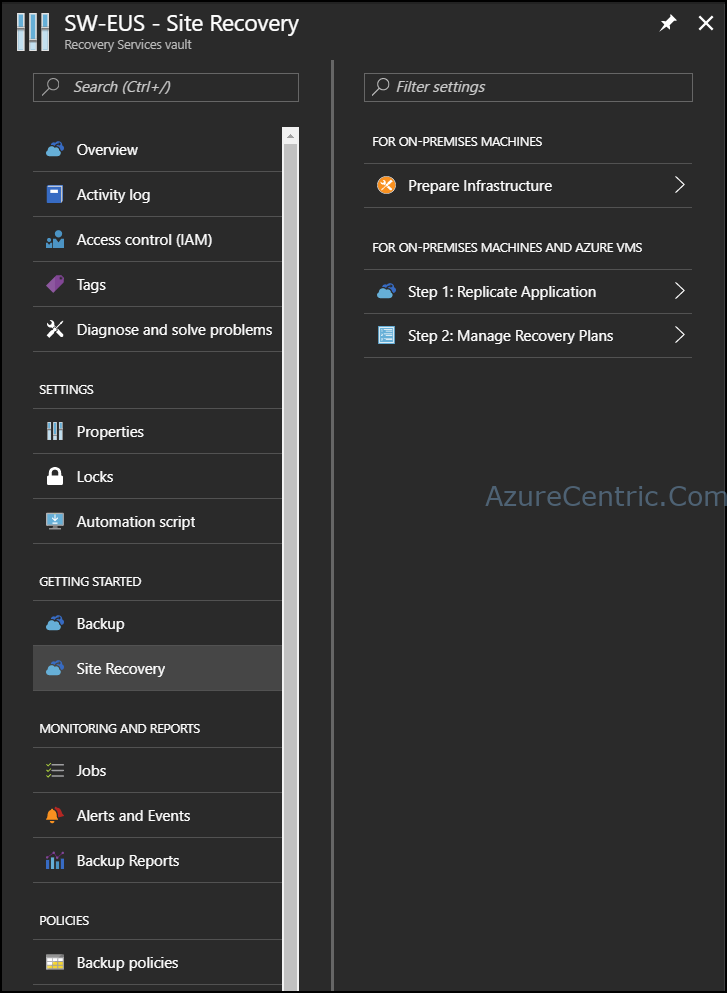
 	
3. Select **Azure – PREVIEW**, under **Where are your machines located?**
4. Make sure that you select **To Azure** on **Where do you want to replicate your machines to?**
5. Click **OK**

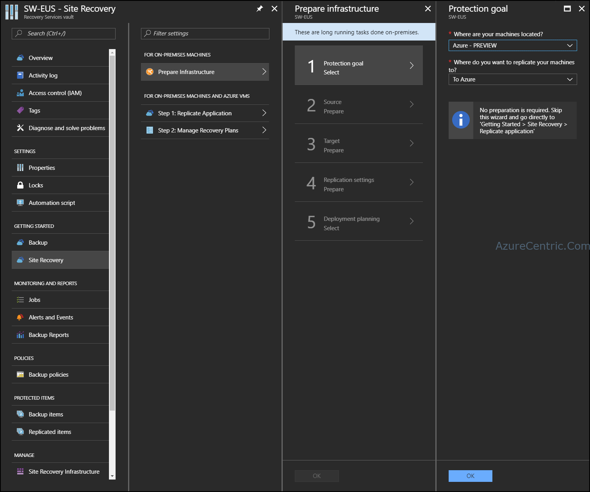

6. Fill all the details required:
  1. **Source Location** – is the region where your workloads are running
  2. **Azure virtual machine deployment model** – make sure that you select **Resource Manager**
  3. **Source resource group** – is the recourse group where your workloads are running
    **NOTE:** If you have more than one resource group on the same region, you must run this setup again, to add more workloads located on another resource group. 	
7. Click **OK** to proceed

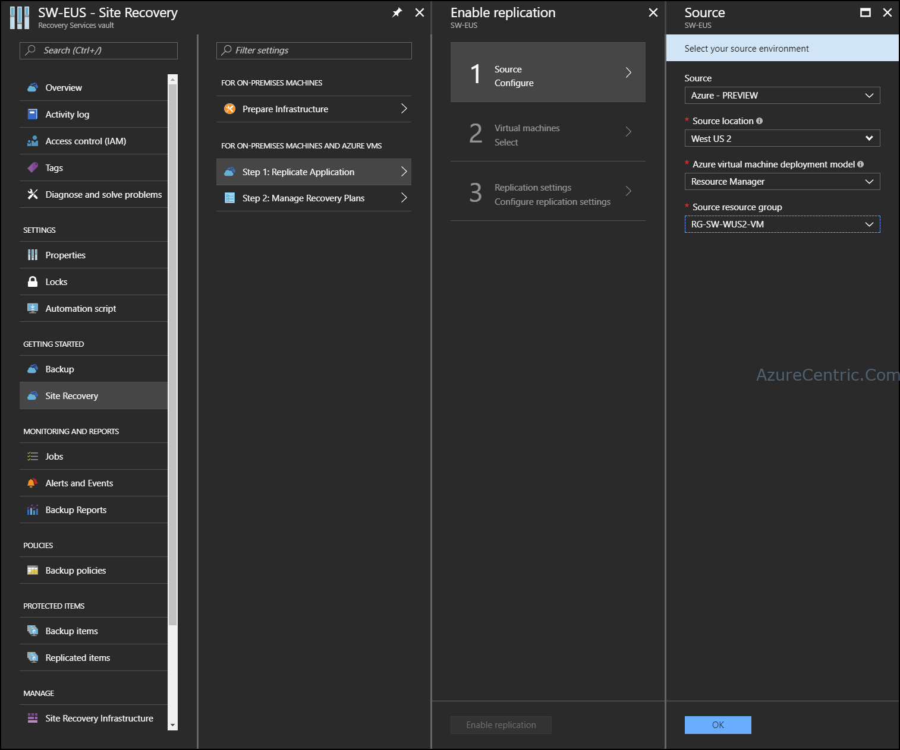

8. Select the workloads that you want to protect.
9. Click **OK**

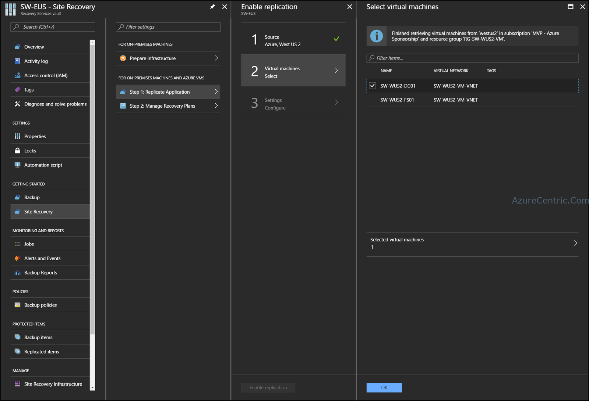

10. On the **Configure settings** blade, click **Create target resources** button to conclude the preparation of the infrastructure.
  **NOTE:** Under Target location, by default choose the location where you create the Recovery Services vault, although you can select another region where do you want to replicate too. It’s not recommend that you choose the location where your workloads are running.

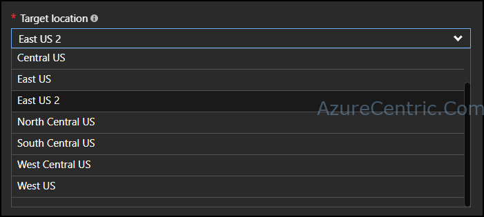

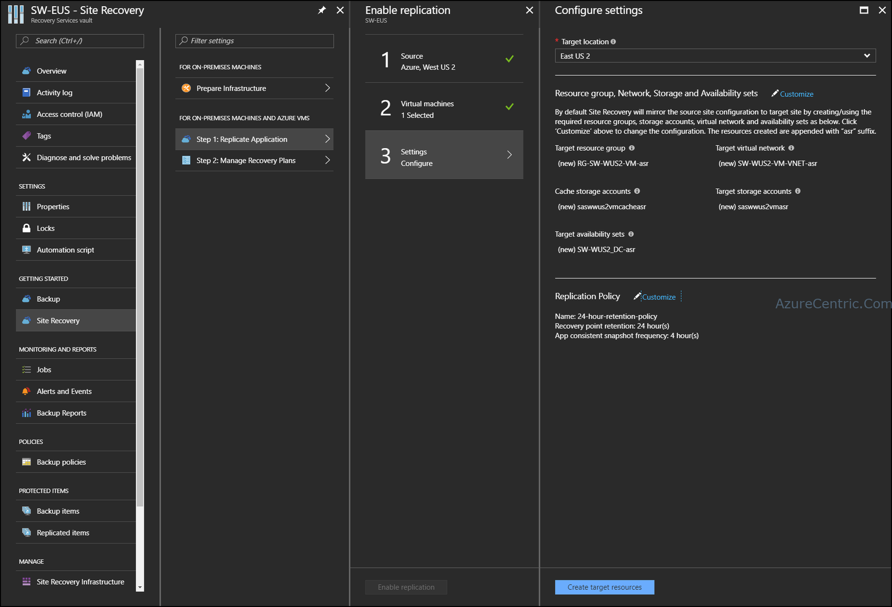

11. If you do want to change the default settings, then you can click on Customize. Otherwise you can skip to the last step. There are two different settings that you can customize:
  1. Resource group, Network, Storage and Availability sets – On this setting you will configure witch resource group, network, storage account and availability set your workload will run, when your failover the virtual machine.
  2. Replication policy – is where you change the name of the replication policy, RPO and the frequency of the replication.

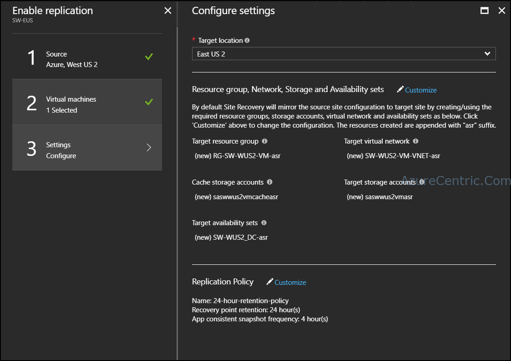
 	
12. If you want to change any of the following setting:
  1. **Target resource group** – This is the Resource group where your workload will run in case of failover. On the drop down, list you will see only the resource group available on the region that you previous select. Although you can either create a new (by default) or use an existing one.

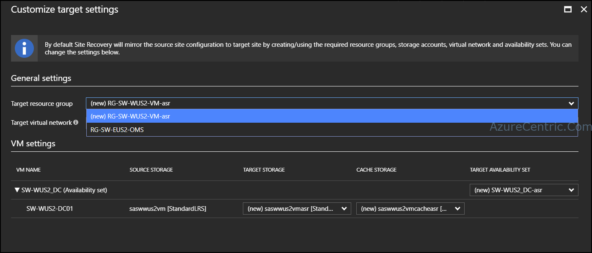

  2. **Target virtual network** – This is where you can define witch network your workload will run in case of failover. On the drop down, list you will see only the networks available on the region that you previous select. Although you can either create a new (by default) or use an existing one.
  3. Storage accounts
    1. **Target Storage** – This is where your workload will be replicated too. On the drop down, list you will see only the storages accounts available on the region that you previous select. Although you can either create a new (by default) or use an existing one.
    2. **Cache Storage** - This is where your workload will be replicated too. On the drop down, list you will see only the storages accounts available on the region that you previous select. Although you can either create a new (by default) or use an existing one.
    4. **Availability sets** - This is availability set that your workload will be running in case of failover. On the drop down, list you will see only the availability sets available on the region that you previous select. Although you can either create a new (by default), use an existing one or choose not to set an availability set (Not Applicable option). 	
13. After you change the settings that you want, click **OK**

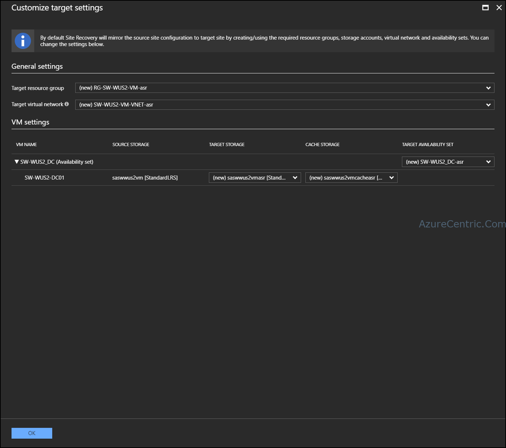
 	
14. If you want to change the policies setting, these are your options:
  1. Choose by creating a new policy or an existing one.
    **NOTE:** If you are running these for the first time, it’s recommended that you create a new policy. Although if you are running for the second or more times, you can either choose an existing policy (if the settings are the same) or create a new policy, if the settings are different. It’s not recommended that you create new policies with the same settings.
  2. Name – This is where you can change the name of the policy
  3. Recovery point retention – This is where you can configure how long do you want to keep each recovery point.
  4. App consistent snapshot frequency – This is where you can choose the frequency of the replication.
  
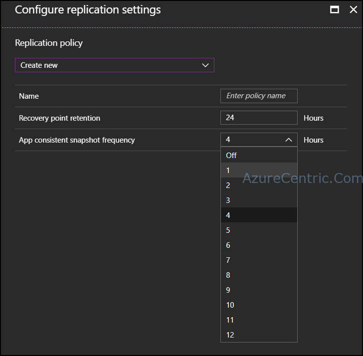
 	
15. After you change the settings that you want, click **OK**

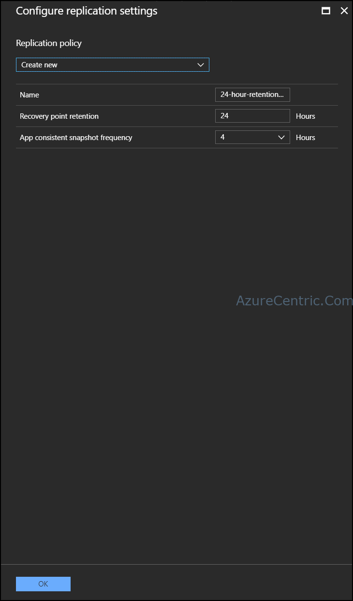
 	
16. Click **Enable replication** button, to start the workload protection.

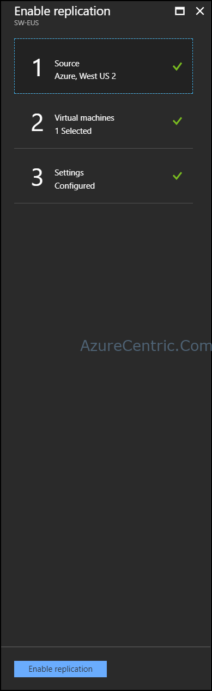
 	
17. After the configuration is done. Azure will start to replicate the workload from on region to another. The time of the replication it will depend on the size of the disks attached to the workload.

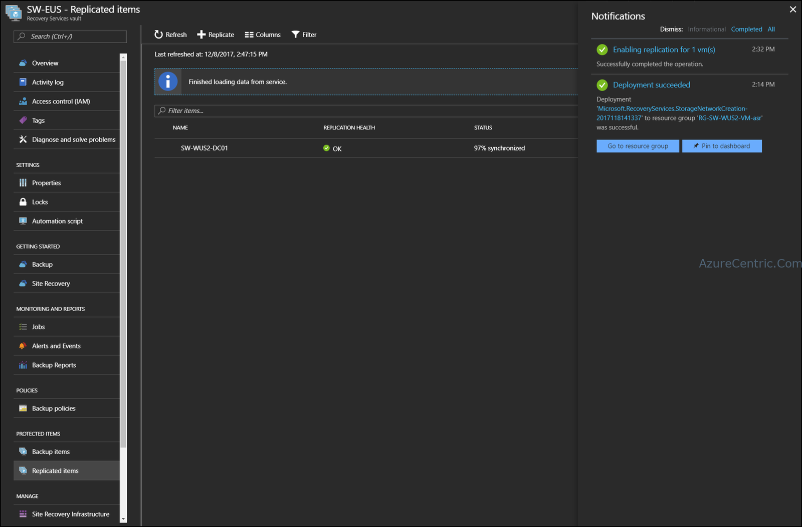

All this process is live. That means you don’t have any downtime while Azure is doing the initial replication.

Cheers,

**Marcos Nogueira**  
**_Azure MVP_**  
[azurecentric.com](http://azurecentric.com)  
Twitter: [@mdnoga](http://www.twitter.com/mdnoga)
