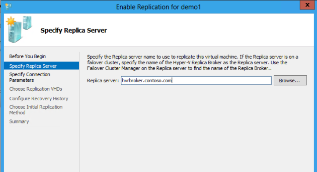
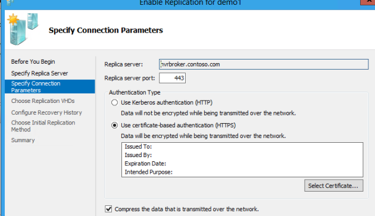
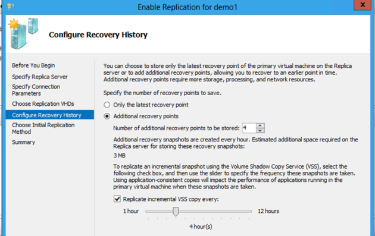
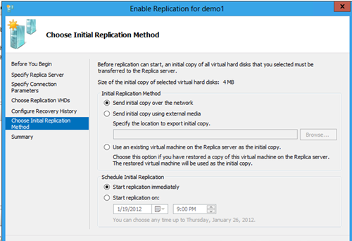
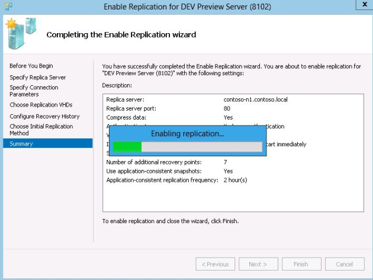
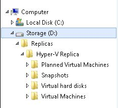
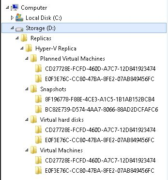

Replication is configured on a per virtual machine basis.  Virtual machines running on Primary site Hyper-V servers (or Hyper-V Failover Clusters) are configured to replicate to Replica servers (or Replica Failover Clusters) at remote sites.

1. In Hyper-V Manager, in the Details pane, Click on a virtual machine
2. With a virtual machine selected, Right-click and choose **Enable Replication.  **This starts the **Enable Replication** wizard
3. In the **Specify Replica Server** screen, enter either the NetBIOS or the Fully-Qualified Domain Name (FQDN) for the Replica Server in the **Replica Server** box.  (**Note:** If the Replica server is a Failover Cluster, ensure the connection point for the Hyper-V Replica Broker is used). Click **Next**

4. If Remote WMI is enabled, then Hyper-V Replica automatically fills the port and authentication settings

5. In the **Choose Replication VHDs** screen, deselect** **the disk(s) you do not want to replicate for the virtual machine and then click **Next**
6. Replication changes are sent to a Replica server every 5 minutes. In the **Configure Recovery History** screen, make selections for the number and types of recovery points to be sent to the Replica server.  If **Only the latest point for recovery** is chosen, then there will be only the parent VHD that is sent during Initial Replication and all changes are merged into that VHD.  If **Additional recovery points** is chosen, set the number of desired additional recovery points (Standard Replicas) that will be saved on the Replica server. The final selection in this screen, **Replicate incremental VSS copy every <select hours>:** (available only if **Recovery History** is enabled) can be used to save Application-consistent Replicas for the virtual machine on the Replica server. After completing the selections, Click **Next**

7. In the **Choose Initial Replication Method** screen, several methods can be used to perform an initial replication for the virtual machine to the Replica server.  The default selection is to **Send initial copy over the network**.  This starts replication immediately over the network to the Replica server.  If immediate replication is not desired, it can be scheduled to occur at a specific time on a specific date.  If the administrator does not want to consume the bandwidth due perhaps to the large amount of data that needs to be replicated, he can choose **Send initial copy using external media**. This method copies all the virtual machine data to a portable storage device that can then be sent to a Replica site and the initial replication can be completed there by importing the data.  The final option available to an administrator is **Use an existing virtual machine on the Replica server as the initial copy**.   A restored virtual machine or snapshot of a virtual machine on the Replica server will be used as the initial copy. Make a selection and then Click **Next**

8. In the **Completing the Enable Replication Relationship Wizard**, review the information in the **Summary** and then Click **Finish**
9. A pop-up dialog box is presented indicating replication was successfully enabled for the virtual machine. In the dialog box is a **Settings** button that can be used to configure the network the replica virtual machine will connect to on the Replica server. This can be useful because the replica virtual machine is not connected to any network on the Replica server by default

The **Enabling Replication** process will start and should complete successfully (i.e. a virtual machine is created on the Replica server and delta replication commences.  If the Replica server is a Failover Cluster, the virtual machine is made highly available). If any errors occur, refer to the troubleshooting section later in this document.

Once the replication relationship is established and if **Send initial copy over the network** was selected (Default setting), the **Status** column for the configured virtual machine will indicate **Sending Initial Replica**. Progress as a percentage of the total replication is also displayed.
    **Note:** If a virtual machine is being replicated to a Failover Cluster (using the Hyper-V Replica Broker), a highly available virtual machine is created in the cluster.  This allows the replica to be migrated to other nodes in the cluster if needed.

If **Send initial copy using external media** was selected, the **Status** for the virtual machine will indicate an **Initial Replication in Progress**.  In this case, the progress reflects the copying of the virtual machine files to a location other than the Replica Server (perhaps a portable storage device) so the files can be transported to the Replica server location and then the Initial Replication can be completed by importing the files on that server.  Once the import process completes, the **Replication State** for the virtual machine in the Primary Site will reflect a new **Replication State** of **Replication Enabled**.

If **Use existing restored virtual machine as initial copy** was selected, the virtual machine files restored from a backup on the Replica server will be used for Initial Replication (IR).  Before delta replication actually begins, a quick resynch is executed.

Hyper-V Replica implements the standard Hyper-V virtual machine folder structure on the Replica server in the location specified when the Replica server (Replica Failover Cluster) is configured.  A **Hyper-V Replica** folder is created as the root folder in the specified location.  Under the **Hyper-V Replica** folder is a series of subfolders as seen here -

   
    **NOTE:** The Snapshots folder is not created unless Recovery History is configured for the virtual machine.

The folders support the necessary files for each virtual machine configured to replicate with the Replica server.  The virtual machines are identified by Globally Unique Identifiers (GUID) as seen here -

Cheers,

**Marcos Nogueira**
[azurecentric.com](http://azurecentric.com)
Twitter: [@mdnoga](http://www.twitter.com/mdnoga)
