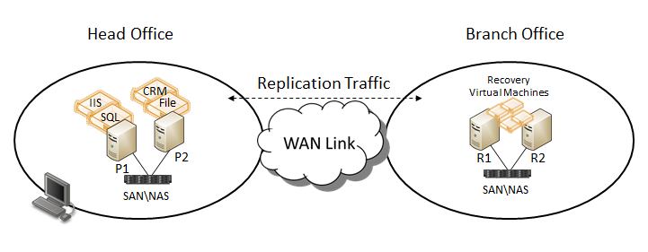
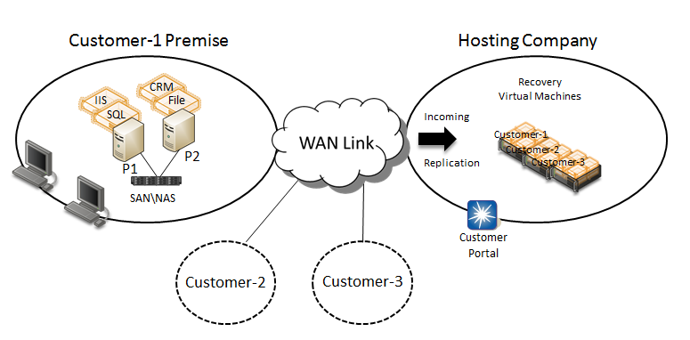

## Installation Considerations

Hyper-V Replica is implemented as part of the Hyper-V Role.  The Hyper-V Role can be enabled on a standalone Hyper-V server or on servers that are members of a Failover Cluster.  Hyper-V servers can function as members of a Workgroup or as member servers in the same or different Active Directory domains.   It is not required that Primary and Replica servers be part of the same Active Directory domain.  If the Hyper-V server role is enabled on servers that are members of a Failover Cluster, those servers must be joined to the same Active Directory domain. The Hyper-V server role can be enabled using the Server Manager console or the Deployment Image and Servicing Management (DISM) command line tool.  The Hyper-V role has no dependencies on any other server roles.  Installing the Hyper-V role also installs the Hyper-V Management interface, which is part of the Remote Server Administration Tools (RSAT) feature.

## Deployment Scenarios

There are four primary deployment scenarios for Hyper-V Replica:
  * Head Office and Branch Office (HO-BO)
  * Enterprise Datacenter
  * Hosting Provider Datacenter
  * Customer Office and Hosting Provider Datacenter (Cross-Premise)

## Head Office and Branch Office

This scenario typically involves Mid-Market customers who have a main corporate Head Office and one or more Branch Offices located in different physical locations. This type of customer typically has a limited budget for purchasing hardware, WAN connectivity, and hiring IT Staff.   As part of a cost saving initiative, a customer may decide to implement Microsoft virtualization technologies to migrate corporate applications running on physical hardware to virtualized workloads running on Microsoft servers running the Hyper-V role.  One or more of servers are hosted in the Head Office location either as standalone servers or as part of one or more Hyper-V Failover Clusters.

Management decides to implement a Disaster Recovery (DR) plan and deploys additional servers running the Hyper-V role (Hyper-V Failover Clusters) at one or more Branch Offices to function as Replica servers.  Using Microsoft's Hyper-V Replica functionality, the customer implements a DR solution.  Implementing this DR solution involves these basic steps:
  1. Configure a Replica Server (Replica Failover Cluster) at one or more designated Branch Offices
  2. Create the replication relationships between the virtual machines running in the Head Office and the Branch Office(s)
  3. Perform the initial replication for all virtual workloads
  4. Perform a **Test Failover** on each virtual machine ensuring it will start on the Branch Office server(s)
  5. Configure the server(s) in the Head Office as Replica servers as part of a reverse replication strategy for the Branch Office Replica servers
  6. Execute a **Planned Failover** of all virtual machines to the Branch Office(s) to ensure all virtual machines come online properly (**Note:**  A Planned Failover requires a Virtual Machine be shutdown first resulting in an outage if it is a production workload)
  7. Execute another **Planned Failover** back to the Head Office from the Branch Office(s) to verify reverse replication
  8. Monitor replication for all virtual machines and generate reports as needed
  9. Test virtual machine mobility scenarios to ensure they function properly.  These scenarios can include live migration of virtual machines between cluster nodes, or migration of virtual machine storage between File Servers
  10. Test replication using virtual machines that have been restored from backup
  11. Modify corporate maintenance (Change Management) plans to include using Hyper-V Replica functionality

## Enterprise Datacenter

The Enterprise Datacenter scenario is very similar to the Head Office and Branch Office scenario in terms of the actual steps an administrator executes to implement Disaster Recovery using Hyper-V Replica.  The main difference would be scale.  Enterprise environments typically include one, or more, large, geographically dispersed datacenters supporting a greater number of virtualized workloads running on more servers.  Additionally, enterprise environments may implement Third Party or 'homegrown' applications that take advantage of Hyper-V Replica APIs (Application Programming Interface) in an effort to streamline internal management processes.

## Hosting Provider Datacenter

The Hosting Provider Datacenter scenario is very similar to the Enterprise scenario in terms of the actual steps an administrator executes to implement Disaster Recovery using Hyper-V Replica.  Hosting companies have additional concerns in that they are dealing with multiple customers (tenants) on a shared internal infrastructure.  This requires implementing stricter isolation policies within the datacenter and a billing system that can accurately track resource usage.

## Customer Office and Hosting Provider Datacenter (Cross-Premises)

The Customer Office and Hosting Provider Datacenter (Cross-Premises) scenario takes the Hosting Provider Datacenter scenario one-step further in that Disaster Recovery is provided as a service (Infrastructure as a Service (IaaS)) to customers external to the hosting company itself.  This modifies the administrative process as follows:
  1. Hosting company configures a Replica Server (Replica Failover Cluster) in the Hosting company datacenter
  2. Hosting company develops a customer portal providing access to customers for tracking their services and adding services as needed
  3. Customer subscribes to hosting company disaster recovery service
  4. Hosting company provides required server and certificate information.  Customer creates the replication relationships between the virtual machines running in the customer environment and the designated Replica server(s) in the hosting company's datacenter (using a secure Virtual Private Network (VPN) connection)
  5. Customer performs the initial replication or all virtual workloads
  6. Customer performs a **Test Failover** on each virtual machine ensuring it will start on the Replica server(s)
  7. Customer configures their server(s) as part of a reverse replication strategy on their own premise server(s)
  8. Customer executes a **Planned Failover** of all virtual machines to the hosting company datacenter Replica server(s) to ensure all virtual machines come online properly
  9. Customer executes another **Planned Failover** back to their on premise server(s) to verify reverse replication
  10. Customer monitors replication for all virtual machines and generates reports as needed
  11. Customer tests virtual machine mobility scenarios provided hosting company provides those services
  12. Customer and hosting company test replication using virtual machines that have been restored from backup
  13. Customer modifies maintenance (Change Management) plans to include using Hyper-V Replica functionality

Cheers,

**Marcos Nogueira**
[azurecentric.com](http://azurecentric.com)
Twitter: [@mdnoga](http://www.twitter.com/mdnoga)
