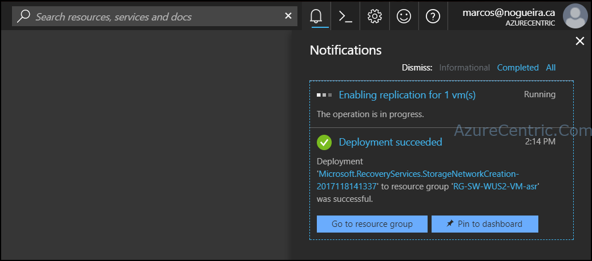

If you are like me and your Azure Portal is your center on your day, you probably see this enhancement of the notifications. I found very useful and make my day way more productive when I need to setup new resources/environments.

Be able to deploy different resources through the Azure Portal and from the notifications access those resources is something that I did think why Microsoft doesn’t improve those little details, but guess what? They listen! WOW.

So, from the notification you can now, access direct where the resource is located, as well as pin to the dashboard.

In some case this could be very useful for some Azure Administrators that use the Azure Portal, because they can easily jump into the Resource Group, where you create the resource, instead of going back to the main menu and navigate to where the resource is. Another aspect is on the visualization on the Azure Portal notification areas, because now you have these two buttons, now you can identify way better what you deployed and find the resource that you are looking for.

You might think, why did I spend time writing this blog post, and the answer is very simple. THEY DID LISTEN! LOL! And besides that, this little thing makes, at least me, my days way better. Could not be much for you, but it’s for me.

Cheers,

**Marcos Nogueira**  
**_Azure MVP_**  
[azurecentric.com](http://azurecentric.com)  
Twitter: [@mdnoga](http://www.twitter.com/mdnoga)
