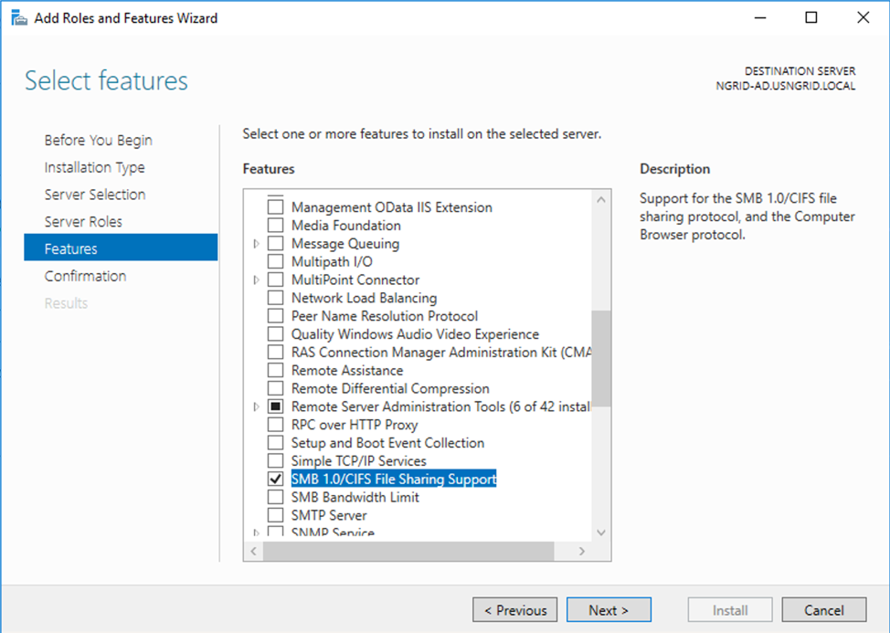
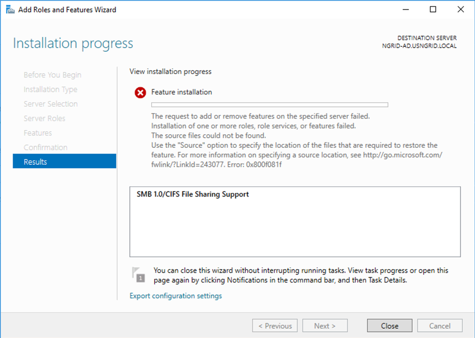

At one of my costumers, I needed to add the SMBv1 feature to enable communication with a legacy File Server running on Windows Server 2003. 

After the process I run into this error:

So then, I download the Windows Server 2016 ISO and tried to
install pointing to the Source folder as mention on the error (similar approach
when you want to try to install .NET 2.0 on a Windows Server 2016). But the
error persisted. 

After a research and contacting Azure Support I realized the following

I got the **_error 0x800F081F = CBS_E_SOURCE_MISSING_** (source for package or file not found, ResolveSource() unsuccessful) when I tried to enable SMBv1 feature. And in this case, it’s because Azure’s Windows Server 2016 deployment template image seems no longer have source file for SMBv1 that I could use (likely to be “**amd64_microsoft-windows-smbserver-v1_31bf3856ad364e35_10.0.14393.0_none_076bd4d60d263c3c**” or anything related to SMBv1) . 

If you have seen this issue before on
deployed Server 2016 machines in Azure using default Azure Server 2016
template. Please kindly follow these steps below:
1. **Point to original Server 2016’s install.wim**
  1. Download **install.wim** (from Windows Server 2016 ISO).
  2. Create **C:\tempwim** and **C:\tempwim\mount** folder
  3. Copy **install.wim** to **C:\tempwim**
  4. Run Command Prompt as administrator
    1. Type: _**dism /mount-wim /wimfile:c:\tempwim\install.wim /index:4 /mountdir:c:\tempwim\mount /readonly**_
    2. **Note:** index 4 = Datacenter. If this machine is running else edition, please replace the index number as below
      1. = Standard CORE
      2. = Standard
      3. = Datacenter CORE
      4. = Datacenter
    3. Type: **_dism /online /Enable-Feature /FeatureName:SMB1Protocol /All /source:c:\tempwim\mount\windows\winsxs /limitaccess_**
  5. Reboot the machine
  6. Then perform configure SMBv1 as needed
2. **Unmount the install.wim from the mount folder**
  1. Run Command Prompt as administrator
  2. Type: **_dism /unmount-wim /mountdir:c:\tempwim\mount /discard_**

Cheers,

**Marcos Nogueira**  
**_Azure MVP_**  
[azurecentric.com](http://azurecentric.com)  
Twitter: [@mdnoga](http://www.twitter.com/mdnoga)
