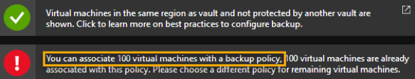

At one of my costumer Azure Subscription, I was adding a new virtual machine to the existing Azure Recovery Vault previously configured, when I run into this error:

I found very odd, why this message appears. So, I start to review the Recovery Vault configuration and I realize this Recovery Vault only
had one backup policy. Then I start to investigate if this was a soft limit or hard limit on Azure. I found this article  [https://docs.microsoft.com/en-us/azure/backup/backup-azure-vm-backup-faq#is-there-a-limit-on-number-of-vms-that-can-beassociated-with-a-same-backup-policy](https://docs.microsoft.com/en-us/azurebackup/backup-azure-vm-backup-faq#is-there-a-limit-on-number-of-vms-that-can-beassociated-with-a-same-backup-policy)

After a few moments I realize this is a limitation of Azure. Then I start to work on the resolution. In this case, was a very simple resolution. Just create a new backup policy, and then you have another 100 more VMs to assign to that backup policy.

Cheers,

**Marcos Nogueira**  
**_Azure MVP_**  
[azurecentric.com](http://azurecentric.com)  
Twitter: [@mdnoga](http://www.twitter.com/mdnoga)
