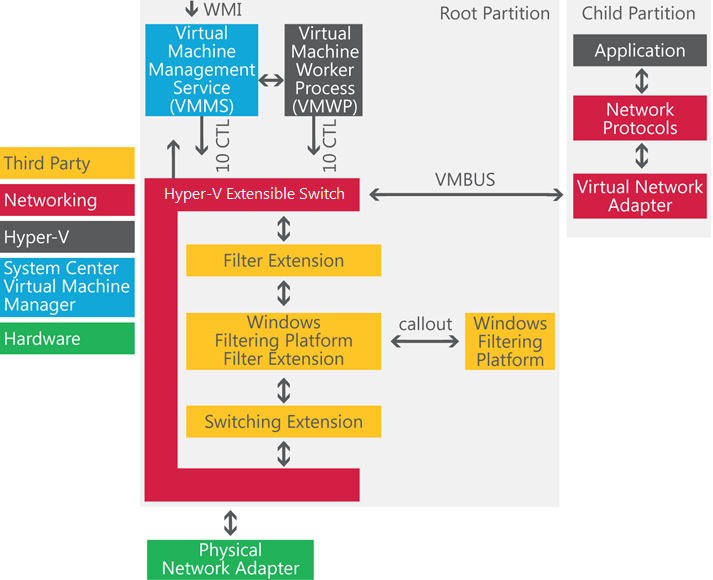

## **Before Windows Server 2012**

Many enterprises need the ability to extend virtual switch features with their own plug-ins to suit their virtual environment. If you’re in charge of making IT purchasing decisions at your company, you want to know that the virtualization platform you choose won’t lock you in to a small set of compatible features, devices, or technologies.

## **With Windows Server 2012**

The Hyper‑V Extensible Switch in Windows Server 2012 is a layer-2 virtual network switch that provides programmatically managed and extensible capabilities to connect virtual machines to the physical network. The Hyper‑V Extensible Switch is an open platform that lets multiple vendors provide extensions that are written to standard Windows API frameworks. The reliability of extensions is strengthened through the Windows standard framework and reduction of required third-party code for functions and is backed by the Windows Hardware Quality Labs (WHQL) certification program. You can manage the Hyper‑V Extensible Switch and its extensions by using Windows PowerShell, programmatically with WMI or the Hyper‑V Manager user interface.

## **Extensibility of the Hyper-V Extensible Switch**

Windows Server 2012 extends the virtual switch to provide new capabilities.

The **diagram** shows the architecture of the Hyper-V Extensible Switch and the extensibility model.

The Hyper‑V Extensible Switch architecture in Windows Server 2012 is an open framework that allows third parties to add new functionality such as monitoring, forwarding, and filtering to the virtual switch.

## **Two platforms**

Extensions are implemented using the following drivers:
  * **Network Device Interface Specification (NDIS)** filter drivers **are used to monitor or modify network packets in Windows. NDIS filters were introduced with the [NDIS 6.0 specification](http://msdn.microsoft.com/en-us/library/ff565501(v=VS.85).aspx).
  * **Windows Filtering Platform (WFP) callout drivers** introduced in Windows Vista and Windows Server 2008, let independent software vendors (ISVs) create drivers to filter and modify TCP/IP packets, monitor or authorize connections, filter IP security (IPsec)-protected traffic, and filter remote procedure calls (RPCs). Filtering and modifying TCP/IP packets provides unprecedented access to the TCP/IP packet processing path. In this path, you can examine or modify outgoing and incoming packets before additional processing occurs. By accessing the TCP/IP processing path at different layers, you can more easily create firewalls, antivirus software, diagnostic software, and other types of applications and services. For more information, see the [Windows Filtering Platform](http://msdn.microsoft.com/en-us/windows/hardware/gg463267.aspx).

**Extensions may extend or replace these aspects of the switching process:**
  * Ingress filtering
  * Destination lookup and forwarding
  * Egress filtering

Only one instance of the forwarding extension may be used per switch instance, and it overrides the default switching of the Hyper-V Extensible Switch.

Some other features of Hyper‑V Extensible Switch extensibility are:
  * **Extension monitoring.** In addition, by monitoring extensions you can gather statistical data by monitoring traffic at different layers of the Hyper‑V Extensible Switch. Multiple monitoring and filtering extensions can be supported at the ingress and egress portions of the Hyper‑V Extensible Switch.
  * **Extension uniqueness.** Extension state/configuration is unique to each instance of an Extensible Switch on a machine.
  * **Extensions that learn virtual machine life cycle.** Virtual machine activity cycle is similar to that of physical servers, having peak times during various parts of the day or night based on their core workloads. Extensions can learn the flow of network traffic based on the workload cycle of your virtual machines and optimize your virtual network for greater performance.
  * **Extensions that can veto state changes.** Extensions can implement monitoring, security, and other features to further improve the performance, management, and diagnostic enhancements of the Hyper-V Extensible Switch. Extensions can help ensure the security and reliability of your system by identifying harmful state changes, and stopping them from being implemented.
  * **Multiple extensions on same switch.** Multiple extensions can coexist on the same Hyper‑V Extensible Switch.

## **Extensibility features**
  * **Extension monitoring** - By monitoring extensions you can gather statistical data by checking the traffic at different layers of the Hyper-V Extensible Switch. Multiple monitoring and filtering extensions can be supported at the ingress and egress portions of the Hyper-V Extensible Switch.
  * **Extension uniqueness** - The extension state/configuration is unique to each instance of a Hyper-V Extensible Switch on a machine.
  * **Extensions that can learn the virtual machine lifecycle.**
  * **Extensions that can veto state changes.**
  * **Multiple extensions on same switch** - Multiple extensions can coexist on the same Hyper-V Extensible Switch.
  * **Integration with built-in features** - Extensions integrate with built-in Hyper-V Extensible Switch features.
  * **Capture extensions** - Capture extensions can inspect traffic and generate new traffic for report purposes. Capture extensions do not modify existing Hyper-V Extensible Switch traffic.

## **Manageability**

Management features built into the Hyper‑V Extensible Switch allow you to troubleshoot and resolve problems on Hyper‑V Extensible Switch networks.
  * **Windows PowerShell and scripting support**.** **Windows Server 2012 provides Windows PowerShell cmdlets for the Hyper-V Extensible Switch that let you build command-line tools or automated scripts for setup, configuration, monitoring, and troubleshooting.
  * **Unified tracing and enhanced diagnostics**.** **The Hyper-V Extensible Switch includes unified tracing to provide two levels of troubleshooting.
    * At the first level, the Event Tracing for Windows (ETW) provider for the Hyper-V Extensible Switch allows tracing packet events through the Hyper-V Extensible Switch and extensions, making it easier to pinpoint where an issue has occurred.
    * The second level allows capturing packets for a full trace of events and traffic packets.

## **Benefits**

Hyper-V Extensible Switch benefits include:
  * **Open platform to fuel plug-ins** - The Hyper-V Extensible Switch is an open platform that allows plug-ins to sit in the virtual switch between all traffic, including virtual machine-to-virtual machine traffic. Extensions can provide traffic monitoring, firewall filters, and switch forwarding. To jump-start the ecosystem, several partners will announce extensions with the unveiling of the Hyper-V Extensible Switch; there’s no “one-switch-only” solution for Hyper-V.
  * **Free core services**  - Core services for extensions are provided without charge. For example, all extensions have live migration support by default; no special coding for services is required.
  * **Windows reliability/quality** - Extensions experience a high level of reliability and quality from the strength of the Windows platform and the Windows logo certification program, which set a high bar for extension quality.
  * **Unified management** - The management of extensions is integrated into Windows management through Windows PowerShell cmdlets and WMI scripting. There’s one management story for all.
  * **Easier support** - Unified tracing means that it’s quicker and easier to diagnose issues when they arise. Reduced downtime increases the availability of services.
  * **Live migration support** - The Hyper-V Extensible Switch provides capabilities so extensions can participate in Hyper‑V live migration.

## **Requirements**

Hyper-V Extensible Switch extensibility is built into the Hyper-V server role and requires Windows Server 2012.

Cheers,

**Marcos Nogueira**
[azurecentric.com](http://azurecentric.com)
Twitter: [@mdnoga](http://www.twitter.com/mdnoga)
