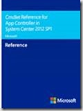
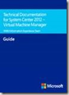
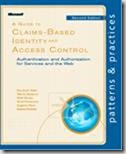
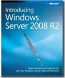
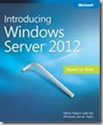
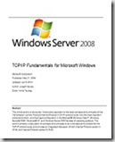
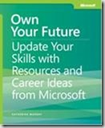

Today I found, completely by accident I might add, a collection of free E-Book of different Microsoft Technologies. 

They cover from IT PRO to Developer subjects. These E-Books are available in multiple formats (EPUB, MOBI and PDF) and in some cases in different languages. You can find the all collection [here](http://social.technet.microsoft.com/wiki/contents/articles/11608.e-book-gallery-for-microsoft-technologies.aspx#UnderstandingMicrosoftVirtualizationSolutions:FromtheDesktoptotheDatacenter,SecondEdition). And I did understand that they will update the list in regular basis. So bookmark the page to receive always the news E-Books. 

Here are the E-Books that I definitely recommend: 

#### System Center

 

#### Windows Server**

 

 

 

#### Career

Cheers,

**Marcos Nogueira**
[azurecentric.com](http://azurecentric.com)
Twitter: [@mdnoga](http://www.twitter.com/mdnoga)
