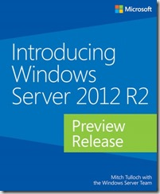

Microsoft just announce another free ebook offering from Microsoft Press. Introducing Windows Server 2012 R2 Preview Release (ISBN 9780735682931), by Mitch Tulloch with the Windows Server Team, introduces new features and capabilities, with scenario-based advice on how the platform can meet the needs of your business. Get the high-level overview you need to begin preparing your deployment now. This book is based on the Preview release and will be updated to cover Windows Server 2012 R2 RTM. 

Download the PDF version of this title [here](http://aka.ms/IntroWinServ2012R2Preview/PDFebook) (108 pages, 5 MB). UPDATE: The EPUB format is [here](http://aka.ms/Ebgv26) and the MOBI format is [here](http://aka.ms/H00nlo) .  

Watch for the lengthier RTM edition of this ebook later this year!  

Cheers,

**Marcos Nogueira**
[azurecentric.com](http://azurecentric.com)
Twitter: [@mdnoga](http://www.twitter.com/mdnoga)
