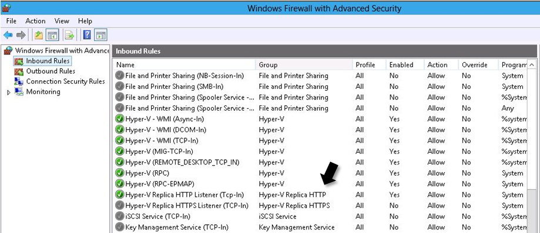

## Hyper-V Replica connectivity issues between Primary and Replica servers

### Symptom:  Hyper-V Replica functionality is disrupted and the Hyper-V VMMS\Admin log reports general network connectivity errors between the Primary and Replica server
  1. Verify the Replica server is booted and running.
  2. Check network connectivity and name resolution functionality between the Primary and Replica server by executing **_ping_** and **_nslookup_** tests.  If **_ping_** test fails, resolve network connectivity issues.  If name resolution fails, check DNS
  3. Ensure the Replica server is listening on the **Replica Server Port**.  This can be accomplished by running a **_netstat -ano_** command on the Replica server after verifying the  appropriate firewall rule has been Enabled or the custom firewall rule has been configured to allow _Inbound _communications on the configured port

  4. Inspect the **System Event Log** on the Primary and Replica servers to determine if there is any failure condition associated with network functionality	
  5. Run the Hyper-V Best Practice Analyzer (BPA) and inspect the report for any configuration or operational issues

## Configuring a virtual machine for replication

### Symptom:  Configuring a virtual machine for replication fails.
  1. Verify the Replica server is booted and running.
  2. Check network connectivity between and name resolution functionality the Primary and Replica server by executing a **_ping_** and **_nslookup_** tests.  If the **_ping_** test fails, resolve network connectivity issues. If name resolution fails, check DNS
  3. Ensure the Replica server is listening on the **Replica Server Port** and the **Authentication Type** is configured correctly.
  4.  If the Replica server configuration matches the parameters entered in the **Enable Replication** wizard,  verify the Firewall on the Replica server has been configured to allow _Inbound _communications on the **Replica Server Port**
  5. Inspect the **System Event Log** on the Primary and Replica servers to determine if there is any failure condition associated with network functionality
  6. Inspect the **Hyper-V VMMS\Admin Log** for any events related to network connectivity on both the Primary and Replica servers

## Virtual machine Planned Failover process

A virtual machine **Planned** **Failover** process is a planned event where a running virtual machine on the Primary server is moved to a designated Replica server.

### Symptom:  The Check that virtual machine is turned off Pre-Requisite test fails.
  1. Ensure the virtual machine has been shut down prior to executing a **Planned** **Failover **to a Replica server

### Symptom:  The **Check configuration for allowing revers replication** test fails.
  1. Ensure the Primary server has also been configured as a Replica server.  The assumption is that if a **Planned** **Failover** is executed to a Replica server, the virtual machine will use the Primary server as the new Replica server.   This configuration in the virtual machine is included as part of the **Planned** **Failover **process

### Symptom:  Send un-replicated data to Replica server fails.
  1. Verify network connectivity to the Replica server using the procedures outlined in the** Hyper-V Replica connectivity issues between Primary and Replica servers** section

## Configuring a virtual machine for Reverse Replication

### Symptom:  Reverse Replication configuration for a virtual machine results in a failure.
  1. Verify network connectivity to the Hyper-V server being used as a Replica server using the procedures outlined in the **Hyper-V Replica connectivity issues between Primary and Replica servers** section

## Initial Replication (IR) for a virtual machine

### Symptom:  Initial Replication (IR) for a virtual machine fails.
  1. Verify network connectivity to the Replica server using the procedures outlined in the** Hyper-V Replica connectivity issues between Primary and Replica servers** section
  2. Ensure the protocol configuration between the Primary and Replica server match
  3. Verify the Primary server is authorized to replicate with the Replica server this includes verifying the **Security Tags** match
  4. Ensure the Authentication method matches between the Primary and Replica server
  5. If there is an error on the Replica server indicating there is insufficient storage space,   verify there is sufficient storage space available on the drive hosting the virtual machine replica file(s).  If there is insufficient storage space, add additional storage space

## Delta Replication (DR) for a virtual machine

### Symptom:  Delta Replication (DR) for a virtual machine fails
  1. Verify network connectivity to the Replica server using the procedures outlined in the** Hyper-V Replica connectivity issues between Primary and Replica servers** section
  2. Ensure the protocol configuration between the Primary and Replica server match
  3. Verify the Primary server is authorized to replicate with the Replica server
  4. Ensure the Authentication method matches between the Primary and Replica server
  5. Check for any error(s) on the Replica server indicating there is insufficient storage space available to host the virtual machine replica files
  6. Check for any error(s) on the Replica server indicating the virtual machine files could not be located

### Symptom:  Application-consistent replicas are not generated by the Primary server and replicated to the Replica server
  1. Verify the virtual machine has been configured to replicate application-consistent replicas to the Replica server
  2. Verify the Integration Services version of the Guest matches what is installed in the Host (if there is a mismatch, a **Warning** message will be registered in the Hyper-V-Integration Admin log)
  3. Check the virtual machine Integration Services and verify the Backup (Volume snapshot) integration component is enabled in the Guest
  4. Review the system event log in the Guest and determine if there any errors pertaining to the Volume Shadow Copy Service (VSS)
  5. Test VSS in the Guest by executing a backup of the operating system
  6. Execute a backup on the Hyper-V host and verify the Guest can be backed up

## Replication Broker issues

### Symptom:  When enabling a virtual machine for replication, a connection to the Client Access Point (CAP) being used by the Hyper-V Replica Cluster Replication Broker cannot be made.
  1. Ensure all the resources supporting the Hyper-V Replica Clustering Replication Broker are Online in the cluster.  If there are any failures for the resources in the group, troubleshoot the failures using standard Failover Cluster troubleshooting procedures
  2. Move the resource group containing the Hyper-V Replica Clustering Replication Broker to another node in the cluster and attempt to enable replication for a virtual machine using the Client Access Point for the Hyper-V Replica Clustering Replication Broker

## Guest IP functionality

### Symptom:  After initiating a Failover for a virtual machine, the configured Failover TCP/IP settings for the virtual machine in the Replica server are not implemented and a connection to the virtual machine cannot be made.
  1. Ensure the Integration Components in the virtual machine have been updated.  This problem could occur in down-level operating systems running in a virtual machine on a Windows Server 2012 Hyper-V server
  2. Check the **Hyper-V-Integration\Admin** event log for an **Event ID: 4010 Warning** message reporting a problem with the Hyper-V Data Exchange functionality with the virtual machine experiencing this problem.  Additionally, an **Event ID: 4132 Error** message will be recorded indicating a problem applying IP settings to a network adapter in the virtual machine experiencing this problem
  3. Update the Integration Components in the virtual machine

Cheers,

**Marcos Nogueira**
[azurecentric.com](http://azurecentric.com)
Twitter: [@mdnoga](http://www.twitter.com/mdnoga)
