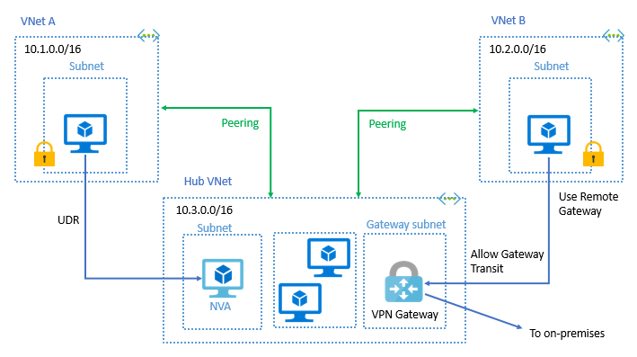

Finally! I have been waiting for this to blog it and start to setup. Being an Azure MVP is AWESOME, although sometimes you can’t share what is coming with no one. Even your costumers! I’m working on a project that this is key for a global dispersed Azure architecture that I’m working right now. I have been designing all of this, without telling the costumer that is possible, although saying that would be great to have it! Now I’m excited to announce to them, we are moving to a Global VNet peering.

### But why this is so key for me?

Because now, I can connect 2 VNets in different regions! 

So, now I truly can have network traffic between regions and deploy workloads that need to talk to each other with low-latency, high bandwidth and above that, the traffic is using the backbone of Azure.

These are the regions that you can now have Global VNet peering:

  * **Americas:** West Central US (Wyoming), West US 2 (Washington), Central US (Iowa), US East 2 (Virginia), Canada Central (Toronto), Canada East (Quebec City)
  * **Asia Pacific:** Southeast Asia (Singapore) Korea South (Buscan), South India (Chennai), Central India (Pune), West India (Mumbai)
  * **Europe:** UK South (London), UK West (Cardiff), West Europe (Netherlands)

Cheers,

**Marcos Nogueira**  
**_Azure MVP_**  
[azurecentric.com](http://azurecentric.com)  
Twitter: [@mdnoga](http://www.twitter.com/mdnoga)
