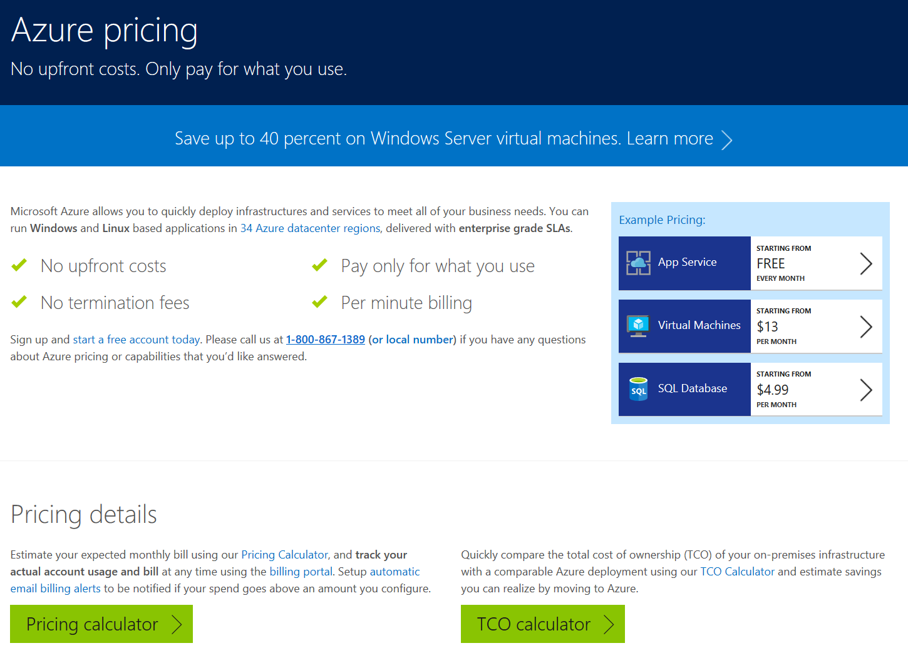

Cloud technologies generally enable you to minimize or eliminate capital expenditures completely. They also might help customers lower their operational costs. These principles are applicable to Azure and are reflected in its pricing model.

Azure charges are, for the most part, calculated on a per-minute basis, and they reflect actual usage. For example, when you deploy Azure virtual machines, the corresponding cost relates mainly to their compute time. These charges apply whenever a virtual machine is running, but terminate as soon as you stop the virtual machine by using the Azure portal or Azure PowerShell. Another less significant part of virtual-machine cost relates to the content of virtual-disk files that you host in an Azure Standard storage account. In this case, you are charged for only the disk space that you use and for the number of Input/Output storage operations that your workload performs. For example, if you provision a 1 terabyte (TB) disk, but you store only 20 gigabyte (GB) of data on it, then your cost will represent 2% of the entire disk’s pricing.

**Note: **There are some exceptions to this rule, typically applicable to higher end services where you pay for guaranteed, provisioned capacity. For example, with the Premium Storage (hosted on solid state drives), you would pay for entire 1TB disk, regardless of the amount of data you store on it. Conversely, in this case, there would be no charges for the number of Input/Output storage operations performed by your workload.

Microsoft offers a majority of Azure services in several pricing tiers, to accommodate different customer needs and facilitate vertical scaling. However, by implementing vertical scaling, customers can increase or decrease processing power and service capacity rapidly. You also can implement horizontal scaling to provide a different, and typically more effective, approach to meet fluctuating demand. This option also is available in Azure. In either case, customers can minimize usage charges by adjusting service levels dynamically.

Pricing also might vary depending on the region in which your services will be hosted and, with respect to licensed products, on the licensing model that is applicable when you implement them in a public cloud.

To estimate the cost of Azure services that you plan to provision, you can use the Azure pricing calculator. This web-based tool allows you to pick different types of Azure services, specify their total projected usage (in hours, weeks, or months), pricing tier, target Azure region, and support options. Then based on this information, you can determine the overall cost of a solution that meets your need.

You also can use the full calculator node for more complex Azure subscriptions. This node enables you to select individual services and their configuration options from all available Azure services.

After you select and configure your Azure subscription services, you can proceed to purchase and provision the subscription.

Here is the link to access the Azure pricing tool: [azure.microsoft.com/en-us/pricing/](https://azure.microsoft.com/en-us/pricing/)

Cheers,

**Marcos Nogueira**
[azurecentric.com](http://azurecentric.com)
Twitter: [@mdnoga](http://www.twitter.com/mdnoga)
