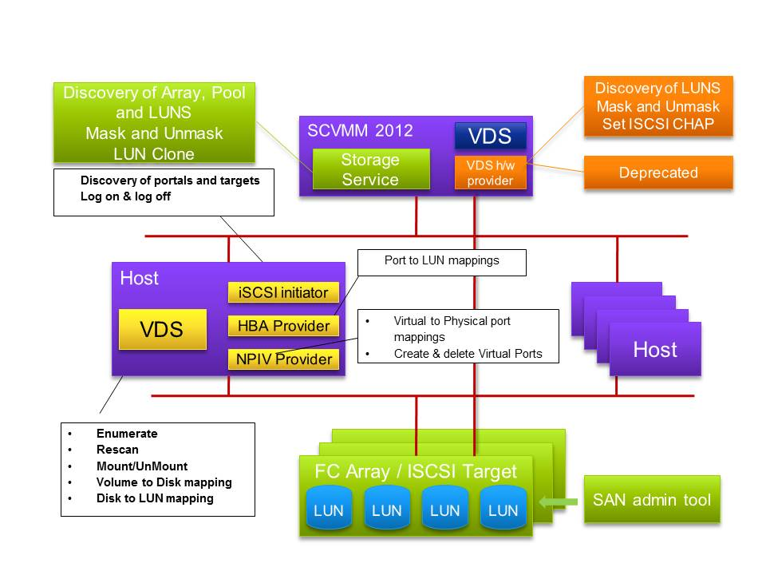
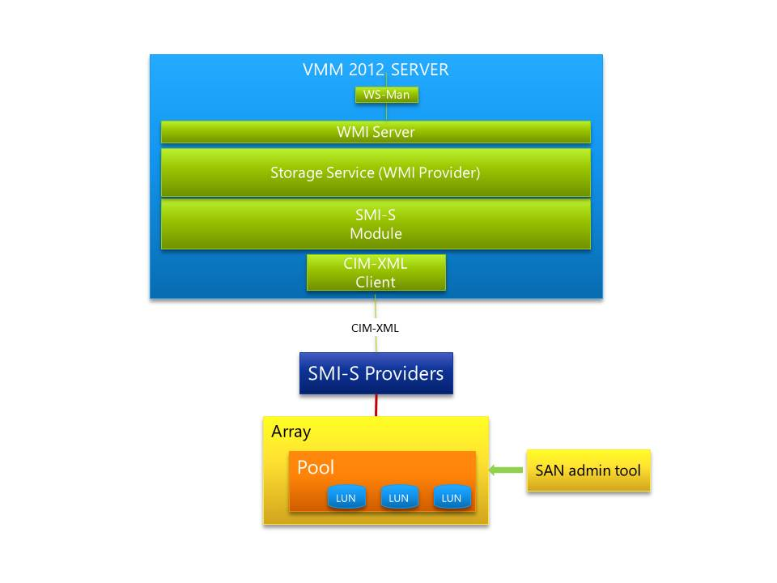
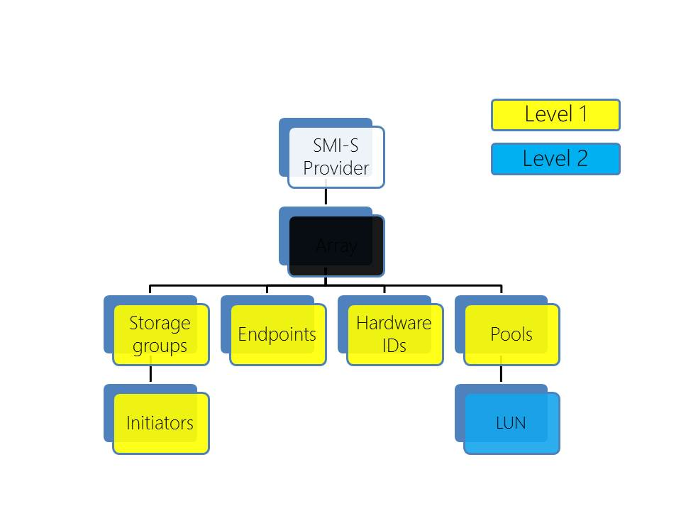

The key piece within the new storage architecture for SCVMM 2012 is the Storage Service.  This service is part of SCVMM 2012 and will not be available separately.  The storage service provides the communication capabilities when talking to the storage subsystems through the SMI-S providers.  SMI-S providers are provided by the storage vendor.  This model insures that the SAN provider tools still work and that SCVMM 2012 does not conflict with those tools

With SCVMM 2012 and the private cloud support, it was important for SCVMM 2012 to provide more management of the underlying fabric.  With respect to storage SCVMM 2012 has moved with a strategic approach.  The storage management is standards based, so the Storage Management Interface - Specification (SMI-S) was selected.  The storage management had to be fully integrated and consistent across array vendors into SCVMM 2012.  Using SMI-S exposes the array functionality required by SCVMM 2012.  All the features and value add that a storage vendor can be exposed using native tools the vendor provides or through PowerShell support.  SMI-S will not enhance or hinder a storage arrays capability.

SCVMM 2012 still supports iSCSI, Fibre Channel and NPIV.  N_Port ID Virtualization (NPIV) on a Fibre Channel SAN. NPIV uses Host Bus Adapter (HBA) technology, which creates virtual HBA ports on hosts by abstracting the underlying physical port. This support enables a single physical Fibre Channel HBA port to function as multiple logical ports, each with its own identity. Each virtual machine can then attach to its own virtual HBA port and be independently zoned to a distinct and dedicated World Wide Port Name (WWPN). For more information about NPIV and HBA technology, refer to the documentation of your HBA vendor.

Architecturally within the storage service within SCVMM 2012 WMI is used to communicate with the higher levels of the storage subsystem and into SMI-S.  SCVMM 2012 through CIM-XML will communicate with the storage vendor supplied SMI-S provider.  The vendor supplied component will either run in the storage controller itself or more commonly require a separate Windows OS instance.  The vendors SMI-S provider will then talk directly to the storage controller and the disk arrays. Microsoft does not recommend running the provider on the SCVMM 2012 Server.

The SCVMM 2012 host agent has always collected the following storage information from the host:
  * Disk
  * Volumes
  * Host Bus Adapters
  * iSCSI
  * Fibre Channel

Once the HBA initiator logs on to the fabric through fibre channel or iSCSI, discovery can begin.  The storage can be queried to supply all the discoverable endpoints that are available to the host.  The system does not supply any array or model information.

Therefore the storage available to a host is queried and available to be viewed within SCVMM 2008 R2.  As no detail about where the disk resides the SCVMM 2012 administrator does not have sufficient information to be able to understand the relationship between the virtual machine, the physical host and the physical storage.

With SCVMM 2012 and the use of the SMI-S management protocol queries much deeper into the storage can be initiated.  This therefore enables much great management and reporting to be returned into SCVMM 2012.  There are two levels of discovery.

With SCVMM 2012 and the use of the SMI-S management protocol queries much deeper into the storage can be initiated.  This therefore enables much great management and reporting to be returned into SCVMM 2012.  There are two levels of discovery.

The Level 1 discovery with the SMI-S protocol returns the following additional information:
  * The Storage Array
  * Storage Groups and Initiators
  * Endpoints
  * Hardware IDs
  * Pools

Once the pool information has been enumerated and SCVMM 2012 is configured which pools you would like it to manage level 2 discovery will occur.  At that point SCVMM 2012 will enumerate the LUNs.  Once the LUNs have been enumerated SCVMM 2012 will start mapping LUNs to the hosts through Storage Groups.

Storage Groups are stored in the array and are a collection LUNs and initiators.  When a LUN is masked or unmasked from a host storage group is being modified, therefore enabling or disabling a host to see a LUN.  With this information SCVMM 2012 now has the ability to report from the LUN what host is connected to it.

If the LUN is a CSV all nodes that have access to the LUN in the cluster would be returned.

Cheers,

**Marcos Nogueira**
[azurecentric.com](http://azurecentric.com)
Twitter: [@mdnoga](http://www.twitter.com/mdnoga)
