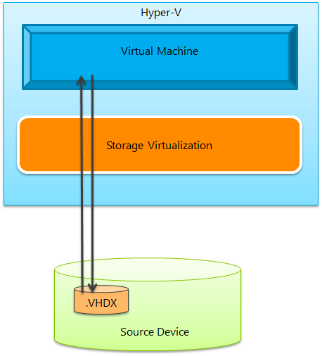
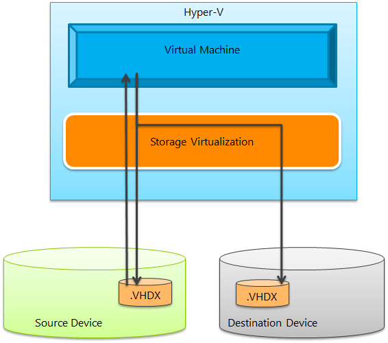
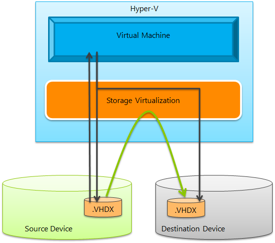
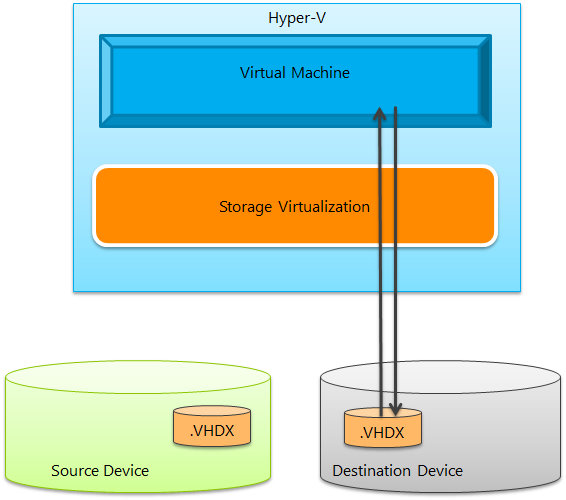
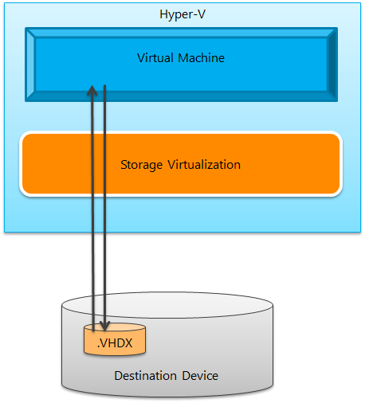

The process followed by Hyper-V internally to perform a storage migration is actually quite simple to explain and is as follows:

**Step 1:** Start with a virtual machine that is reading and writing to a virtual hard disk file (.VHDX in the diagram, but storage migration is supported for both .VHDX and .VHD files).

**Step 2:** After the user selects to perform a storage migration, immediately create a new virtual hard disk in the requested destination. Continue to read and write to the source virtual hard disk – but any new write operations are also mirrored to the new virtual hard disk.

**Step 3:** Perform a single pass operation to copy the data from the source virtual hard disk to the destination virtual hard disk. While this copy is happening, it still continues to mirror writes to both disks. It also keep track of uncopied blocks that have already been updated through a mirrored write – and make sure to not needlessly copy that data again.

**Step 4:** Once the copy operation is complete – it switch the virtual machine to be running only on the destination virtual hard disk.

**Step 5:** Delete the source virtual hard disk and the migration is now complete.

One important note to make here – Microsoft are very careful to not delete the source virtual hard disk until after the virtual machine is successfully running on the destination virtual hard disk. This way if there is an error at any point in the storage migration – we can always fail back to running off of the source virtual hard disk.

Cheers,

**Marcos Nogueira**
[azurecentric.com](http://azurecentric.com)
Twitter: [@mdnoga](http://www.twitter.com/mdnoga)
