Usually for social media automation I used for a long time IFTTT, although with Azure Logic Apps I decide to give a try. I started to use Azure Logic Apps for a project not long time ago, and my experience was really good. So, I decide to apply to my personal life to see how it goes.
First I use my Azure Subscription to create the Logic Apps.

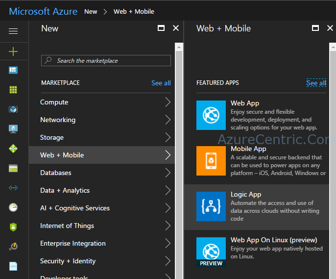

Then you have to fill all the information. In this case I created a new Resource Group, so in case I don’t want to use it, it’s the simple way to remove it. You just need to remove (in this case, delete) the Resource Group (RG) and everything on the RG will be gone.

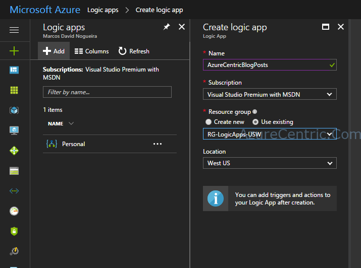

From this step, your logic apps are ready to be configure.

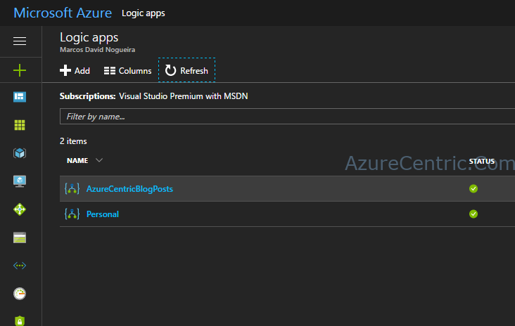

So, lets configure the Logic Apps. First we need to go the Logic App Designer to start to create our logic. It’s a very simple process. In this example, I want every blog post to be published on different Facebook pages that I manage and I usually publish my blog post.

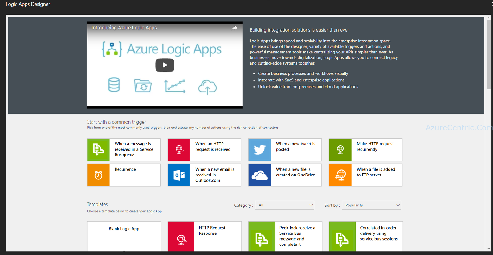

First step is to grab all the new posts from my blog to be published on Facebook pages. So in this example I will use a Blank Logic App. You have lot of templates that you can use, that are already prebuild and you have just to enter the right information. But I will complicate this time, just for you to see how simple it’s to create a Logic App in Azure.

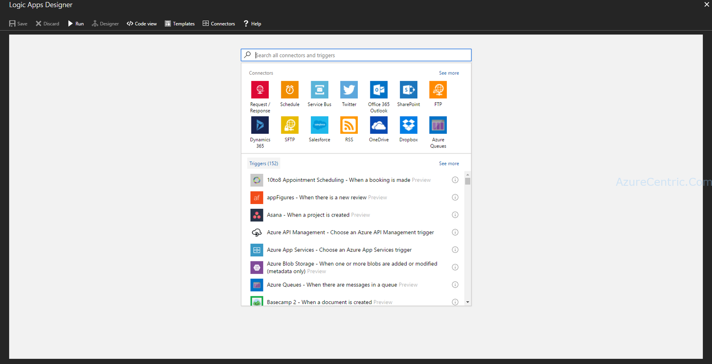

Because my blog is in WordPress on Azure, I have to look for the WordPress connector.

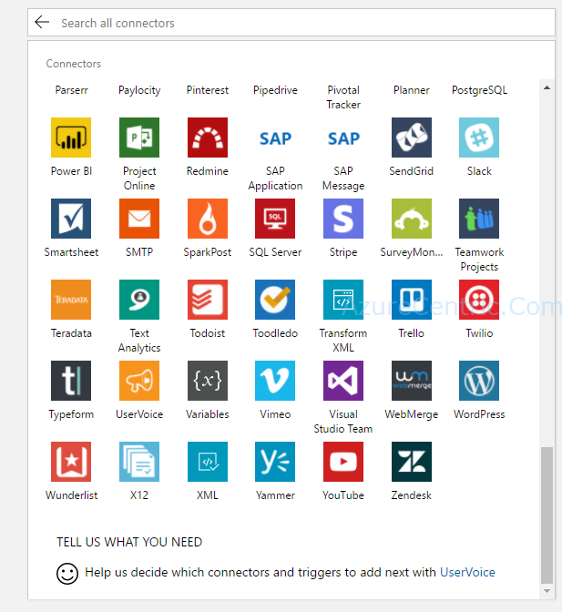

When you select the WordPress connector appears all the action/triggers that you have available with that connector.

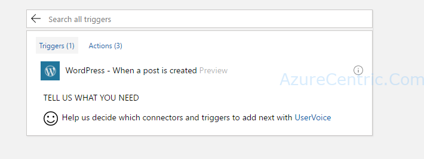

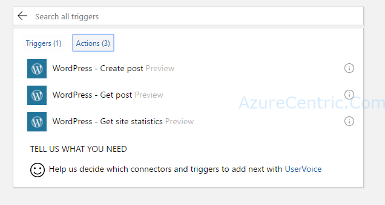

For this propose I will select the trigger “WordPress – When a post is created”. I want every post that I created as the trigger for this Logic App. Next, you should configure the frequency and the interval when this trigger will run. So, I decide to run every 3 hours.

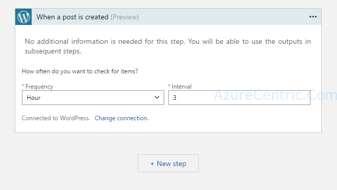

**Note:** Because I already created before a WordPress activity on other Logic Apps, I didn’t need to configure the connection to WordPress. But it’s really simple, what you have to do is simple login in on WordPress on the separate window, that will open automatically, and that is it.

As the next step, I configure the actions that I want as a result of the new post created.

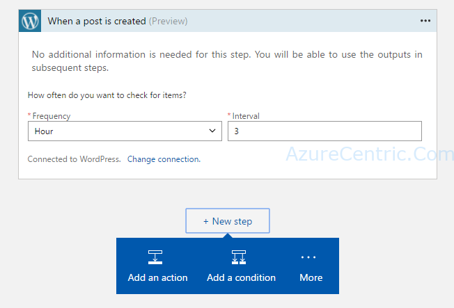

Lets look for the Facebook connector. Because I want to proceed on my flow of my Logic Apps I select the Action instead of the trigger actions. In this case, I select the “Facebook – Post to page” action.

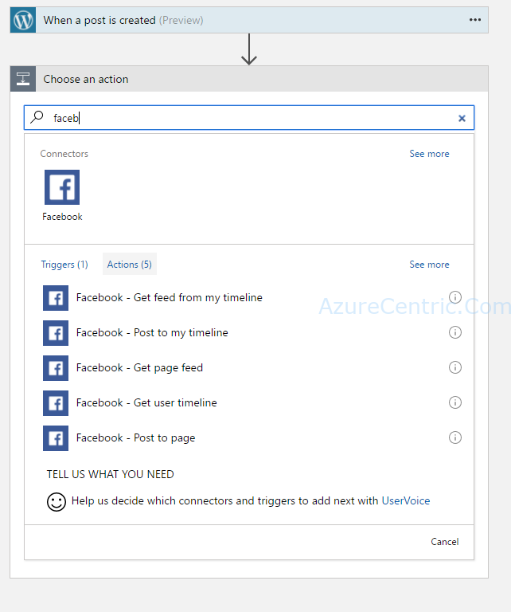

Because you are linking all of this activities, when you click on the cell to fill the information, you can decide to use the dynamic content or the values that you want to insert. Just be aware, if you decide to insert manually the value, every time this Logic App run, will use the same value.

I love to use this Dynamic Content, because I can make this Logic App, way more automated.

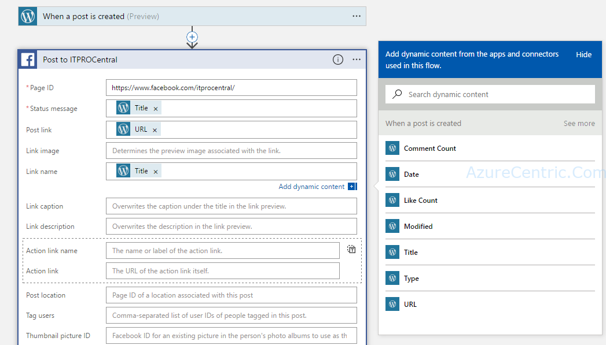

That is it! I just configure this Logic App.

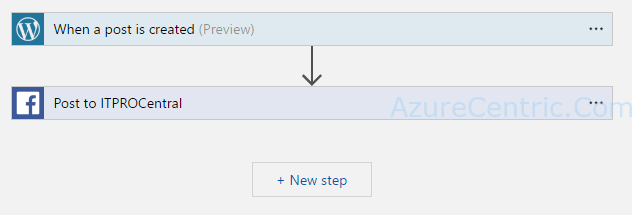

The last step is save the Logic App. After that you click on the Run Trigger, to start the Logic App.

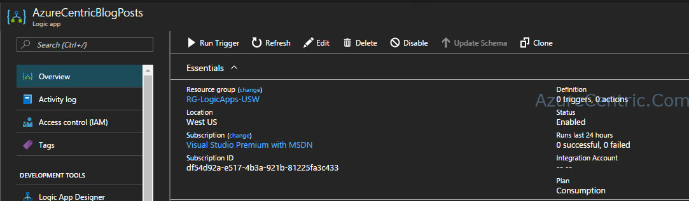

BTW, this post was the first one to be published on Facebook using the Logic Apps.

Cheers,

**Marcos Nogueira**
[azurecentric.com](http://azurecentric.com)
Twitter: [@mdnoga](http://www.twitter.com/mdnoga)
