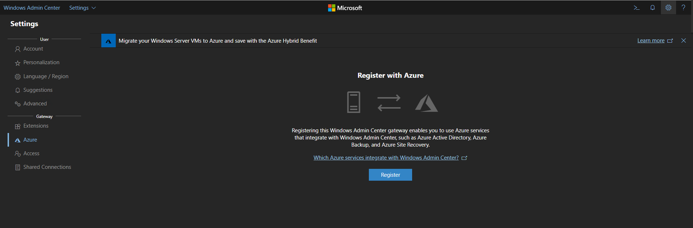
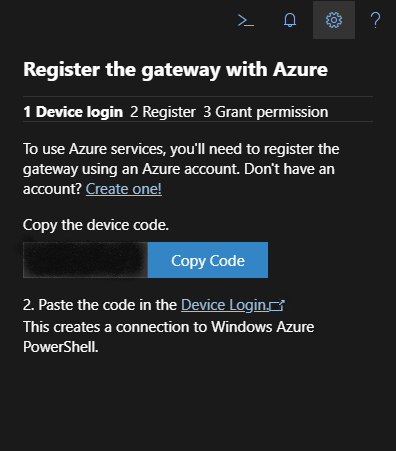
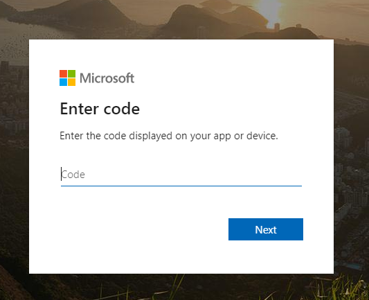
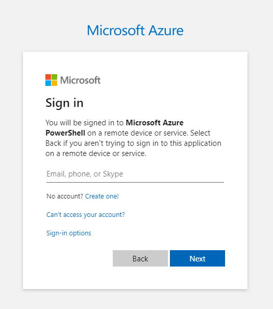
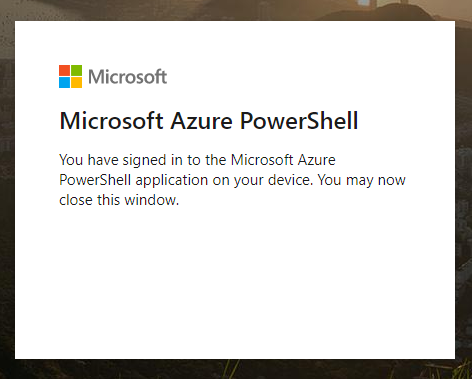
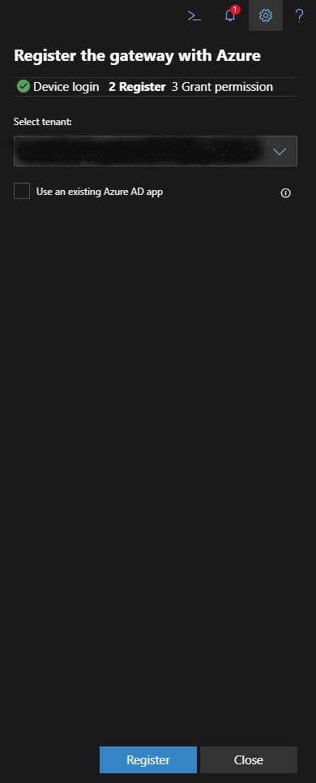
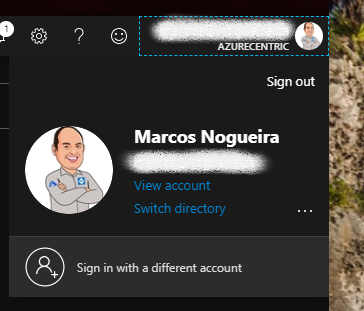
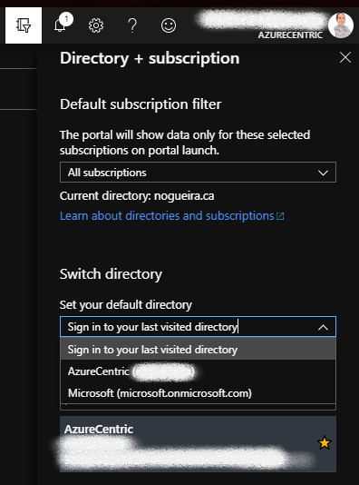
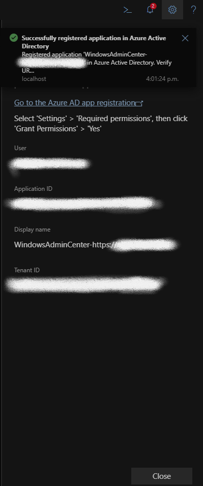

When I start a project with a new costumer and the conversation ends how to manage your workloads either On-Premises or on Azure, I always like to add the Windows Admin Center (WAC) as a topic on managing the workloads.

Since the early times of Windows Admin Center, I become completely addicted to WAC. I found really easy to work with and if you compare with the other native tool to manage servers (Yes, Server Manager), is way better, like night and day.

So, after you install the WAC, if you navigate to **Settings**, you will find the **Azure** configuration under **Gateway**. Then you need to click on
Register button to start the process.

After you click on **Register**, appear the device code that you need to register into your Azure Tenant. Copy the code (or click on **Copy Code** Button). I suggest you paste to a notepad temporally. 

Then you need to click on the **Device Login** url, mentioned on step 2.

After you click on the **Device Login** link, it will appear the window to enter the Device Code, previously provided. Paste the code and then click on **Next**.

Now you need to enter the credentials to connect the WAC with Azure. Type your email address and then the password. Then click **Next**.

After login with the valid credentials, you are almost done on register your Device as a trust device to manage the workloads with WAC and connecting to Azure Services.

Now that you register the device, you need to configure the permissions. This step you need to choose the right Azure Tenant. If you have only one Azure Tenant assign to your account, then you just click **Register**.

 

If you have more than one Azure Tenants associated with your account, you need to verify what Azure Tenant you want to grant permissions. At the present moment, WAC only shows the ID of the Azure Tenant. Assuming that you don’t memorized the ID of your Azure Tenant, this is the way that I recommend validating what is Azure Tenant ID that you want to grant permissions your WAC with Azure. 

Login at the Azure Portal, and at the top right corner you will find your credentials. Click on the credentials, and then click on the **Switch Directory** link.

When you clicked on **Switch Directory**, it will expand the **Directory + Subscription**. Then, under Switch Directory, use the dropdown to view what Azure Tenants you have associated. If you select the right one, you will be able to see the Azure Tenant ID. Verify if the same ID appears on the WAC. Then Click **Register**.

Cheers,

**Marcos Nogueira**  
**_Azure MVP_**  
[azurecentric.com](http://azurecentric.com)  
Twitter: [@mdnoga](http://www.twitter.com/mdnoga)
