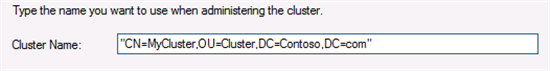

In Windows Server 2012 there have been several enhancements to how Windows Server Failover Clusters integrate with the Active Directory.  In this post we going to discuss some of the changes to help enable creating Failover Clusters in restrictive Active Directory environments where permissions to create computer objects is delegated to specific organizational units (OU).

In Windows Server 2008 R2, Failover Clustering created computer objects in the Active Directory under the default Computers container for cluster Network name resources.  In Windows Server 2012 this has changed to enable greater flexibility when setting up a Failover Cluster.

## **Cluster Name Object (CNO)**

The CNO is the computer object associated with the cluster network name resource called “Cluster Name” that is created during initial setup of the cluster.  Before running Create Cluster one of the requirements is that all nodes be members of a domain.  Since all nodes are domain joined and have corresponding computer objects, the OU in which the nodes computer objects reside in is used as the location to create the CNO.  If you had permissions to setup the node computer objects, then this will enable creating a cluster to ‘just work’ with no additional considerations needed.  The default setup experience now has better heuristics.

For increased flexibility, if you wish to create the CNO in a different OU location, now with Windows Server 2012 you can do so by specifying the full distinguished name during either the Create Cluster wizard in Failover Cluster Manager or through the **New-Cluster** PowerShell cmdlet.  The distinguished name includes the path to the OU under which you would like the computer object created.

## **Specifying a Custom OU with Failover Cluster Manager:

To create a cluster with the Failover Cluster manager Create Cluster wizard and for example have the CNO placed in the OU named "Cluster":



### **Specifying a Custom OU with PowerShell:**

To create a cluster via PowerShell and for example have the CNO placed in the OU named “Cluster” it would be in the following syntax:
```powershell
New-Cluster -Name CN=MyCluster,OU=Cluster,DC=Contoso,DC=com -Node node1,node2
```
### **Virtual Computer Object (VCO)**

The VCO is the computer object associated with all other cluster network name resources that are created for highly available roles on the cluster.  This would include roles such as for a highly available File Server or SQL Server for example.

The VCO’s will all be created in the same OU in which the CNO currently resides at creation time.

## **Additional Information:**

The user credentials of the currently logged on user who is creating the Failover Cluster will be used to create the computer objects in Active Directory.The user must have Create Computer Objects permissions to the OU to create the computer objects.  Additionally, the CNO must have Create Computer Objects privileges in the OU it currently resides in to be able to create VCO’s.

If you do not have Create Computer Objects permissions, your domain admin can manually pre-stage the CNO and VCO computer objects.  If you wish to move the CNO or VCO’s to a different location than the one they are originally created in, it is safe to do so without impacting the functionality of the Failover Cluster.

Font: [http://blogs.msdn.com/b/clustering/archive/2012/03/30/10289577.aspx](http://blogs.msdn.com/b/clustering/archive/2012/03/30/10289577.aspx)

Cheers,

**Marcos Nogueira**
[azurecentric.com](http://azurecentric.com)
Twitter: [@mdnoga](http://www.twitter.com/mdnoga)
