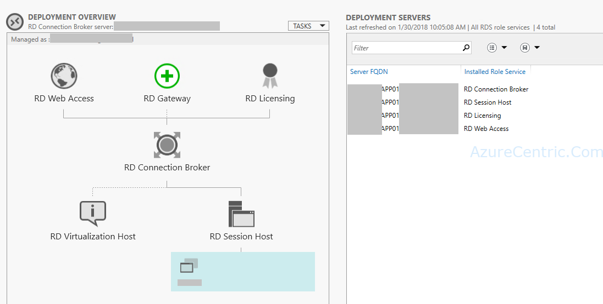
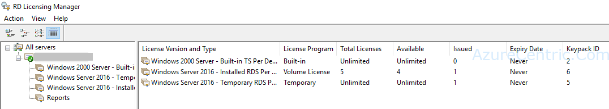
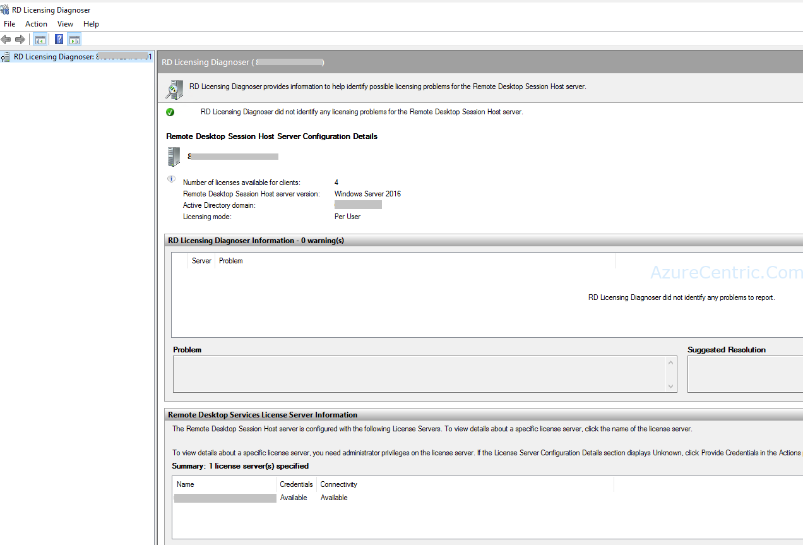
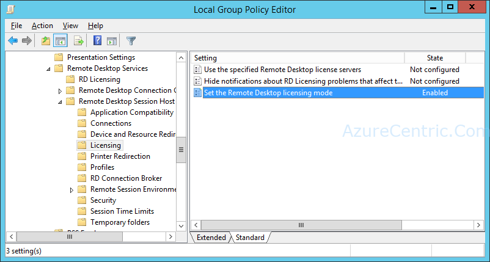

In some organization, it’s common practice to have a jump server in Azure to be used, specially when you have several tools that need to run **“locally”** on the server. Usually this machine is on a segregated network and not domain join.

Although, if you enable RDS licenses to have more than the 2 normal RDP sessions that a Windows Server 2016 give to us, you probably will see some similarity with the following scenario.

You increase the number of the simultaneous RDP connections to 5. The VM hosted in Azure is running Windows Server 2016. You can see the 5 CALs installed and deployed.

Although when you remote in, you can see that you are using 1 of the 5 RDP licenses.

But when the 3rd person try to RDP in, it doesn’t allow him.

## **How to solve this issue?**

Please follow the steps below to correctly configure your RDS deployment with the new RDS CAL:
1. Edit the RDS deployment properties 
  1. **Server Manager** > **Remote Desktop Services** > **Overview** > **Deployment Overview** > **Tasks**> **Edit Properties Deployment** > **Licensing/License Manager pane** (from the left area) > please confirm that your RD Licensing Server is added and the RDS Licence type (per user or device) is checked
2. It’s recommended to force these settings via Group Policy using Domain GPO if the machine is member of AD Domain. Open the GPMC.Msc snap-in can help you do that or Local Group Policy if this is a Standard Server member of a Workgroup (GPEdit.msc snap-in must be used). please follow the group policy settings paths listed below to perform these actions:

3. To force using a specific RD Licensing Server (in your case it will the same server: **Computer Configuration** > **Administrative Templates** > **Windows Components** > **Remote Desktop Services** > **Remote Desktop Session Host** > **Licensing** > **Use the specified RD License Servers** > open the dialog box and enter your RD licensing server name
  1.  To force using a specific RDS license type (Per-User or Per-Device RDS CAL): **Computer Configuration** > **Administrative Templates** > **Windows Components** > **Remote Desktop Services** > **Remote Desktop Session Host** > **Licensing** > **Set the Remote Desktop Licensing mode** > open the dialog box and tick and license type of the RDS CAL you already bought.   
4. Finally, refresh the Group Policy engine and try to connect to your RD Session server (at least make three simultaneous connection and then open RD Licensing Manager to check if new RDS CAL was successfully attributed.

Cheers,

**Marcos Nogueira**  
**_Azure MVP_**  
[azurecentric.com](http://azurecentric.com)  
Twitter: [@mdnoga](http://www.twitter.com/mdnoga)
