After a few times deploying a Windows Virtual Desktop (WVD) infrastructure on Azure, I always found that sometimes you have the necessity to reset your environment, specially if this is your test environment.

After a few tries on resetting the environment I develop the following process that allows me to reset in a few minutes. The process is simple. You just need to remove the virtual machines crested, the Application group(s), the Session Host servers and the Host Pool.

The Virtual Machines created on the moment of the deployment of your environment is simple to remove. If you follow the best practices of create an empty Resource Group, you just need to delete the Resource group. Although there are some services/resources on the background that you need to delete as well, like the Application groups, Session Hosts and the Host Pool. At the present moment, you can’t do it through the Azure Portal, so the only option is PowerShell.

You can either use the PowerShell on your desktop or the use the CloudShell on Azure. 

## 1 – Login on Windows Virtual Desktop Tenant

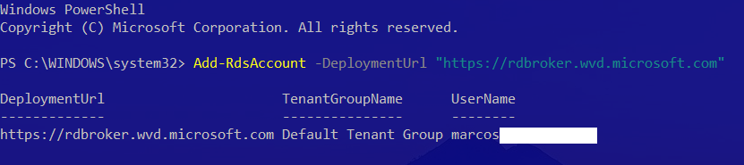

## 2 - Validate the WVD Infrastructure

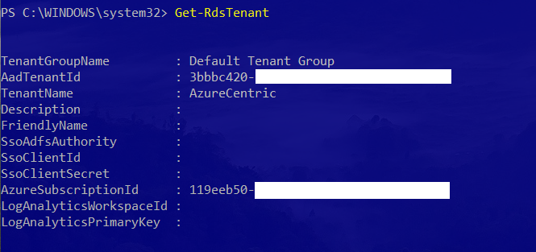

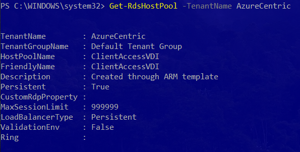

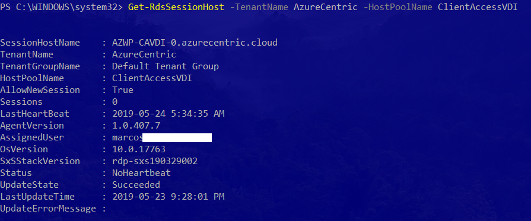

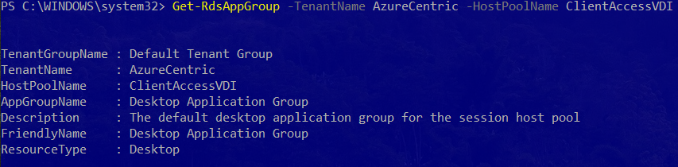

## 3 - Remove the Application Group(s)

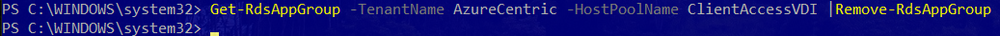

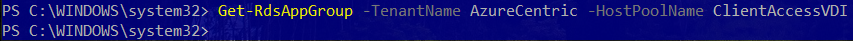

## 4 - Remove the Session Host servers

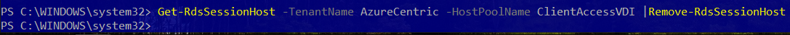

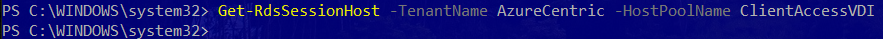

## 5 - Remove the Host Pool

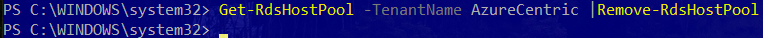

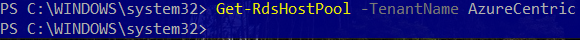

To simplify, here is the script that I created for this:

```powershell
    $TenantName="<TENANT_NAME>"
    $HostPoolName="<HOST_POOL_NAME>"
    
    #STEP 1 - Login on Windows Virtual Desktop Tenant 
    Add-RdsAccount -DeploymentUrl "https://rdbroker.wvd.microsoft.com" 
    #STEP 2 - Remove Application Group associated to the Host Pool 
    Get-RdsAppGroup -TenantName $TenantName -HostPoolName $HostPoolName |Remove-RdsAppGroup
    #STEP 3 - Remove Session Host servers associated to the Host Pool 
    Get-RdsSessionHost -TenantName $TenantName -HostPoolName $HostPoolName |Remove-RdsSessionHost
    #STEP 4 - Remove the Host Pool 
    Get-RdsHostPool -TenantName $TenantName -HostPoolName $HostPoolName |Remove-RdsHostPool
```

Cheers,

**Marcos Nogueira**  
**_Azure MVP_**  
[azurecentric.com](http://azurecentric.com)  
Twitter: [@mdnoga](http://www.twitter.com/mdnoga)
