Since when they announce the Azure Cloud Shell (see post [here](/posts/azure-cloud-shell)), I’ve been waiting to use the PowerShell on the Azure Cloud Shell. I’m still growing my learning how to use the Azure CLI, but PowerShell I’ve been using for years, and I feel way more comfortable with it.

So, how I can use Azure Cloud Shell? Just open the Azure Portal, and on the top bar, between the Notifications and the Settings you will find the Azure Cloud Shell icon  

 .

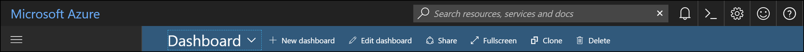

When you click on the icon, it will ask you to configure the Azure Cloud Shell. The process will provision machines, where you can run the shells (Azure CLI and Azure PowerShell). It’s a fairly simple process. Just follow the steps below.

1. Choose what is your Shell of choice. It doesn’t matter if you choose Bash or PowerShell. You can always switch back and forward after the initial setup.

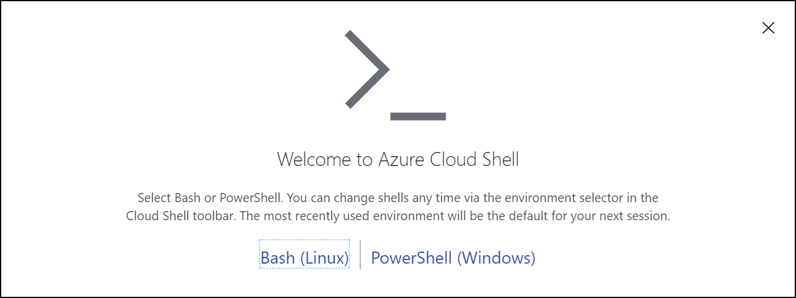
 	
2. Choose what is the subscriptions that you want to use. Then you have the simple option of creating the storage or click in **Show advanced setting**. In this case I opt for the advanced settings.

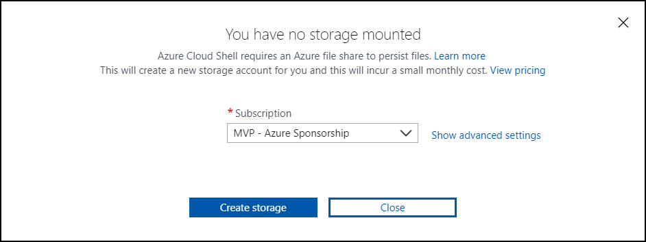
 	
3. On the Advanced setting, you can specify the Resource Group, Storage Account and File Share names that you want to use.

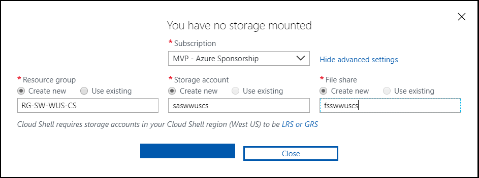

  **NOTE:** Just remember that you have to follow the requirements how to create storage account and file shares (small caps and alphanumeric characters).

4. In this case I select the Bash. After I click create, starting to provision the machines. First create all the resources from the previous step.

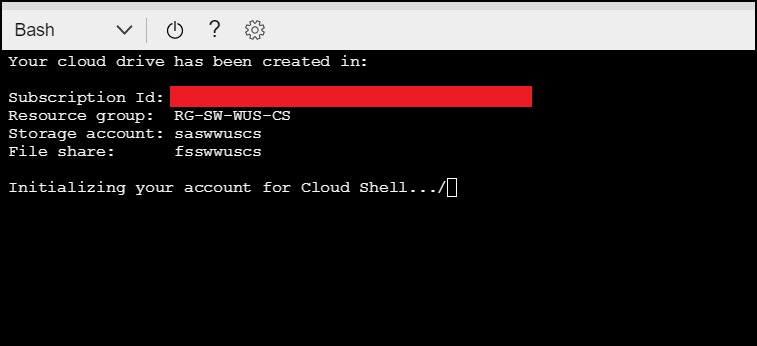
 	
5. After the creation of the resources, it’s connecting to the Bash terminal.

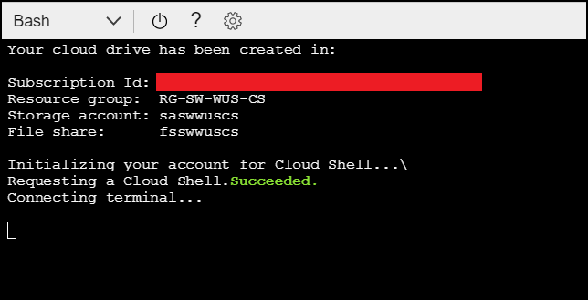
 	
6. And that is the end! Now you can start to use the Azure CLI on the Azure Portal.

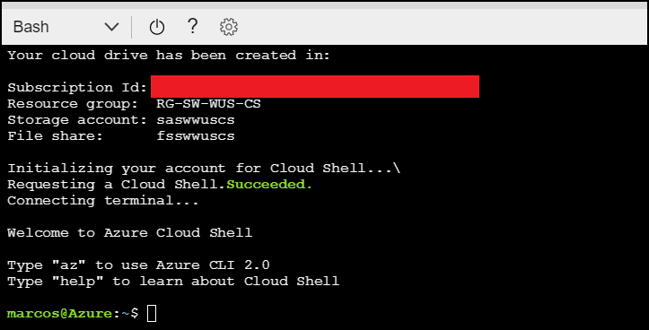

## Changing to PowerShell (or Shell)

After you create the Azure Cloud Shell, you can switch from Bash to PowerShell and vice versa. To do that, just follow the steps:

1. Click on the Shell that you are using. In this case I was using Bash. When you click the drop box, you will see the other Shell.

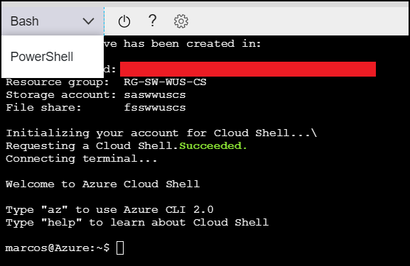
 	
2. Select the Shell that you want. In this case PowerShell, then click Restart.

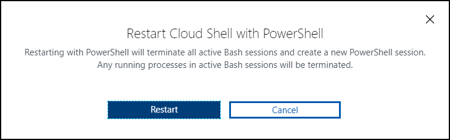
 	
3. After that, the Azure Cloud Shell is shutdown the previous Shell and it will restart on the new Shell (even if you never use it before).

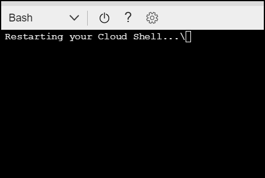
 	
4. Now it’s creating all the resources required for the first use.

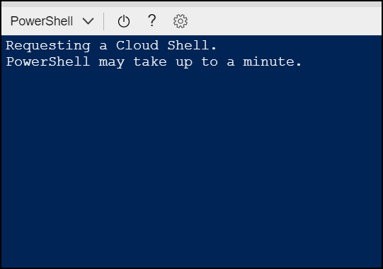
 	
5. After the creating of all the resources, it will connect to the terminal.

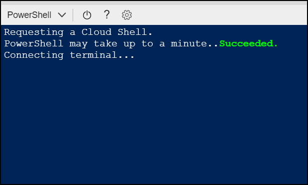
 	
6. Finished! Now you can you use the PowerShell on Azure portal.

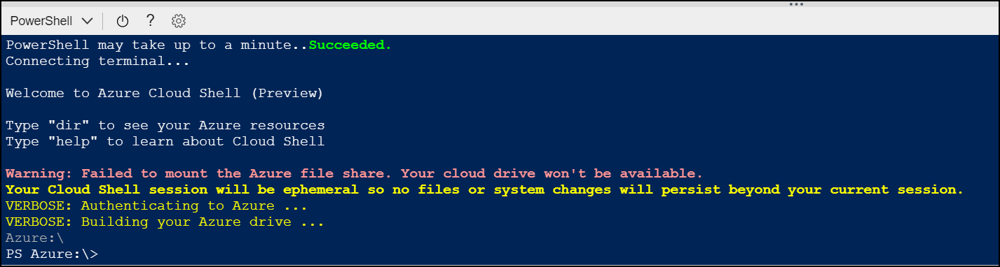

Because you are login at the Azure Portal, you don’t need to run the PowerShell command **_Login-AzureRm_**. You can start from there.

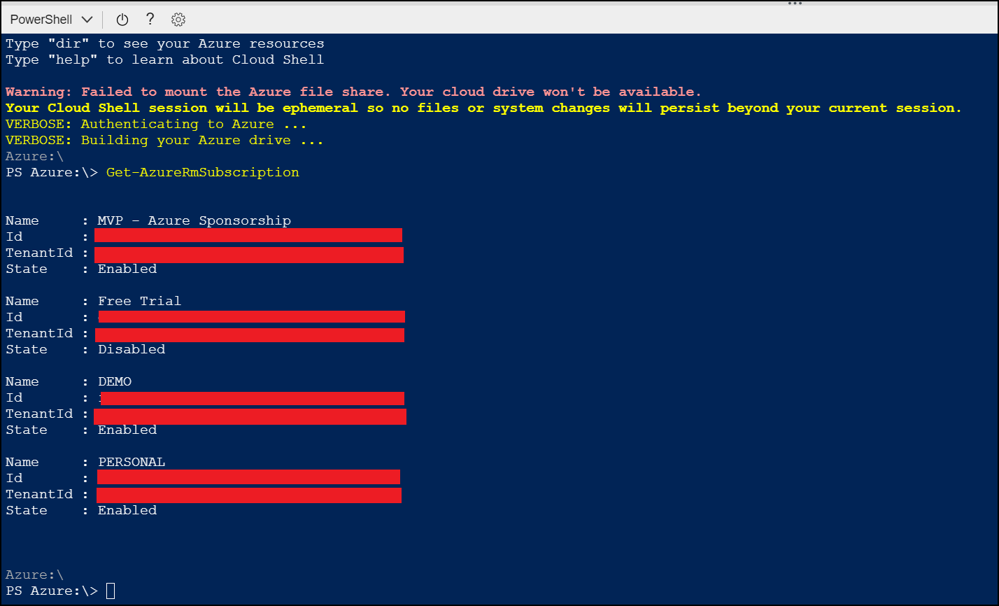

Cheers,

**Marcos Nogueira**  
**_Azure MVP_**  
[azurecentric.com](http://azurecentric.com)  
Twitter: [@mdnoga](http://www.twitter.com/mdnoga)
