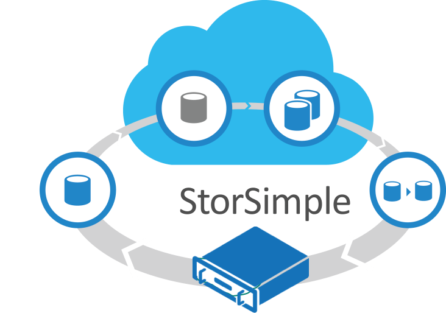

Cloud storage is the ideal way to handle the exploding demand for storage across industries. By moving data that is less frequently accessed to the cloud, you free up space on-premises while bringing down costs.

Microsoft Azure StorSimple is a hybrid cloud storage array that you can use to connect to Azure from your on-premises datacenter. A key feature is intelligent storage tiering, so that inactive or archival data is automatically moved to the cloud.

StorSimple is a great enterprise solution, because it connects seamlessly into your existing storage strategy. With StorSimple, you get cloud economics, automated data protection, and increased IT agility.

**Cloud economics:** Because cloud storage is dramatically less expensive than traditional storage options, you can easily bring down cost. StorSimple lets you:
  * Consolidate multiple distinct storage systems into a single hybrid cloud storage system
  * Add storage incrementally without having to rebalance application workloads
  * Take advantage of the lower cost of cloud storage for inactive and data-protection data

**Automated data protection:**  With StorSimple, you get a built-in data protection solution, which lets you:
  * Eliminate tape and all tape reliability problems and management hassles
  * Get very fast data protection at a far lower cost than replication solutions
  * Do instant recovery by utilizing synthetic full volume images
  * Test DR – something many IT teams can’t do for much of their data

**Increased IT agility:** Microsoft Azure StorSimple Manager consolidates storage management through an Azure portal. As a result, you save time by managing all storage arrays from a single point. You can now get near real-time status and updates for all StorSimple arrays.

Overall, IT teams save a lot of administrative time that can be used for business-driven technology instead of storage infrastructure.

Cheers,

**Marcos Nogueira**
[azurecentric.com](http://azurecentric.com)
Twitter: [@mdnoga](http://www.twitter.com/mdnoga)
