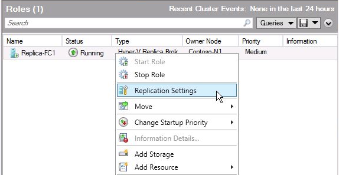
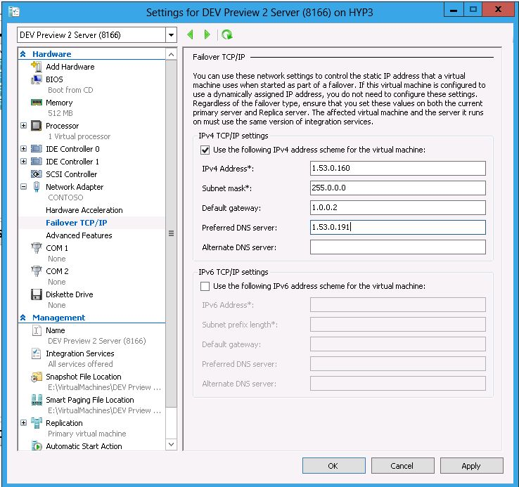
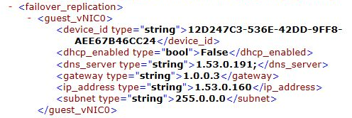

Failover Clustering has proven its value in making virtualized workloads highly available.  We saw this in Windows Server 2008 using Quick Migration and then in Windows Server 2008 R2 with the addition of Live Migration. Failover Clustering can also play an important role as a Replica Cluster.  To accommodate this, a new role has been added in Failover Clustering called the Hyper-V Replica Broker.  A new resource type, Virtual Machine Replication Broker, was added to support this new Role.

## Failover Replication Broker Architecture

The Hyper-V Replica Broker runs in a Replica cluster and provides a Replica server name (connection point (a.k.a.  Client Access Point (CAP))) for initial virtual machine placement when contacted by a Primary server. After a virtual machine is initially replicated to the Replica Cluster, the Hyper-V Replica  Broker provides the virtual machine to Replica Server (cluster node) mapping to ensure the Primary server can replicate data for the virtual machine to the correct node in the cluster in support of mobility scenarios on the Replica side (e.g. Live\Quick Migration, or Storage Migration).

The Hyper-V Replica Broker is used to configure the replication settings for all nodes in the cluster.  In standalone Hyper-V servers, the Hyper-V Manager is used to configure replication settings.  The Failover Cluster Manager is used to configure replication settings in the Replica cluster.  Using the **Hyper-V Replica Role**, Replication Settings across the entire cluster are set.

The replication settings are the same as those for standalone Hyper-V servers.

## Network Considerations for Hyper-V Replica Scenarios

There are scenarios where the Replica server, or Replica cluster, will reside at a Disaster Recovery (DR) site located across a WAN link and the DR site uses a completely different network-addressing scheme than the Primary site.  In this configuration, when virtual machines are failed over to a DR site, a new IP configuration will be needed for each network configured in the virtual machine.  To accommodate this scenario, there is built-in functionality in Hyper-V Replica where virtual machines network settings can be modified to include configuration information for a different network at a DR site.  To take advantage of this, the Hyper-V Administrator must modify the network configuration for each replicated virtual machine on the Replica server.  If connectivity to networks at the replica site is required, the settings for all networks a virtual machine is connected to must be modified. The Hyper-V Administrator can provide both IPv4 and IPv6 configuration information for a virtual machine. The **Failover TCP/IP** setting, which is available after replication is enabled for the virtual machine, is used to provide the network configuration information in the virtual machine.

The addressing information provided is used when a **Failover **action (**Planned Failover** or **Failover**) is executed.  The configuration of the Guest virtual machine IP settings in this manner only applies to Synthetic Network Adapters and not Legacy Network Adapters.  The operating system running in the Guest virtual machine must be one of the following - Windows Server "8" Beta, Windows Server 2008 R2, Windows Server 2008, Windows Server 2003 SP2 (or higher), Windows 7, Vista SP2 (or higher), and Windows XP SP2 (or higher).  The latest Windows Server "8" Beta Integration Services must be installed in the virtual machine.

The information is reflected in the virtual machine configuration file located on the Replica server.

Cheers,

**Marcos Nogueira**
[azurecentric.com](http://azurecentric.com)
Twitter: [@mdnoga](http://www.twitter.com/mdnoga)
