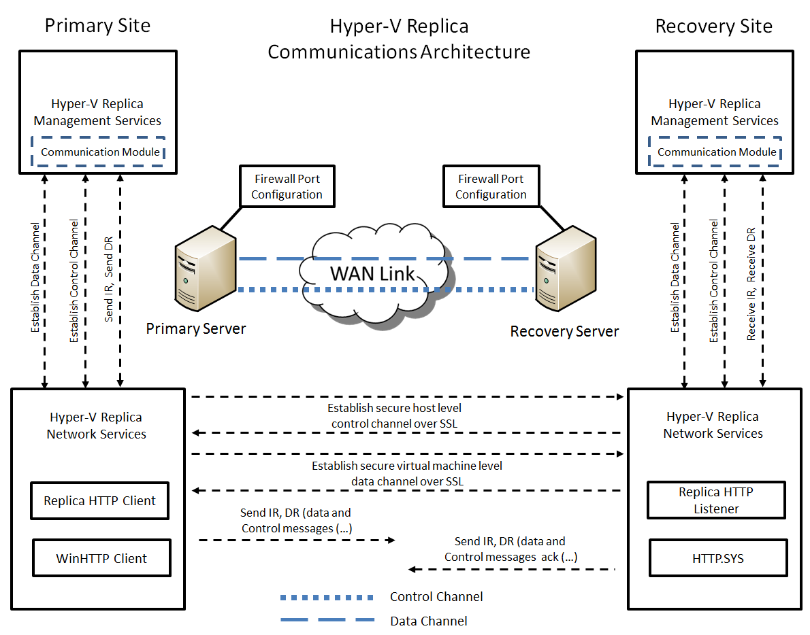
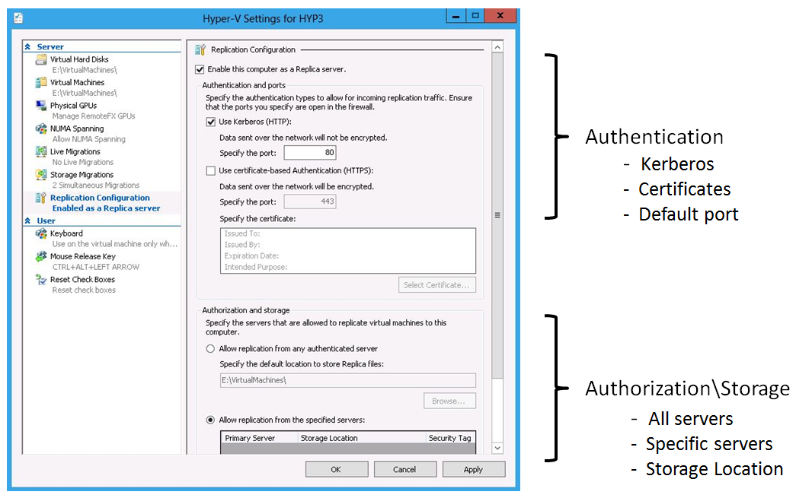
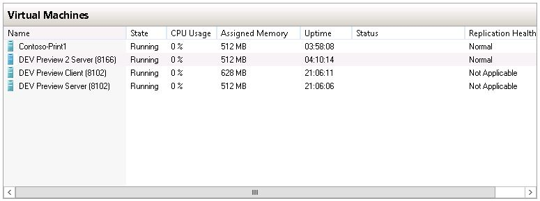
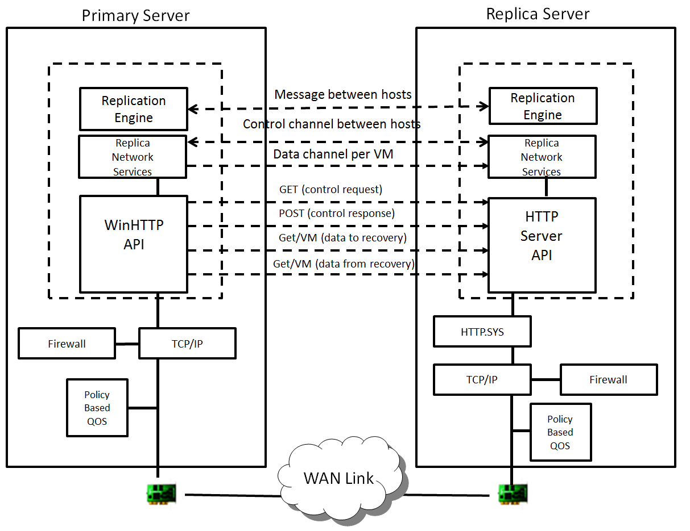

## **Hyper-V Replica Communications Architecture**

The Hyper-V Replica communications architecture is implemented at the Hyper-V Replica Network transport layer.  This layer provides a bi-directional transport channel based on the HTTP Client-Server model to send virtual machine replicas and control messages between Primary and Replica servers.  Replica Network Services is responsible for authorizing access to a Replica server and mutually authenticating the Primary and Replica servers.  It also provides the ability to encrypt and compress data that is sent by the primary server. In summary, Replica Network Services provides a secure, authorized, authenticated and efficient network transport channel for replicating virtualized workloads between Hyper-V servers.

Hyper-V Replica Network Services supported features include:
  * Authorizing the Primary server on the Replica server
  * Mutual Authentication using certificates  (HTTPS server)
  * Mutual Authentication using Kerberos (HTTP server)
  * Encryption of data stream(s) if certificates are being used for authentication
  * Compression of data stream(s)
  * Partial network throttling using Quality of Service (QOS) Policy
  * Directing replication to a particular port based on Hyper-V Replication configuration and port configuration in the firewall.

Some of the supported features are visible in the configuration interface for the Replica Server.

Encryption of communications between Primary and Replica sites is not enabled by default.   If Windows Integrated Authentication (Kerberos) is selected, the Kerberos encrypt function is not used by Hyper-V Replica.  This method uses the Windows Security Support Provider Interface (SSPI) to generate the message exchange between the Primary and Replica server.  Kerberos authentication for services is achieved by using Service Principal Names (SPNs).  Hyper-V Replica Network Services creates and registers a new SPN (Service Principal Name) for which the service class is 'Hyper-V Replica Service'.  If encryption is desired, then Certificate-based Authentication should be selected allowing the underlying SSL layer to encrypt the packets using a selected certificate.
  **Note:** A valid X509v3 digital certificate is required for Mutual Authentication using certificates.

Once the Replica server configuration is completed, communications between a Primary and Replica server do not commence until a virtual machine hosted on the Primary server is configured for replication.  Before this happens, the **Replication Health** (if displayed) for a virtual machine is **Not Applicable**.  Each virtual machine hosted on a Primary server must be individually configured for replication using the **Enable Replication **wizard.   Once configured, the **Replication Health** for a virtual machine changes to **Normal**.

Once reliable communications are established between a Primary and Replica server, control and data messages are exchanged.

## **Send Message Process**

The Hyper-V Replica Network Services layer creates a control channel to send and receive control messages from the Primary to the Replica server.  Hyper-V Replica Network Services first checks to see if a control connection already exists.  If one does, the connection is used.  If one does not, a new connection is created and stored in an internal table.  Hyper-V Replica Network Services then generates a packet for the control message and sends it across the network to the Replica server.  Hyper-V Replica Network Services on the Replica server forwards the package to the Hyper-V Replica Replication Engine (RE), which acts upon it and sends a response back within a timeout interval (120 seconds).  Unlike data packets, control packets are not chunked or compressed.  Furthermore, the control channel messages are synchronous and therefore there is no retry logic built into Hyper-V Replica Network Services for control channels if a connection fails.

## Send Data Process

Once a session is established with a Replica server and control packets have been successfully exchanged, the Hyper-V Replica Replication Engine will start transferring data from the Primary to the Replica server for the configured virtual machine based on the virtual machine ID (GUID).  The Hyper-V Replica Network Services layer will check if a data connection exists for the virtual machine to the Replica server and use it.  If it does not, a connection is created and the connection information is stored in an internal table.  Before any data is sent, a control packet is sent to the replica server that contains a list of files that will be sent from the Primary server. The Replica server response contains information about which, if any, of the files already exist.  The Hyper-V Replica Replication Engine on the Primary server will use the network interface provided by the Hyper-V Replica Network Service to send the data (files).  These files will be either for an Initial Replication (IR) or for a Delta Replication (DR).  The Hyper-V Replica Network Service layer chunks the data (2 MB chunks) and compresses the data.  The data is encrypted if using the Mutual Authentication scheme involving certificates.

Once the chunks of data are received by the Hyper-V Replica Network Service layer on the Replica server, they are decrypted, deflated, and glued back together and placed in the location that was provided in the virtual machine configuration. Once the entire payload is received, the Hyper-V Replica Network Service on the Replica server notifies the Replication Engine on the Primary that the transfer has been completed.

If a virtual machine migration occurs while a data transfer is in progress, the Hyper-V Replica Network Service will clean-up any existing connections and reinitiate the connection to the Replica server without any manual intervention once the migration is completed.  Once a connection is available, the Hyper-V Replica Network Service will send the same replica that may have been interrupted because of the migration.  This is accomplished by doing a file comparison on what is already available on the Replica server against the files that need to be sent by the Primary server.

If a storage migration in the Primary server occurs while a data transfer is in progress, the Hyper-V Replica Network Service will stop sending any replicas to the replica server until the migration is completed and the data channel has been cleaned up. Once a migration completes, the Hyper-V Replica Network Service re-opens the connection to the Replica server and sends the same replica that had not been sent already. This is accomplished by doing a file comparison on what is already available on the Replica server against the files that need to be sent from the Primary server.

Data channels are persistent channels between Primary and Replica servers.  Control channels, on the other hand, are short lived.  To persist the data channel in an environment where 'proxies' potentially exist, an echo process has been put in place.  Most 'proxies' allow for a 120-second 'keep-live' for a connection.  To persist the data channel between a Primary and Replica server, echo packets are sent every 90 seconds.   A Data channel is torn down when replication is paused, replication is removed for a virtual machine, or a virtual machine enabled for replication is deleted.

## Retry Logic for Delta Replication

In addition to a connection timeout default (120 seconds), there is built-in retry logic within the Hyper-V Replica Network Service when a DR is occurring.
<table cellpadding="0" cellspacing="0" border="1" >
<tbody >
<tr >

<td width="318" valign="top" >

**RETRY LOGIC**

</td>

<td width="444" valign="top" >

**INTERVAL**

</td>
</tr>
<tr >

<td width="318" valign="top" >Network Error
</td>

<td width="444" valign="top" >Exponentially increase the retry interval from start of first attempt at DR (1, 2, 4, 8, 10 minutes).   If network error persists, retry every 30 minutes.
</td>
</tr>
<tr >

<td width="318" valign="top" >Replication Paused\Low disk Space on the Replica server
</td>

<td width="444" valign="top" >This is a case where replication has been paused for a virtual machine or the Replica server is running low on disk space.  Retries occur every replication interval or when the user manually triggers a replication (Resume Replication).  Check the Hyper-V VMMS\Admin log for additional information.
</td>
</tr>
<tr >

<td width="318" valign="top" >Network Error - Replica Broker
</td>

<td width="444" valign="top" >If the Replica server is a Hyper-V Failover Cluster and the Replication Broker role is configured, retries occur at 1, 2, and 3 minutes.  Failing to start a DR, the Replica Broker is re-contacted to determine the correct location of the Replica server.
</td>
</tr>
<tr >

<td width="318" valign="top" >Non-Recoverable Error
</td>

<td width="444" valign="top" >Virtual machine **Replication Status** will be shown as **Critical - suspended** and administrator intervention is required.  Examples would include a broken VHD chain or the Replica virtual machine is in an invalid state.
</td>
</tr>
<tr >

<td width="318" valign="top" >Network Authentication Error
</td>

<td width="444" valign="top" >This is a non-recoverable error and no retires will be attempted. An event log message is registered and administrator intervention is required.
</td>
</tr>
<tr >

<td width="318" valign="top" >Authorization Error
</td>

<td width="444" valign="top" >This is a non-recoverable error and no retires will be attempted. An event log message is registered and administrator intervention is required.
</td>
</tr>
<tr >

<td width="318" valign="top" >Virtual Machine not found
</td>

<td width="444" valign="top" >In the case of a standalone Hyper-V server, this is a non-recoverable error and administrator intervention is required. If the Replica server is a Hyper-V Failover Cluster with the Replica Broker configured, the same logic is applied as indicated above (Network Error - Replica Broker).
</td>
</tr>
<tr >

<td width="318" valign="top" >Low memory condition
</td>

<td width="444" valign="top" >If a low memory condition occurs on the Primary server, the retry logic is the same as indicated above for Paused Replication.
</td>
</tr>
<tr >

<td width="318" valign="top" >Cancel\Pause from Primary Server
</td>

<td width="444" valign="top" >There is no retry logic in this case.
</td>
</tr>
</tbody>
</table>

Cheers,

**Marcos Nogueira**
[azurecentric.com](http://azurecentric.com)
Twitter: [@mdnoga](http://www.twitter.com/mdnoga)
