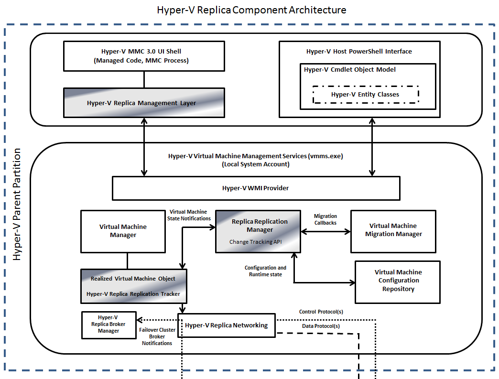
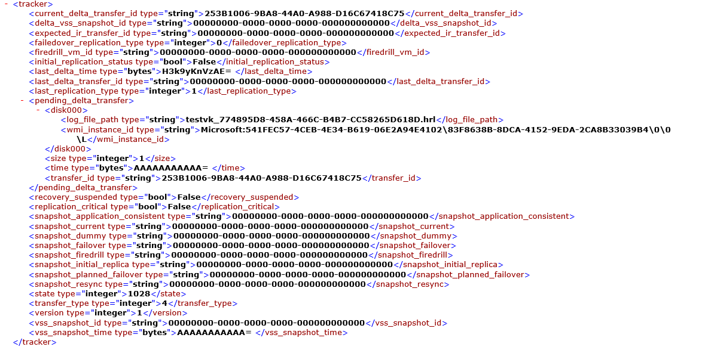

As already mentioned, Hyper-V Replica is new functionality that is included as part of the Hyper-V role in Windows Server 2012.  The main components are:
  * Hyper-V Replica Management Interface
  * Hyper-V Replica PowerShell Objects
  * Hyper-V Replica WMI API
  * Hyper-V Replica Replication Manager (RM)
  * Hyper-V Replica Replication Tracker (RT)
  * Hyper-V Replica Networking
  * Hyper-V Replica Broker Manager

## Hyper-V Replica Management Layer

The Hyper-V Manager interface is used to configure, manage, and monitor Hyper-V Replica. Hyper-V Administrators use Hyper-V Manager to perform selection, configuration, provisioning, failover, and test failover operations monitoring, and reporting activities for virtual machines.  All Hyper-V Replica management is built exclusively on WMI.

## Hyper-V Replica PowerShell Objects

The Hyper-V Replica PowerShell interface is an implementation of the “Admin Task Model” and allows Hyper-V administrators to accomplish administrative tasks in managing configuration, provisioning, failover, test failover, operations monitoring, and reporting activities using PowerShell scripts. The Replica PowerShell objects are built exclusively on the Hyper-V Replica WMI (Windows Management Interface) API.

## Hyper-V Replica WMI API

The Hyper-V Replica WMI API is part of the Hyper-V WMI provider and provides programmability of the underlying stack. Remoteable UI (using Windows Server 2012 Remote Server Administration Tools (RSAT)) and PowerShell are achieved by integrating with the Windows Remote Management Client and Listener (WinRM).The Hyper-V WMI Provider communicates SOAP (Simple Object Access Protocol) Messages using the WS-MAN (Web Services-Management) protocol with the Virtual Machine Management Service (VMMS) that runs on the remote Hyper-V Host. For more details on the WMI provider, refer to [WMI Architecture](http://msdn.microsoft.com/en-us/library/aa394553(VS.85).aspx). For more details on the remoting architecture, refer to [Windows Remote Management Architecture](http://msdn.microsoft.com/en-us/library/aa384464(VS.85).aspx).

## Hyper-V Replica Replication Manager (RM)

The Virtual Machine Management Service (VMMS) is a collection of management components that manage virtual machines on the host computer system. VMMS follows an object model where subsystems have a singleton manager class that is activated by the Service Module.  Hyper-V Replica components plug into the VMMS object model.  The Hyper-V Replica Replication Manager is a component that plugs into the Hyper-V architecture and is responsible for interacting with Hyper-V to implement an efficient virtual machine level change tracking mechanism.

This Hyper-V Replica Replication Manager object registers for migration and AVHD (differencing disk) reference count notifications, and it monitors the internal Hyper-V state through queries and callbacks. It stores and retrieves per virtual machine configuration and runtime state. The Replication Manager manages all the metadata describing each protected virtual machine and interacts with the Virtual Machine Configuration Repository to store metadata.  The metadata includes:
  * Configuration metadata including Standard-replica and Application-consistent replicas, encryption, compression, and source to destination storage mappings
  * The collection of virtual machines running on a Primary server.  For any given virtual machine, all replicated Virtual Hard Disk (VHD) path information
  * Current replica state (information about the last successful Application-consistent or Standard replica recovery point replication event)

The Hyper-V Replica Replication Manager implements all the handlers for initial replication, failover, and test-failover tasks. It initiates and tears down the sequence for initial replication (IR) (in-band or out-of-band), delta replication (DR), failover, and test failover testing. Hyper-V Replica Replication Manager is responsible for scheduling repetitive and one-time tasks and managing the status of these tasks. The following task handlers are implemented:
  * Initial Replication handler
  * Delta Replication handler
  * Failover handler
  * Failback handler
  * Test Failover handler

The Hyper-V Replica Replication Manager handles all virtual machine lifecycle change events in support of virtual machine mobility scenarios (cluster failover, live migration, Export-Import, etc…).  To accomplish this, the Replication Manager registers for synchronous callbacks from the Virtual Machine Migration Manager for migration events. These are required so the Replication Manger can quiesce and suspend replication processes before migration begins.  Conversely, the Replication Manager resumes replication when migration has been completed or cancelled. The Hyper-V Replica Replication Manager interacts with Hyper-V and the Hyper-V Replica Change Tracker to implement the core of the replication tasks.  This combination of functionality is referred to as the Hyper-V Replica Replication Engine (RE).  The Hyper-V Replica Replication Engine:
  * Exposes private API’s to the handlers in the Replication Task Manager that initiate the call sequence for IR and DR.
  * Implements a virtual machine lifecycle change tracking mechanism that notifies the Replication State Manager whenever the virtual machine configuration changes in a way that affects the replication sequence. Examples of this include a failover of a virtual machine from one primary to another when deployed in a clustered configuration.
  * Performs IR and DR task sequences.

## Hyper-V Replica Replication Tracker (RT)

The Hyper-V Replica Replication Tracker is part of the Hyper-V Replica Replication Engine.  The Hyper-V Replica Replication Tracker encapsulates the replication state of a virtual machine and periodically replicates updates to the virtual hard disks associated with a virtual machine to a Replica server.  By default, virtual machine Delta Replication happens every 5 minutes and is not configurable.   The changes to a VHD on the Primary server are tracked in a Hyper-V Replication Log (*.hrl) that is located in the same directory as the VHD it is associated with.  Each VHD configured in a virtual machine that is selected for replication has an associated tracking log.  This log(s) is (are) sent to the Replica server.  When a log is in transit to the Replica server, the changes in the primary virtual machine are tracked in another log file in the same directory. The selections made by a Hyper-V Administrator when configuring **Recovery History** for a virtual machine, determine how the replication logs are handled on the Replica server.  As an example, if the selection **Store only the latest point for recovery** is made, all of the replication log data is merged into the VHD file(s) that was (were) initially replicated to the Replica server for the virtual machine.  Once an acknowledgement is received from the Replica server, the log, which is tracking the changes, is sent and the process repeats itself.

The Hyper-V Replica Replication Manager also provides virtual machine state updates (like migration) to the Replication Tracker.  The Replication Tracker persists its state in the virtual machine configuration thus ensuring the replica state is preserved consistently across virtual machine configuration changes.  An example of a virtual machine configuration file with this information is shown here -

The Replication tracker enables VMMS to store its configuration metadata inside the virtual machine configuration, specifically metadata that must be preserved during a virtual machine mobility scenario (e.g. cluster failover, live migration, export-import, etc…).  The Replication Tracker implements the following sequence for Delta Replication (DR):
  * Hyper-V Replica replicates changes every 5 minutes for all virtual machines that have replication enabled to their respective Replica Servers.  The replication logs (are sent, provided the previous replication was acknowledged by the Replica Server. There are three specific cases
    * **Case 1:** Administrator has chosen to store only the latest recovery point
    * **Case 2:** Administrator has chosen to store multiple recovery points (Standard Replicas)
    * **Case 3:** Administrator has chosen to store multiple recovery points (Standard Replica) and wants Application-Consistent recovery points as well which uses the Volume Shadow Copy Service in the virtual machine to create snapshots for transport to the Replica Server
  * For **Case 1**, every 5 minutes the current log file(s), which is (are) tracking changes to the virtual machine are frozen for transportation to the Replica Server.  A new log file(s) is generated to continue tracking changes.  The frozen log file(s) is(are) sent to the Replica Server and merged into the replica VHDs
  * For **Case 2**, as before, log files are sent every 5 minutes and a new log file(s) is generated to continue tracking changes.   However, unlike case 1, in the replica server, a recovery snapshot is created every 1 hour to which the log files are written. It is worth noting that this value (1 hr) is not configurable by the user.  The number of such recovery snapshots created is determined by the selection made by the Admin when replication is configured. Once the limit is reached, a merge is initiated which merges the oldest snapshot to the base replica VHD
  * For **Case 3**, like case 1 and 2 earlier, log files are sent from the primary server every 5 minutes. However as the user wants an application consistent recovery point, a VSS snapshot is taken at the desired interval that is sent to the replica site. The behavior in the replica server is similar to case 2 – however when an app consistent copy arrives, the entire replica snapshot now becomes app consistent. To illustrate with an example, if the administrator has configured to take an hourly app consistent copy, then every recovery snapshot in the replica server is app consistent (as the 12th log file which arrives at a 5min interval in a given hour is app consistent). If the user has picked a 2 hour app consistency window, then every other recovery snapshot in the recovery snapshot tree is app consistent. At any time on the Primary Server, if a new log cannot be created, changes continue to be tracked in the existing log and an error is registered.  Replication for the virtual machine is suspended and a Warning is reflected in the **Replication Health Report** for the virtual machine.  The virtual machine may transition into a **Resync Required** state at some point
  * When multiple virtual machines on the same host are configured for replication, the Hyper-V Replica Networking component throttles the DR send requests so there are no spikes on the host

## Hyper-V Replica Broker Manager

The Hyper-V Replica Broker Manager is a singleton object that runs as part of the Hyper-V VMMS service. This module plays an important role if the Replica server is a Failover Cluster.  The Replica Broker Manager maintains a network listener that uses Hyper-V Replica Networking services to communicate with the Hyper-V Replica Broker Role that is configured in the Failover Cluster.  The Hyper-V Replica Broker role tracks the movement of Replica virtual machines hosted in a Failover Cluster.  As part of virtual machine mobility scenarios, virtual machines can be migrated between nodes in the cluster.  The Hyper-V Replica Broker Manager provides information that ensures proper, continued replication of virtual machines.

Cheers,

**Marcos Nogueira**
[azurecentric.com](http://azurecentric.com)
Twitter: [@mdnoga](http://www.twitter.com/mdnoga)
