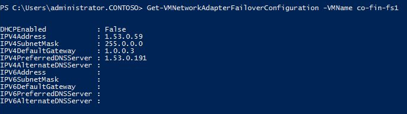
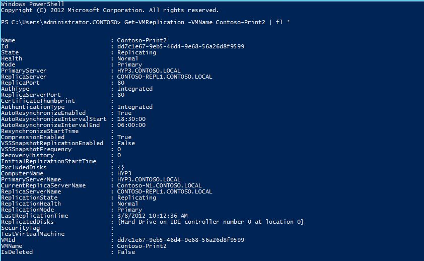
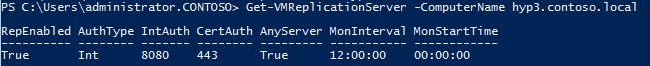
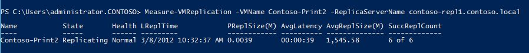

The following Hyper-V PowerShell cmdlets apply to Hyper-V Replica.   ****
<table cellpadding="0" width="798" cellspacing="0" border="1" >
<tbody >
<tr >

<td width="144" valign="top" >

**Cmdlet**

</td>

<td width="654" valign="top" >

**Complete-VMFailover**

</td>
</tr>
<tr >

<td width="144" valign="top" >

**Description**

</td>

<td width="654" valign="top" >This cmdlet completes the Failover process of the virtual machine. The virtual machine’s current recovery point is committed and all other recovery points are removed. Failover cannot be cancelled once the recovery points are removed.
</td>
</tr>
<tr >

<td width="144" valign="top" >

**Verb-Noun**

</td>

<td width="654" valign="top" >Complete-VMFailover
</td>
</tr>
<tr >

<td width="144" valign="top" >

**Syntax**

</td>

<td width="654" valign="top" >Complete-VMFailover [-VMName] <String> [-ComputerName <String[]>] [-PassThru]
</td>
</tr>
<tr >

<td width="144" valign="top" >

**Example**

</td>

<td width="654" valign="top" >_Complete-VMFailover -VMName C0-FIN-FS1_
</td>
</tr>
</tbody>
</table>

<table cellpadding="0" width="798" cellspacing="0" border="1" >
<tbody >
<tr >

<td width="144" valign="top" >

**Cmdlet**

</td>

<td width="654" valign="top" >

**Get-VMNetworkAdapterFailoverConfiguration**

</td>
</tr>
<tr >

<td width="144" valign="top" >

**Description**

</td>

<td width="654" valign="top" >Retrieves the Failover IP settings on a virtual machine network adaptor.
</td>
</tr>
<tr >

<td width="144" valign="top" >

**Verb-Noun**

</td>

<td width="654" valign="top" >Get-VMNetworkAdapterFailoverConfiguration
</td>
</tr>
<tr >

<td width="144" valign="top" >

**Syntax**

</td>

<td width="654" valign="top" >Get-VMNetworkAdapterFailoverConfiguration [-VMName] <String[]> [[-VMNetworkAdapterName] <String[]>] [-ComputerName <String[]>]
</td>
</tr>
<tr >

<td width="144" valign="top" >

**Example**

</td>
<td width="654" valign="top" > 

</td>
</tr>
</tbody>
</table>

<table cellpadding="0" width="798" cellspacing="0" border="1" >
<tbody >
<tr >

<td width="144" valign="top" >

**Cmdlet**

</td>

<td width="654" valign="top" >

**Get-VMReplication**

</td>
</tr>
<tr >

<td width="144" valign="top" >

**Description**

</td>

<td width="654" valign="top" >Retrieve the replication relationship information of one or more virtual machines.
</td>
</tr>
<tr >

<td width="144" valign="top" >

**Verb-Noun**

</td>

<td width="654" valign="top" >Get-VMReplication
</td>
</tr>
<tr >

<td width="144" valign="top" >

**Syntax**

</td>

<td width="654" valign="top" >Get-VMReplication [[-VMName] <String[]>] [-ComputerName <String[]>] [-ReplicaServerName <String>] [-PrimaryServerName <String>] [-State <String>] [-ReplicationTag <String>]
</td>
</tr>
<tr >

<td width="144" valign="top" >

**Example**

</td>

<td width="654" valign="top" > 

</td>
</tr>
</tbody>
</table>

<table cellpadding="0" width="798" cellspacing="0" border="1" >
<tbody >
<tr >

<td width="144" valign="top" >

**Cmdlet**

</td>

<td width="654" valign="top" >

**Get-VMReplicationAuthorizationEntry**

</td>
</tr>
<tr >

<td width="144" valign="top" >

**Description**

</td>

<td width="654" valign="top" >This cmdlet returns the details of an authorization entry as identified by the input parameter. The possible ways to get a particular authorization entry is by using AllowedPrimaryServer, or security tag.
</td>
</tr>
<tr >

<td width="144" valign="top" >

**Verb-Noun**

</td>

<td width="654" valign="top" >Get-VMReplicationAuthorizationEntry
</td>
</tr>
<tr >

<td width="144" valign="top" >

**Syntax**

</td>

<td width="654" valign="top" >Get-VMReplicationAuthorizationEntry [[-AllowedPrimaryServer] <String>] [-ComputerName <String[]>] [-ReplicaStorageLocation <String
</td>
</tr>
<tr >

<td width="144" valign="top" >

**Example**

</td>

<td width="654" valign="top" >_Get-VMReplicationAuthorizationEntry -AllowedPrimaryServer hyp3.contoso.local -ReplicaStorageLocation e:\VirtualMachines -SecurityTag CONTOSO_
</td>
</tr>
</tbody>
</table>

<table cellpadding="0" width="798" cellspacing="0" border="1" >
<tbody >
<tr >

<td width="144" valign="top" >

**Cmdlet**

</td>

<td width="654" valign="top" >

**Get-VMReplicationServer**

</td>
</tr>
<tr >

<td width="144" valign="top" >

**Description**

</td>

<td width="654" valign="top" >This cmdlet retrieves the replication settings of the Replica server. If the server has not been configured as replica server, then the command returns default object.
</td>
</tr>
<tr >

<td width="144" valign="top" >

**Verb-Noun**

</td>

<td width="654" valign="top" >Get-VMReplicationServer
</td>
</tr>
<tr >

<td width="144" valign="top" >

**Syntax**

</td>

<td width="654" valign="top" >Get-VMReplicationServer [[-ComputerName] <String[]>]
</td>
</tr>
<tr >

<td width="144" valign="top" >

**Example**

</td>

<td width="654" valign="top" > 

</td>
</tr>
</tbody>
</table>

<table cellpadding="0" width="798" cellspacing="0" border="1" >
<tbody >
<tr >

<td width="144" valign="top" >

**Cmdlet**

</td>

<td width="654" valign="top" >

**Import-VMInitialReplication**

</td>
</tr>
<tr >

<td width="144" valign="top" >

**Description**

</td>

<td width="654" valign="top" >This cmdlet is used on the replica server to import the IR files transferred by admin using external media. The IR files are expected to be accessible using the specified path.
</td>
</tr>
<tr >

<td width="144" valign="top" >

**Verb-Noun**

</td>

<td width="654" valign="top" >Import-VMInitialReplication
</td>
</tr>
<tr >

<td width="144" valign="top" >

**Syntax**

</td>

<td width="654" valign="top" >Import-VMInitialReplication [-VMName] <String> [-ComputerName <String[]>] [-Path] <String> [-PassThru] [-AsJob]
</td>
</tr>
<tr >

<td width="144" valign="top" >

**Example**

</td>

<td width="654" valign="top" >_Import-VMInitialReplication -VMName CO-LEGAL-FS11 -Path I:\Replicas\CO-LEGAL-FS11_B410F33F-55E1-44CB-A81F-6D60F408A756_
</td>
</tr>
</tbody>
</table>

<table cellpadding="0" width="798" cellspacing="0" border="1" >
<tbody >
<tr >

<td width="144" valign="top" >

**Cmdlet**

</td>

<td width="654" valign="top" >

**Measure-VMReplication**

</td>
</tr>
<tr >

<td width="144" valign="top" >

**Description**

</td>

<td width="654" valign="top" >This cmdlets gets the statistics of VMReplication.
</td>
</tr>
<tr >

<td width="144" valign="top" >

**Verb-Noun**

</td>

<td width="654" valign="top" >Measure-VMReplication
</td>
</tr>
<tr >

<td width="144" valign="top" >

**Syntax**

</td>

<td width="654" valign="top" >Measure-VMReplication [[-VMName] <String[]>] [-ReplicaServerName <String>] [-ComputerName <String[]>] [-ReplicationTag <String>] [-State <String>] [-PrimaryServerName <String>]
</td>
</tr>
<tr >

<td width="144" valign="top" >

**Example**

</td>

<td width="654" valign="top" > 

</td>
</tr>
</tbody>
</table>

<table cellpadding="0" width="798" cellspacing="0" border="1" >
<tbody >
<tr >

<td width="144" valign="top" >

**Cmdlet**

</td>

<td width="654" valign="top" >

**New-VMReplicationAuthorizationEntry**

</td>
</tr>
<tr >

<td width="144" valign="top" >

**Description**

</td>

<td width="654" valign="top" >This cmdlet creates a new authorization entry for the recovery server. The authorization entry consists of the following - AllowedPrimaryServer, ReplicaStorageLocation, KeepPrimaryStorageLocation, and SecurityTag
</td>
</tr>
<tr >

<td width="144" valign="top" >

**Verb-Noun**

</td>

<td width="654" valign="top" >New-VMReplicationAuthorizationEntry
</td>
</tr>
<tr >

<td width="144" valign="top" >

**Syntax**

</td>

<td width="654" valign="top" >New-VMReplicationAuthorizationEntry -KeepPrimaryStorageLocation [-AllowedPrimaryServer] <String> [-ComputerName <String[]>]
</td>
</tr>
<tr >

<td width="144" valign="top" >

**Example**

</td>

<td width="654" valign="top" >_New-VMReplicationAuthorizationEntry hyp3.contoso.local -ReplicaStorageLocation d:\ReplicaStorage DEFAULT_
</td>
</tr>
</tbody>
</table>

<table cellpadding="0" width="798" cellspacing="0" border="1" >
<tbody >
<tr >

<td width="144" valign="top" >

**Cmdlet**

</td>

<td width="654" valign="top" >

**Remove-VMReplication**

</td>
</tr>
<tr >

<td width="144" valign="top" >

**Description**

</td>

<td width="654" valign="top" >This cmdlet is used to remove the replication relationship of a virtual machine. Replication relationship should be individually removed from both primary and replica virtual machines.
</td>
</tr>
<tr >

<td width="144" valign="top" >

**Verb-Noun**

</td>

<td width="654" valign="top" >Remove-VMReplication
</td>
</tr>
<tr >

<td width="144" valign="top" >

**Syntax**

</td>

<td width="654" valign="top" >Remove-VMReplication [-VMName] <String> [-ComputerName <String[]>] [-PassThru]
</td>
</tr>
<tr >

<td width="144" valign="top" >

**Example**

</td>

<td width="654" valign="top" >_Remove-VMReplication -VMName CO-FIN1-FS1_
</td>
</tr>
</tbody>
</table>

<table cellpadding="0" width="798" cellspacing="0" border="1" >
<tbody >
<tr >

<td width="144" valign="top" >

**Cmdlet**

</td>

<td width="654" valign="top" >

**Remove-VMReplicationAuthorizationEntry**

</td>
</tr>
<tr >

<td width="144" valign="top" >

**Description**

</td>

<td width="654" valign="top" >This cmdlet enables the admin to remove an authorization entry from the Replica server, rescinding authorization of replication attempts made against the primary server associated with the entry.
</td>
</tr>
<tr >

<td width="144" valign="top" >

**Verb-Noun**

</td>

<td width="654" valign="top" >Remove-VMReplicationAuthorizationEntry
</td>
</tr>
<tr >

<td width="144" valign="top" >

**Syntax**

</td>

<td width="654" valign="top" >Remove-VMReplicationAuthorizationEntry [-AllowedPrimaryServer] <String> [-ComputerName <String[]>] [-PassThru]
</td>
</tr>
<tr >

<td width="144" valign="top" >

**Example**

</td>

<td width="654" valign="top" >_Remove-VMReplicationAuthorizationEntry -AllowedPrimaryServer hyp3.contoso.local_
</td>
</tr>
</tbody>
</table>

<table cellpadding="0" width="798" cellspacing="0" border="1" >
<tbody >
<tr >

<td width="144" valign="top" >

**Cmdlet**

</td>

<td width="654" valign="top" >

**Reset-VMReplicationStatistics**

</td>
</tr>
<tr >

<td width="144" valign="top" >

**Description**

</td>

<td width="654" valign="top" >This cmdlet resets all the replication statistics for a specific virtual machine.  These statistics can be retrieved using the Measure-VMReplication cmdlet.
</td>
</tr>
<tr >

<td width="144" valign="top" >

**Verb-Noun**

</td>

<td width="654" valign="top" >Reset-VMReplicationStatistics
</td>
</tr>
<tr >

<td width="144" valign="top" >

**Syntax**

</td>

<td width="654" valign="top" >Reset-VMReplicationStatistics [-VMName] <string[]> [-PassThru] [-ComputerName <string[]>] [-WhatIf] [-Confirm]
</td>
</tr>
<tr >

<td width="144" valign="top" >

**Example**

</td>

<td width="654" valign="top" >_Reset-VMReplicationStatistics -VMName Contoso-Print1_
</td>
</tr>
</tbody>
</table>

<table cellpadding="0" width="798" cellspacing="0" border="1" >
<tbody >
<tr >

<td width="144" valign="top" >

**Cmdlet**

</td>

<td width="654" valign="top" >

**Resume-VMReplication**

</td>
</tr>
<tr >

<td width="144" valign="top" >

**Description**

</td>

<td width="654" valign="top" >This cmdlet is used to resume replication of the virtual machine that is passed as input and are paused currently OR used to start resynchronization for a suspended/critical state virtual machine.
</td>
</tr>
<tr >

<td width="144" valign="top" >

**Verb-Noun**

</td>

<td width="654" valign="top" >Resume-VMReplication
</td>
</tr>
<tr >

<td width="144" valign="top" >

**Syntax**

</td>

<td width="654" valign="top" >Resume-VMReplication [-VMName] <String> [-ComputerName <String[]>] [-ResynchonizeStartTime <DateTime>] [-Resynchronize] [-PassThru]
</td>
</tr>
<tr >

<td width="144" valign="top" >

**Example**

</td>

<td width="654" valign="top" >_Resume-VMReplication -VMName CO-EXEC-DATA1_
</td>
</tr>
</tbody>
</table>

<table cellpadding="0" width="798" cellspacing="0" border="1" >
<tbody >
<tr >

<td width="144" valign="top" >

**Cmdlet**

</td>

<td width="654" valign="top" >

**Set-VMNetworkAdapterFailoverConfiguration**

</td>
</tr>
<tr >

<td width="144" valign="top" >

**Description**

</td>

<td width="654" valign="top" >Configures the Failover IP settings for the n/w adapter. These IP settings will be applied to the virtual machines’s operating system whenever the virtual machines is started as part of failover.
</td>
</tr>
<tr >

<td width="144" valign="top" >

**Verb-Noun**

</td>

<td width="654" valign="top" >Set-VMNetworkAdapterFailoverConfiguration
</td>
</tr>
<tr >

<td width="144" valign="top" >

**Syntax**

</td>

<td width="654" valign="top" >Set-VMNetworkAdapterFailoverConfiguration [-VMName] <String[]> [[-VMNetworkAdapterName] <String[]>] [-ComputerName <String[]>] [-IPv6SubnetPrefixLength <String>] [-IPv6Address <String>] [-IPv6DefaultGateway <String>] [-IPv6AlternateDNSServer <String>] [-IPv6PreferredDNSServer <String>] [-IPv4SubnetMask <String>] [-IPv4Address <String>] [-IPv4DefaultGateway <String>] [-IPv4AlternateDNSServer <String>] [-IPv4PreferredDNSServer <String>]
</td>
</tr>
<tr >

<td width="144" valign="top" >

**Example**

</td>

<td width="654" valign="top" >A good example would be to use another Hyper-V cmdlet (Get-VMNetworkAdapter) to get the adapter and then make the setting changes -

_Get-VMNetworkAdapter -VMName CO-EXEC-DATA1 | Set-VMNetworkAdapterFailoverConfiguration -IPv4Address 1.53.0.170 -IPv4SubnetMask 255.0.0.0 -IPv4DefaultGateway 1.0.0.3 -IPv4PreferredDNSServer 1.53.0.191_
</td>
</tr>
</tbody>
</table>

<table cellpadding="0" width="798" cellspacing="0" border="1" >
<tbody >
<tr >

<td width="144" valign="top" >

**Cmdlet**

</td>

<td width="654" valign="top" >

**Set-VMReplication**

</td>
</tr>
<tr >

<td width="144" valign="top" >

**Description**

</td>

<td width="654" valign="top" >This cmdlet configures the replication relationship for a virtual machine. If the virtual machine is already configured for replication, it modifies the replication relationship of the virtual machine.
</td>
</tr>
<tr >

<td width="144" valign="top" >

**Verb-Noun**

</td>

<td width="654" valign="top" >Set-VMReplication
</td>
</tr>
<tr >

<td width="144" valign="top" >

**Syntax**

</td>

<td width="654" valign="top" >Set-VMReplication [-VMName] <String> [-ComputerName <String[]>] [[-ReplicaServerName] <String>] [[-ReplicaServerPort] <Int32>] [[-AuthenticationType] <String>] [-AsJob] [-PassThru] [-Reverse] [-AutoResynchronizeIntervalStart <DateTime>] [-AutoResynchronizeIntervalEnd <DateTime>] [-InitialReplicationStartTime <DateTime>] [-AsReplica] [-RecoveryHistory <Int32>] [-ExcludedVhdPath <String[]>] [-ExcludedVhd <Microsoft.Vhd.PowerShell.VirtualHardDisk[]>] [-CertificateThumbprint <String>] [-CompressionEnabled] [-ApplicationConsistentSnapshotFrequency <Int32>] [-DisableAppConsistentReplication] [-AutoResynchronizeEnabled]
</td>
</tr>
<tr >

<td width="144" valign="top" >

**Example**

</td>

<td width="654" valign="top" >_Set-VMReplication -VMName CO-FIN-FS1 -ReplicaServerName hyp3.contoso.com -ReplicaServerPort 8080 -AuthenticationType Integrated -CompressionEnabled 1 -RecoveryHistory 0_
</td>
</tr>
</tbody>
</table>

<table cellpadding="0" width="798" cellspacing="0" border="1" >
<tbody >
<tr >

<td width="144" valign="top" >

**Cmdlet**

</td>

<td width="654" valign="top" >

**Set-VMReplicationAuthorizationEntry**

</td>
</tr>
<tr >

<td width="144" valign="top" >

**Description**

</td>

<td width="654" valign="top" >This cmdlet edits an existing authorization entry for the Replica server. This cmdlet can be used to modify the following - ReplicaStorageLocation,  KeepPrimaryStorageLocation, and SecurityTag for an existing "AllowedPrimaryServer".
</td>
</tr>
<tr >

<td width="144" valign="top" >

**Verb-Noun**

</td>

<td width="654" valign="top" >Set-VMReplicationAuthorizationEntry
</td>
</tr>
<tr >

<td width="144" valign="top" >

**Syntax**

</td>

<td width="654" valign="top" >Set-VMReplicationAuthorizationEntry [-AllowedPrimaryServer] <String> [[-ReplicaStorageLocation] <String>] [-KeepPrimaryStorageLocation] [-ComputerName <String[]>] [-PassThru]
</td>
</tr>
<tr >

<td width="144" valign="top" >

**Example**

</td>

<td width="654" valign="top" >_Set-VMReplicationAuthorizationEntry -AllowedPrimaryServer hyp3.contoso.local -ReplicaStorageLocation d:\ReplicaStorage_
</td>
</tr>
</tbody>
</table>

<table cellpadding="0" width="798" cellspacing="0" border="1" >
<tbody >
<tr >

<td width="144" valign="top" >

**Cmdlet**

</td>

<td width="654" valign="top" >

**Set-VMReplicationServer**

</td>
</tr>
<tr >

<td width="144" valign="top" >**Description**
</td>

<td width="654" valign="top" >This cmdlet is used to provision the replica server, including specification of server authentication and the default storage location to be used. Multiple types of authentication could be allowed for the replica server. If certificate based authorization is chosen, then the certificate thumbprint is required.  You can also choose to enable replication from any servers thereby adding a * entry in the Authorization list
</td>
</tr>
<tr >

<td width="144" valign="top" >

**Verb-Noun**

</td>

<td width="654" valign="top" >Set-VMReplicationServer
</td>
</tr>
<tr >

<td width="144" valign="top" >

**Syntax**

</td>

<td width="654" valign="top" >Set-VMReplicationServer [-KeepPrimaryStorageLocation] [-ReplicationEnabled] [[-AllowedAuthenticationType] <Enum>] [-ReplicationAllowedFromAnyServer] [-ComputerName <String[]>] [-MonitoringStartTime <DateTime>] [-MonitotingInterval <TimeSpan>] [-CertificateAuthenticationPort <Int32>] [-CertificateThumbprint <String>] [-PassThru] [-IntegratedAuthenticationPort <Int32>]

</td>
</tr>
<tr >

<td width="144" valign="top" >

**Example**

</td>

<td width="654" valign="top" >_Set-VMReplicationServer -ReplicationEnabled 1 -AllowedAuthenticationType Integrated -IntegratedAuthenticationPort 8080 -DefaultStorageLocation d:RecoveryData  -ReplicationAllowedFromAnyServer 1_
</td>
</tr>
</tbody>
</table>

<table cellpadding="0" width="798" cellspacing="0" border="1" >
<tbody >
<tr >

<td width="144" valign="top" >

**Cmdlet**

</td>

<td width="654" valign="top" >

**Start-VMFailover**

</td>
</tr>
<tr >

<td width="144" valign="top" >

**Description**

</td>

<td width="654" valign="top" >This cmdlet is used in multiple contexts - **Planned Failover**, **Failover**, and **Test Failover**.
</td>
</tr>
<tr >

<td width="144" valign="top" >

**Verb-Noun**

</td>

<td width="654" valign="top" >Start-VMFailover
</td>
</tr>
<tr >

<td width="144" valign="top" >

**Syntax**

</td>

<td width="654" valign="top" >Start-VMFailover [-VMName] <String> [-Prepare] [-ComputerName <String[]>] [-PassThru] [-AsJob]

Start-VMFailover [-VMName] <String> [-VMRecoverySnapshot]  [-Prepare] [-PassThru] [-AsJob]

Start-VMFailover [-VMName] <String> [-ComputerName <String[]>] [-PassThru] [-Prepare] [-AsJob] [-AsTest]
</td>
</tr>
<tr >

<td width="144" valign="top" >

**Example**

</td>

<td width="654" valign="top" >

**Planned Failover**

Planned Failover is a workflow, and requires a series of cmdlets to be run in a particular order. Some cmdlets need to be run on the primary server, while others on the Replica server. Run the cmdlets in the following order:
  1. **1.     **On the primary server:****
    1. **a.      **_Stop-VM –VMName CO-FIN-FS1_ (Shuts down the VM)****
    2. _New-VMReplicationAuthorizationEntry hyp3.contoso.com -ReplicaStorageLocation d:\ReplicaStorage DEFAULT _(Ensure current primary server/cluster allows current replica server/cluster to replicate. If the current primary server already authorizes the current replica server to send replication data, then this step (1b) can be skipped)
    3. _Start-VMFailover -VMName CO-FIN-FS1 –prepare _(Replicates any unreplicated changes)
  2. On the Replica server:
    1. _Start-VMFailover -VMName CO-FIN-FS1 _(Fails over the VM)
    2. _Start-VMFailover -VMName CO-FIN-FS1 –reverse _(Resumes the replication in the reverse direction)
    3. _Start-VM –VMName CO-FIN-FS1 _(Starts the VM)

**Failover**
_Start-VMFailover -VMName CO-FIN-FS1 -VMRecoverySnapshot_

**Test Failover**
_Start-VMFailover -VMName CO-FIN-FS1 -AsTest_
</td>
</tr>
</tbody>
</table>

<table cellpadding="0" width="798" cellspacing="0" border="1" >
<tbody >
<tr >

<td width="144" valign="top" >

**Cmdlet**

</td>

<td width="654" valign="top" >

**Start-VMInitialReplication**

</td>
</tr>
<tr >

<td width="144" valign="top" >

**Description**

</td>

<td width="654" valign="top" >This cmdlet is used to start initial replication of the virtual machine. This cmdlet serves 3 purposes -

a. Starts Initial replication and Delta replication at the end of IR.

b. Starts initial replication if the Initial replication was cancelled manually by an administrator

c. Starts initial replication if the replication stopped due to some unrecoverable failure
</td>
</tr>
<tr >

<td width="144" valign="top" >

**Verb-Noun**

</td>

<td width="654" valign="top" >Start-VMInitialReplication
</td>
</tr>
<tr >

<td width="144" valign="top" >

**Syntax**

</td>

<td width="654" valign="top" >Start-VMInitialReplication [-VMName] <String> [-ComputerName <String[]>] [-PassThru] [-DestinationPath <String>] [-AsJob]
</td>
</tr>
<tr >

<td width="144" valign="top" >

**Example**

</td>

<td width="654" valign="top" >Online initial replication:

_Start-VMInitialReplication –VMName CO-FIN-FS1_

Initial replication using external media:

_Start-VMInitialReplication –VMName CO-FIN-FS1 –DestinationPath “F:\ExportData”_

Initial replication seeding from backup copy on Replica server

On Replica server

_Set-VMReplication VM01 –AsReplica –AllowedPrimaryServer hyp3.contoso.local _

On primary server

_Start-VMInitialReplication –VMName CO-FIN-FS1 -UseBackup_
</td>
</tr>
</tbody>
</table>

<table cellpadding="0" width="798" cellspacing="0" border="1" >
<tbody >
<tr >

<td width="144" valign="top" >

**Cmdlet**

</td>

<td width="654" valign="top" >**Stop-VMFailover**
</td>
</tr>
<tr >

<td width="144" valign="top" >

**Description**

</td>

<td width="654" valign="top" >This cmdlet allows the admin to cancel the ongoing failover of a virtual machine or the test failover for the virtual machine.
</td>
</tr>
<tr >

<td width="144" valign="top" >

**Verb-Noun**

</td>

<td width="654" valign="top" >Stop-VMFailover
</td>
</tr>
<tr >

<td width="144" valign="top" >

**Syntax**

</td>

<td width="654" valign="top" >Stop-VMFailover [-VMName] <String> [-ComputerName <String[]>] [-PassThru]
</td>
</tr>
<tr >

<td width="144" valign="top" >

**Example**

</td>

<td width="654" valign="top" >_Stop-VMFailover –VMName CO-FIN-FS1_
</td>
</tr>
</tbody>
</table>

<table cellpadding="0" width="798" cellspacing="0" border="1" >
<tbody >
<tr >

<td width="144" valign="top" >

**Cmdlet**

</td>

<td width="654" valign="top" >

**Stop-VMInitialReplication**

</td>
</tr>
<tr >

<td width="144" valign="top" >

**Description**

</td>

<td width="654" valign="top" >This cmdlet is used to cancel the online Initial Replication that is going on. This cmdlet can also be used to cancel the ongoing export/import of OOB IR.
</td>
</tr>
<tr >

<td width="144" valign="top" >

**Verb-Noun**

</td>

<td width="654" valign="top" >Stop-VMInitialReplication
</td>
</tr>
<tr >

<td width="144" valign="top" >

**Syntax**

</td>

<td width="654" valign="top" >Stop-VMInitialReplication [-VMName] <String> [-ComputerName <String[]>] [-PassThru]
</td>
</tr>
<tr >

<td width="144" valign="top" >

**Example**

</td>

<td width="654" valign="top" >_Stop-VMInitialReplication -VMName CO-FIN-FS1_
</td>
</tr>
</tbody>
</table>

<table cellpadding="0" width="798" cellspacing="0" border="1" >
<tbody >
<tr >

<td width="144" valign="top" >

**Cmdlet**

</td>

<td width="654" valign="top" >

**Stop-VMReplication**

</td>
</tr>
<tr >

<td width="144" valign="top" >

**Description**

</td>

<td width="654" valign="top" >This cmdlet is used to cancel the resync Replication that is going on.
</td>
</tr>
<tr >

<td width="144" valign="top" >

**Verb-Noun**

</td>

<td width="654" valign="top" >Stop-VMReplication
</td>
</tr>
<tr >

<td width="144" valign="top" >

**Syntax**

</td>

<td width="654" valign="top" >Stop-VMReplication [-VMName] <String> [-ComputerName <String[]>] [-PassThru]
</td>
</tr>
<tr >

<td width="144" valign="top" >

**Example**

</td>

<td width="654" valign="top" >_Stop-VMReplication -VMName CO-FIN-FS1_
</td>
</tr>
</tbody>
</table>

<table cellpadding="0" width="798" cellspacing="0" border="1" >
<tbody >
<tr >

<td width="144" valign="top" >

**Cmdlet**

</td>

<td width="654" valign="top" >

**Suspend-VMReplication**

</td>
</tr>
<tr >

<td width="144" valign="top" >**Description**
</td>

<td width="654" valign="top" >This cmdlet pauses replication in the virtual machine that is passed as input.
</td>
</tr>
<tr >

<td width="144" valign="top" >

**Verb-Noun**

</td>

<td width="654" valign="top" >Suspend-VMReplication
</td>
</tr>
<tr >

<td width="144" valign="top" >

**Syntax**

</td>

<td width="654" valign="top" >Suspend-VMReplication [-VMName] <String> [-ComputerName <String[]>] [-PassThru]
</td>
</tr>
<tr >

<td width="144" valign="top" >

**Example**

</td>

<td width="654" valign="top" >_Suspend-VMReplication -VMName CO-EXEC-DATA1_
</td>
</tr>
</tbody>
</table>

Cheers,

**Marcos Nogueira**
[azurecentric.com](http://azurecentric.com)
Twitter: [@mdnoga](http://www.twitter.com/mdnoga)
