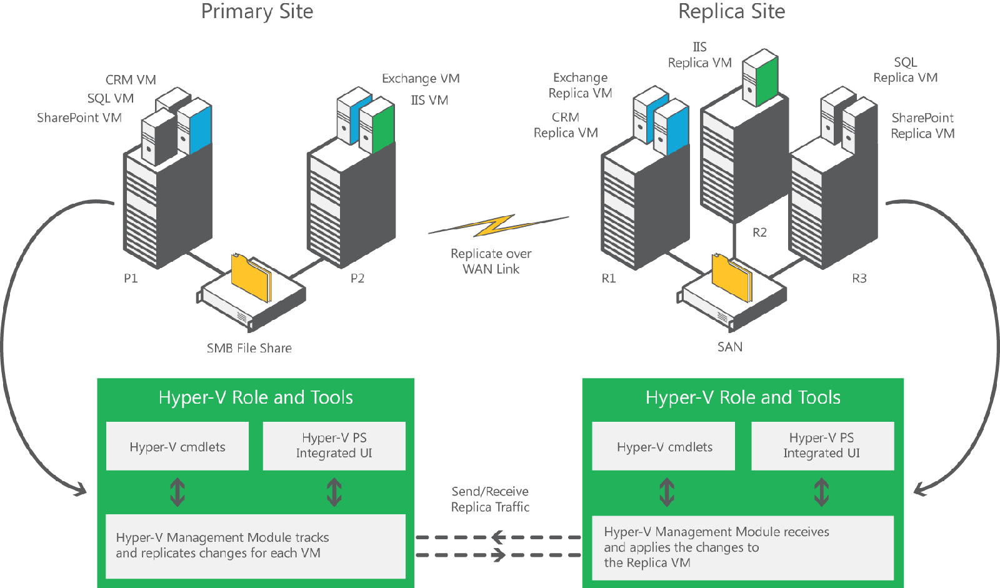

## **Before Windows Server 2012**

Beginning with Windows Server 2008 R2, Hyper-V and Failover Clustering can be used together to make a virtual machine highly available and minimize disruptions.  Administrators can seamlessly migrate their virtual machines to a different host in the cluster in the event of outage or to load balance their virtual machines without impacting virtualized applications.  While this can protect virtualized workloads from a local host failure or scheduled maintenance of a host in a cluster, this does not protect businesses from outage of an entire data center. While Failover Clustering can be used with hardware-based SAN replication across data centers, these are typically expensive. Hyper-V Replica fills an important gap in the Windows Server Hyper-V offering by providing an affordable in-box disaster recovery solution.

## **Windows Server 2012 Hyper-V Replica**

Windows Server 2012 introduces Hyper‑V Replica, a built-in feature that provides asynchronous replication of virtual machines for the purposes of business continuity and disaster recovery. In the event of failures (such as power failure, fire, or natural disaster) at the primary site, the administrator can manually fail over the production virtual machines to the Hyper-V server at the recovery site. During failover, the virtual machines are brought back to a consistent point in time, and within minutes they can be accessed by the rest of the network with minimal impact to the business. Once the primary site comes back, the administrators can manually revert the virtual machines to the Hyper-V server at the primary site.

Hyper‑V Replica is a new feature in Windows Server 2012. It lets you replicate your Hyper‑V virtual machines over a network link from one Hyper‑V host at a primary site to another Hyper‑V host at a Replica site without reliance on storage arrays or other software replication technologies. The figure below shows secure replication of virtual machines from different systems and clusters to a remote site over a WAN.

**Benefits of Hyper-V Replica**
  * Hyper-V Replica fills an important gap in the Windows Server Hyper-V offering by providing an **affordable in-box business continuity and disaster recovery solution.**
  * **Failure recovery in minutes. **In the event of an unplanned shutdown, Hyper-V Replica can restore your system in just minutes.
  * **More secure replication across the network.** Hyper‑V Replica tracks the write operations on the primary virtual machine and replicates these changes to the Replica server efficiently over a WAN. The network connection between the two servers uses the HTTP or HTTPS protocol and supports both integrated and certificate-based authentication. Connections configured to use integrated authentication are not encrypted; for an encrypted connection, you should choose certificate-based authentication. Hyper‑V Replica is closely integrated with Windows failover clustering and provides easier replication across different migration scenarios in the primary and Replica servers.
  * Hyper-V Replica **doesn’t rely on storage arrays.**
  * Hyper-V Replica **doesn’t rely on other software replication technologies.**
  * Hyper-V Replica **automatically handles live migration.**
  * **Configuration and management are simpler **with Hyper-V Replica:
    * Integrated user interface (UI) with Hyper-V Manager.
    * Failover Cluster Manager snap-in for Microsoft Management Console (MMC).
    * Extensible WMI interface.	
    * Windows PowerShell command-line interface scripting capability.

## **Requirements**

To use Hyper‑V Replica, you need two physical computers configured with:
  * Windows Server 2012.
  * Hyper‑V server role.
  * Hardware that supports the Hyper‑V role.
  * Sufficient storage to host the files that virtualized workloads use. Additional storage on the Replica server based on the replication configuration settings may be necessary.
  * Sufficient network bandwidth among the locations that host the primary and Replica servers and sites.
  * Firewall rules to permit replication between the primary and Replica servers and sites.
  * Failover Clustering feature, if you want to use Hyper‑V Replica on a clustered virtual machine.

Cheers,

**Marcos Nogueira**
[azurecentric.com](http://azurecentric.com)
Twitter: [@mdnoga](http://www.twitter.com/mdnoga)
