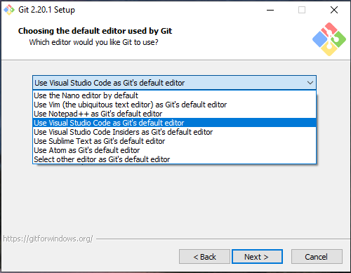
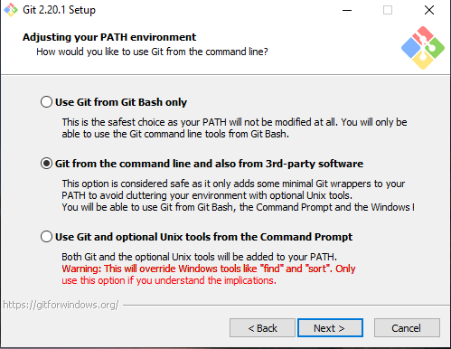
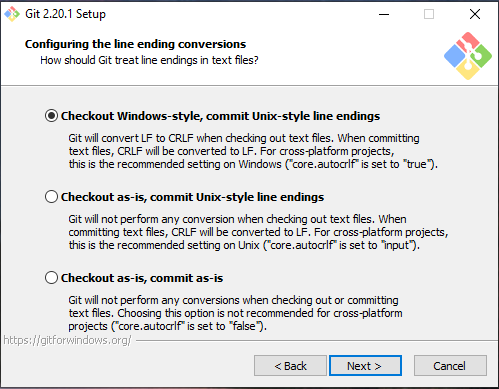

On the previous and first post about the IaC Series, I wrote about the beginning on the IaC and did describe the tools. On this post I will
detail all the tools that I have been using on my IaC projects.

So, before you get started, there are a few tools that you want to make sure that you have to install prior to started working with IaC project. At least for me, these were the steps I took before I started. As mention on the previous post (see [HERE](http://azurecentric.com/2019/02/04/infrastructure-as-a-code-iac-series-the-beginning/)), I use the following toolset: 

**Visual Studio Code** – Visual Studio Code is a lightweight code editor that can be used with almost any coding language. You can download VSCode [HERE](https://code.visualstudio.com/Download). 

**Terraform Extension** – Mikael Olenfalk’s Terraform extension for Visual Studio Code will provide syntax highlighting and autocomplete that is specific to the Terraform language. You can download the extension [HERE](https://marketplace.visualstudio.com/items?itemName=mauve.terraform). This need to be installed after the Visual Studio Code.

**Git** – Git is essential to the build and release process, which relies heavily on repositories to handle changes to Terraform code. You can download Git [HERE](https://git-scm.com/downloads). The installation it’s very simple and I went with the defaults the majority of the times, although make sure during the Git installation you select the following:

1 - On the **Choosing the default editor used by Git** window, you choose the **Use Visual Studio Code as Git’s default editor**

2 – On the **Adjusting your PATH environment** window, you select the option **Git from the command line and also from 3rd-party software**  

3 – On the **Configuring the line ending conversations** windows, you select the option **Checkout Windows-style, commit Unix-style line endings**

If you are not familiar with Git, and how Git works, I highly recommend reading more about its functions and be familiar with how to use them. You can read up on the basics of Git [HERE](https://www.atlassian.com/git/tutorials). 

**PowerShell** – PowerShell comes pre-installed with Windows, so you won’t have to download anything, however, make sure you know how to open PowerShell as an
administrator. This can be done by typing **_PowerShell_** in the start menu, right clicking the PowerShell icon, and selecting **Run as Administrator**.

**AzureRM Powershell** – Azure Powershell is a set of modules for Powershell that allows Windows to interface with Azure. To install **_AzureRM_**, open PowerShell as an administrator and type in **_Install-Module -Name AzureRM -AllowClobber_**. If it asks if you want to install all the modules, select **_A_** for **yes to all**. 

Cheers,

**Marcos Nogueira**  
**_Azure MVP_**  
[azurecentric.com](http://azurecentric.com)  
Twitter: [@mdnoga](http://www.twitter.com/mdnoga)
