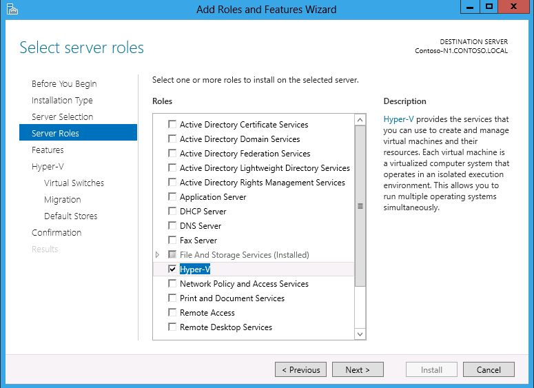
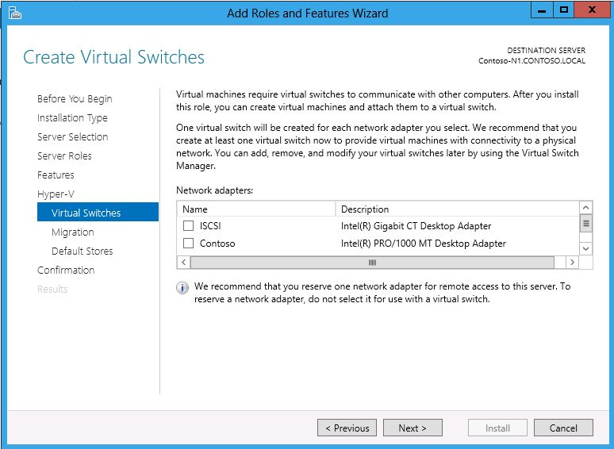
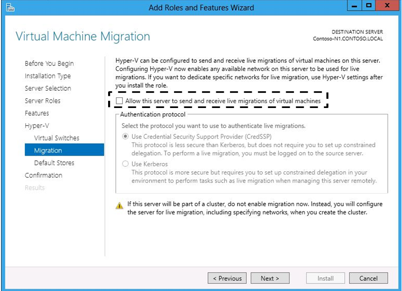
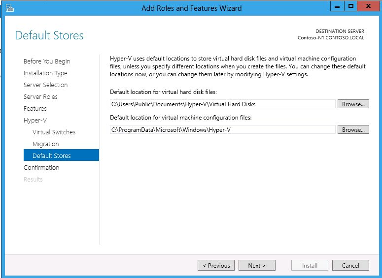
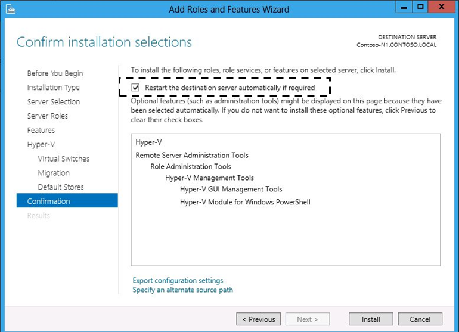

Hyper-V Replica is installed as part of the Hyper-V Role.

## Installation UI/Wizard

To add the Hyper-V Role to a server installation, use the Add Role and Feature Wizard (ARFW), which is part of Server Manager or use the Deployment Image and Servicing Management (DISM) command line tool.  A reboot is required.  This can occur automatically if the installation is being executed in the Server Manager interface by checking a box (**Restart each target machine automatically if needed)** in the wizard (Confirmation screen).  This allows the server to reboot, if needed.

[

## Installation Command Line Interface (CLI)

The Hyper-V Role can also be installed from the command line interface by using the Deployment Image and Service Management (DISM) command line tool.  At a command prompt, type: **dism /online /enable-feature /featurename: Microsoft-Hyper-V**.  A reboot is required to complete the installation.  The Server Manager PowerShell cmdlet **Install-WindowsFeature **can also be used.
```powershell
Install-WindowsFeature -Name Hyper-V -IncludeManagementTools
```
When adding the Hyper-V Role using the ARFW, there is an opportunity to create Virtual Switches in Hyper-V.  This step can be accomplished in the wizard when installing the Role or it can be done afterwards using the Hyper-V Manager interface.



You can allow the Hyper-V server to receive Live Migrations



You can also specify the default location for virtual hard disks and virtual machine configuration files



A reboot is required to complete the configuration of the Hyper-V role.



## Verifying Installation

Once the installation is completed (following a reboot of the server), the Hyper-V role will show as installed in Server Manager and the Hyper-V Manager will be listed under Administrative tools.  To verify proper functioning of Hyper-V, run the Hyper-V Best Practices Analyzer (BPA) and then create a new virtual machine and verify it starts correctly.

## Uninstalling/Disabling

To remove the Hyper-V Role, use the Remove Roles and Features Wizard (RRFW) in Server Manager, use the Deployment Image and Servicing Management (DISM) command line tool, or use the Server Manager PowerShell Cmdlet **Uninstall-WindowsFeature**.  A reboot is required to complete the process.

Cheers,

**Marcos Nogueira**
[azurecentric.com](http://azurecentric.com)
Twitter: [@mdnoga](http://www.twitter.com/mdnoga)
