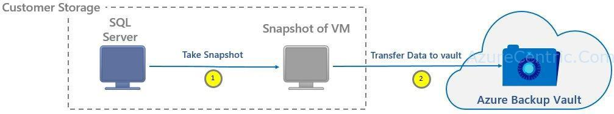

With everything that happens on Azure, and following what has been announced of the increase of the size of the disk in Azure, from 1TB to 4TB, the only missing part of this was the support of Azure Backup to be able to backup and recovery those volumes.

But what changed? Today the Azure Backup job consist of the Two phases:

1. Taking a VM snapshot
2. Transferring the VM snapshot to Azure Backup Vault

So, depending how many recovery points you configure on your policy, it will only be available a recovery point when both phases are complete. With the introduction of Instant Recovery Points feature on Azure Backup, a recovery point is created as soon as the snapshot is finished. That means that you RPO and RTO can be reduced significantly.

You can use the same restore flow on Azure Backup, to restore from this instant recovery point. For this you can identify the recovery point from a snapshot in the Azure Portal, using the **_Snapshot_** as a recovery point type. Once the snapshot is on the Azure Backup Vault, the recovery point type will change to **_Snapshot and Vault_**.



By default, the snapshots are retained for 7 days. This will allow you to complete restore way faster, from these snapshots and at the same time, reducing the time required to copy the backup from the vault to the storage account where you want to restore.

**Instant Recovery Point Features**

Please note that all the features are not yet available, this is still on preview

1. Ability to see snapshot taken as part of backup job to be available for recovery without waiting for data transfer to complete.Note: that this will reduce the wait on snapshot to be copied to vault before triggering restore. _Also, this will eliminate the additional storage requirement we have for backing up premium VMs._
2. As part of above feature, we will also enable some data integrity checks. This will take some additional time as part of backup. We will be relaxing these checks as we move and so it will reduce backup times.
3. Support for 4TB unmanaged disks
4. Ability to use original storage accounts (even when VM has disks are distributed across storage accounts). This will make restores faster for a wide variety of VM configurations.Note: this is not same as overriding the original VM.
5. Ability to do above things for managed disks**. **

Is important to know that when you enable this feature you will notice the following:

Since the snapshot are store on the Azure Backup vault, to reduce the recovery point and reduce the restore time, you will see some increase on the storage cost, corresponding to the snapshots that are store for 7 days (if you go with the defaults).

When you are doing a restore from a snapshot recovery point for a Premium VM, you will might see a temporary storage location being used while the VM is created, as part of the restore.

Once you enable the preview feature, you can’t revert, that means you can go back and all the future backups will use this feature.

If you have the VMs with Managed Disks, this feature is not support yet. Although if you have VMs that are using Managed Disks, is supported, but they will be using the normal backup (the Instant Recovery Point will not be used, in this case). Virtual Machines migrations from unmanaged and managed are not supported.

If you want to try this feature, run the following commands:

1. Open PowerShell with elevated privilege
2. Login to your Azure Account
  ```powershell
  Login-AzureRmAccount
  ```
3. Select the subscription you want to enable the Instant Recovey Point feature
  ```poweshell
  Get-AzureRmSubscription –SubscriptionName “<SUBSCRIPTION_NAME>” | Select-AzureRmSubscription
  ```
4. Register for the preview
  ```powershell
  Register-AzureRmProviderFeature -FeatureName “InstantBackupandRecovery” –ProviderNamespace Microsoft.RecoveryServices
  ```

Cheers,

**Marcos Nogueira**  
**_Azure MVP_**  
[azurecentric.com](http://azurecentric.com)  
Twitter: [@mdnoga](http://www.twitter.com/mdnoga)
